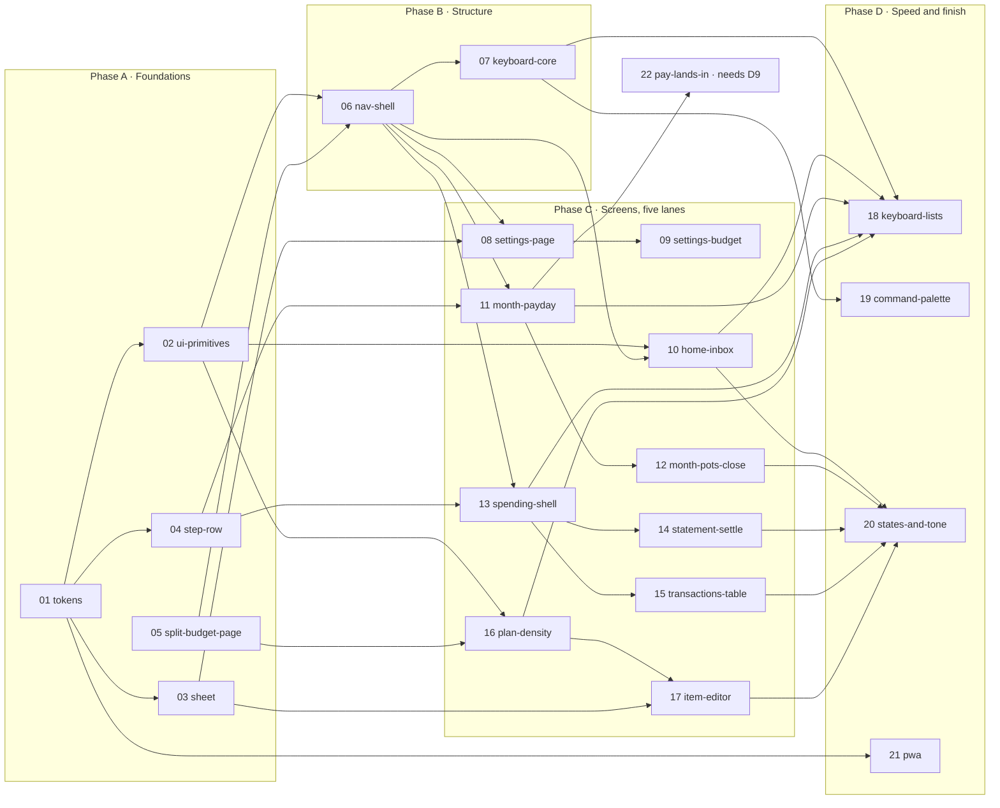

# North Planner · audit 3 implementation plan

**11 November 2026 · for approval before any code changes**

Read with [review.md](review.md) (30 findings, F01–F30) and the [mockups](mockups/index.html). Each PR has a self-contained brief in [prs/](prs/).

---

## 1. In one page

**What changes**
- **Navigation:** five tabs become four destinations (**Home · Month · Plan · Spending**), with **Settings** at the sidebar foot.
- **Month:** gathers the month's money in one place: payday steps (was Transfers), pots against the plan (was Spending › This month), and closing a month.
- **Spending:** becomes just the card: To sort → Set aside → Statements with Settle up inline.
- **Home:** becomes an inbox. A three-figure strip on top, then one To do list ordered by date.
- **Plan:** sheds about 300px of chrome, opens its groups on desktop, edits amounts in place, and gets one editor for adding and editing items.
- **Under all of it:** one design system. Semantic tokens, three type weights, one focus ring, and about a dozen shared components: one header, one section heading, one list row, one step row, one sheet. Plus a keyboard model (go-to keys, `/`, `N`, list navigation, ⌘K).

**How it ships:** 22 PRs in five phases. Each one is reviewable in a sitting.

| Phase | PRs | You get |
| --- | --- | --- |
| **A · Foundations** | 01–05 | Tokens, shared components, one sheet, one step row, MonthlyBudget split. Little visible change, but the fixes for F12, F22, F23 and the first of F03 land here. |
| **B · Structure** | 06–07 | The new navigation, Settings and Month destinations (hosting today's panels at first), and core keyboard. |
| **C · Screens** (five lanes in parallel) | 08–17 | Settings, Home inbox, Month, Spending, Plan. |
| **D · Speed and finish** | 18–21 | Keyboard on every list, ⌘K, empty/error states and tone, an installable app. |
| **E · Model** (needs D9) | 22 | Steps say where the money comes from. |

Phase A is worth shipping even if you stop there. Phase B is the point of no return for the navigation, so decision **D1** gates it.

---

## 2. Target design

### 2.1 Navigation and structure

| Destination | Key | Holds | Replaces |
| --- | --- | --- | --- |
| **Home** | <kbd>G</kbd> <kbd>H</kbd> | Status strip (Plan · Spent · Amex), To do (every task, by date), Coming up, Done | Home's meter, month cards, per-person To do cards |
| **Month** | <kbd>G</kbd> <kbd>M</kbd> | Month title and stage. **Payday** (steps per person, "By account" table). **Pots** (spent, planned, left, pace, in Monzo). **Close &lt;Month&gt;** when the month has ended. Pot pages. Check balances. | Transfers tab; Spending › This month; Close &lt;Month&gt;; pot pages |
| **Plan** | <kbd>G</kbd> <kbd>P</kbd> | Month title, figures, one toolbar, items, one editor | Plan (same screen, denser) |
| **Spending** | <kbd>G</kbd> <kbd>S</kbd> | Card header (status line, Bring in). Tabs **To sort** (then Set aside), **Transactions**, **Statements**. Statement page with Settle up. Amex pot page. | Spending minus This month and Rules; the Amex pot banner; the side rail |
| **Settings** | <kbd>G</kbd> <kbd>,</kbd> | Household · Pay & income · Accounts & pots · Categories · Cards · Sorting rules · Account & sync | Household tab; Plan ⋯ › Edit income and Manage; Spending › Rules; the phone ⋯ "Budget and account" sheet |

**Shell rules**
- **Desktop sidebar:** expanded by default at ≥1280px (216px), with icon, label, count (Home: open tasks; Spending: to sort) or shortcut hint. Below 1280 it starts collapsed. <kbd>⌘\\</kbd> toggles it and the choice is remembered per device. At the foot: Search (⌘K), Settings, then the account and save status. A status shows only when it isn't Saved.
- **Phone:** a pine header with the page title, plus an optional subtitle (month stage or carried-over note). Top right is always the **account button** (Settings, save status, Sign out). The page's own ⋯ sits to its left only when the page has actions. The bottom tab bar has four 48px+ items.
- **Month context:** one selected month across Month, Plan and Home (Home shows today's month and links into others). Spending's statements carry their own dates and ignore the month.
- **URLs:** `view=home|month|plan|spending|settings`, plus `month`, `section` (Spending tab or Settings section), `pot`, `statement` and `close`. Every legacy link redirects:

| Old | New |
| --- | --- |
| `view=budget&budgetView=plan` | `view=plan` |
| `view=budget&budgetView=transfers` | `view=month` |
| `view=spending&spendingView=month` (+`spendingPot`, `spendingClose`) | `view=month` (+`pot`, `close`) |
| `view=spending&spendingView=sort\|all\|statements` (+`spendingStatement`) | `view=spending&section=sort\|transactions\|statements` (+`statement`) |
| `view=spending&spendingView=rules` | `view=settings&section=rules` |
| `view=household` | `view=settings&section=household` |
| `planDestination`, history states (`northStepsReturn`, `northReviewPerson`, `northPlanItem`, `northAffectedTransfers`) | Kept as they are, re-pointed from Transfers to Month |

- **Document title:** "&lt;Screen&gt; · &lt;Month&gt; · North", e.g. "Month · November 2026 · North" or "October statement · North".

### 2.2 Page structure

Every page is `PageHeader` → (optional `Tabs` or `Toolbar`) → `Section`s. The header holds at most one primary action and a ⋯. The content width is the full workspace (max 1224px plus 40px gutters on desktop). Reading pages (Settings, detail pages) cap their main column at 880px and may add a right column. Cards group content; there are no cards inside cards.

| Page | Header (title · context · actions) | Body, in order |
| --- | --- | --- |
| Home | "November" · stage chip · today's date · none | StatTile strip (3) → To do (ListRow list, "Heads-up" group last) │ right column: Coming up, Done |
| Month | MonthTitle · stage chip · Check balances, ⋯ (By account, Funding notes); **Close &lt;Month&gt;** primary when ended | Stage-ordered: Payday (person columns or switch) · Pots (table) · Close (covers, money left). A finished section folds to one row. |
| Pot page | Breadcrumb "Month › Groceries" · "Joint · monthly" · Check against Monzo | Left this month + pace chart → Balance (In Monzo, Free, reconciliation folded) → Transactions |
| Plan | MonthTitle · carried-over note · ⋯ (Edit income ↗ Settings, Go back to the October budget), **Add item** | Figures row → Toolbar (search, Category/Destination, Filter, count, Collapse all) → grouped table |
| Spending | Card name ("Amex") · statement-so-far status line · ⋯ (Add a transaction, Sorting rules ↗, Card settings ↗), **Bring in** | Tabs To sort / Transactions / Statements → tab body |
| Statement | Breadcrumb "Statements › October statement" · period and due date · ⋯ | Summary row (amount, checks, progress) → Settle up steps in account columns → folded breakdown |
| Settings | "Settings" | Section nav (left; a list on phones) → section body |

### 2.3 Design system

The rules below apply to all new and touched code. The [design system mockup](mockups/07-design-system.html) shows them.

**Tokens** (in the `:root` block of `src/styles.css`; values unchanged unless marked new)

| Group | Tokens | Rule |
| --- | --- | --- |
| Colour, semantic | `--bg` (cream), `--surface` (card), `--surface-sunken` (surface-subtle), `--surface-selected` (soft-fern), `--text` (charcoal), `--text-muted` (muted), `--accent` (pine), `--border` (line), **`--border-field` `#80887a` (new, 3.46:1)**, `--critical`/`--critical-bg` (status-error), `--warning`/`--warning-bg` (status-review), `--positive` (pine), **`--focus` (pine)** | Components use semantic names. Palette names stay as the source values. Red is only for an amount that is over; amber only for pace and needs-review. Never colour alone: always a word. |
| Type | `--text-xs 12` (chips, kbd, counts), `--text-sm 13` (meta), `--text-md 14` (body, rows, buttons), `--text-lg 16` (section headings), `--text-xl 20` (key figures), `--text-2xl 28` (page titles). Display 42 is retired except the setup wizard. | **Three weights:** `--weight-regular 400`, `--weight-medium 600`, `--weight-bold 700`. The wordmark keeps 800. Sentence case everywhere, no ALL CAPS. Tabular numerals (already global). |
| Space | 4, 8, 12, 16, 24, 32, 48 (`--space-1…7`) | Page gutter 40 desktop / 16 phone. Section gap 24. Row padding 8×16. |
| Size | **`--control-h 36px`** desktop / **44px** mobile, **`--row-h 44px`** / **`--row-h-touch 56px`** | One height for inputs, selects and buttons. |
| Radius | sm 4 (kbd), md 8 (controls), lg 12 (cards), pill | `--radius-lg` goes from 14 to 12. |
| Focus | `outline: 2px solid var(--focus); outline-offset: 2px` | The only focus style. Never `outline: none` without a replacement. |

**Components** (new, in `src/components/ui/`, each with its own `.css` file next to it, imported by the component)

| Component | Use | Notes |
| --- | --- | --- |
| `PageHeader` | Every page | `title` (or `MonthTitle`), `context`, `chip`, `breadcrumb`, `actions` (⋯ plus at most one `primary`). Renders the page's only h1 and sets `document.title`. |
| `MonthTitle` | Month, Plan | Wraps today's `MonthControl` (picker, ‹ ›). <kbd>[</kbd>/<kbd>]</kbd> step the month. |
| `Section` | Every grouped block | `title`, `count`, `aside`, `collapsed` (folds to one row). 16/700 title, muted count. |
| `ListRow` | Home tasks, Settings, transactions (phone), statements | `icon`, `tone`, `title`, `meta`, `trailing` (amount or chip), `onOpen`. A button or link, 44/56px, with a focus state that `useListNavigation` drives. |
| `StepRow` + `StepGroup` | Payday, Set aside, covers, Settle up | From `PaydaySteps`. Tick, label, caption, copy amount, "changed since ticked". `mode="tick"` or `"copy"`. `StepGroup` is the account band with an optional link. |
| `StatTile` | Home strip, Statement summary | Label, value, detail, link. Tone only on the value. |
| `StatusChip` | Stages, pace, review | Tones: neutral, positive, warning, critical. Optional dot. Text always. |
| `Meter` | Plan figures, pace, progress | One bar: fill, over-hatch, pace tick, tone. Replaces `.allocation-meter-track`, `.spending-bar`, `.transfer-progress-track`, `.home-task-progress`, `.settle-progress`. |
| `Tabs` | Spending, Settings (phone) | ARIA tabs with an underline style. Count badge. |
| `Toolbar` with `SearchField`, `Segmented`, `FilterMenu` | Plan, Transactions | Search shows a <kbd>/</kbd> hint. Filter is one menu, with chips when active. |
| `Sheet` | Every overlay | A centred dialog on desktop and a bottom sheet on phones. Title, close, scroll body, footer actions. One focus trap. Replaces ModalDialog's internals, the editor dialog, the Manage panel and the utility sheet. |
| `EmptyState` | Every empty list | Title, one sentence, one action, placed where the content would be. |
| `Kbd`, `Breadcrumb`, `Toast` | Hints, detail pages, "Copied £2,215.45" and save feedback | `Toast` is polite `role="status"`, top right on desktop and above the tab bar on phones. |

**Emphasis rules**
1. **One primary per screen**, and it lives in the header. In-content actions are secondary. Rows are the tap target, so there are no per-row primary pills.
2. **Order carries urgency.** Due dates sort first. Colour marks only the amount that is over or at risk.
3. **Links are pine 600 with no underline.** They're underlined only inside running text. Back navigation is a breadcrumb.
4. **A fact has one home.** Other screens link to it rather than restating it.
5. **Hints show once per device**, e.g. "Click an amount to copy it".

**Keyboard** (global unless noted; never fires while typing in a field)

| Keys | Action |
| --- | --- |
| <kbd>G</kbd> then <kbd>H</kbd> / <kbd>M</kbd> / <kbd>P</kbd> / <kbd>S</kbd> / <kbd>,</kbd> | Go to Home / Month / Plan / Spending / Settings |
| <kbd>⌘K</kbd> | Command palette: screens, items, pots, statements, actions |
| <kbd>/</kbd> | Focus the page's search (Plan, Transactions) |
| <kbd>N</kbd> | New: Add item (Plan), Add a transaction (Spending) |
| <kbd>I</kbd> | Bring in (Spending) |
| <kbd>[</kbd> / <kbd>]</kbd> | Previous / next month |
| <kbd>J</kbd> <kbd>K</kbd> or <kbd>↓</kbd> <kbd>↑</kbd>, <kbd>↵</kbd> | Move through any list, open the row |
| <kbd>X</kbd>, <kbd>C</kbd> | Tick the focused step, copy its amount |
| <kbd>E</kbd> | Edit the focused item's amount in place (Plan) |
| <kbd>?</kbd> | Show these keys |
| <kbd>⌘\\</kbd> | Collapse or expand the sidebar |
| <kbd>Esc</kbd> | Close the sheet, cancel the edit, clear search |

A skip link ("Skip to content") is the first tab stop.

**Tone of voice**
- **Figure first, then words.** "£1,141.87 over" beats "You're both over". Name people only when it's about them ("Ada £429.66 over").
- **Actions are verbs that say what happens:** Bring in, Mark £140.59 moved, Close October, Add item.
- **Glossary:** keep Available · Planned · Funding · Move · Spent · Left · Bring in · Sort · Settle up · Built up · Free. Add **Month** (the destination), **Payday** (the steps section; "Transfers" retires as a screen name, see D2), **Set aside** (moving card spend into the Amex pot) and **Settings**. Retire "needs care" in favour of "ahead of pace" or "over".
- **Cut hard:** keep only what changes a decision. Scope above save, real warnings, empty states.

**CSS architecture**
- New styles go in the component's own CSS file (`src/components/ui/*.css`) or the screen's (`src/pages/<screen>.css`). `styles.css` keeps the tokens, element defaults and shell, and from PR 01 on it only shrinks.
- `styles.tokens.test.ts` scans every `src/**/*.css` file and also guards font weights (the three tokens only) and control heights.
- A screen PR deletes the old classes it replaces. "Dead CSS" is checked by grepping class names in `src/`.

---

## 3. PR sequence

| # | Brief | Title | Size | Needs | Fixes |
| --- | --- | --- | --- | --- | --- |
| 01 | [tokens](prs/01-tokens.md) | Design tokens: semantic colours, three weights, field borders, one focus ring | M | — | F22, F23, F24 (part) |
| 02 | [ui-primitives](prs/02-ui-primitives.md) | Shared parts: PageHeader, Section, ListRow, StatTile, StatusChip, Meter, Tabs, EmptyState, Kbd | M | 01 | F10, F11 (parts) |
| 03 | [sheet](prs/03-sheet.md) | One Sheet: dialog on desktop, bottom sheet on phones | M | 01 | F12 |
| 04 | [step-row](prs/04-step-row.md) | One StepRow for every money move | M | 01 | F03 |
| 05 | [split-budget-page](prs/05-split-budget-page.md) | Split MonthlyBudget into PlanPage and PaydayPage (no visible change) | M | — | (enables 06, 11, 16) |
| 06 | [nav-shell](prs/06-nav-shell.md) | Navigation: Home · Month · Plan · Spending + Settings, legacy links, titles | M | 02, 05 | F02, F08 (shell), F10, F25, F27 |
| 07 | [keyboard-core](prs/07-keyboard-core.md) | Keyboard: skip link, go-to keys, `/`, `N`, `[ ]`, `?` sheet | M | 06 | F07 |
| 08 | [settings-page](prs/08-settings-page.md) | Settings: household, cards, sorting rules, account | M | 03, 06 | F08 |
| 09 | [settings-budget](prs/09-settings-budget.md) | Settings: pay & income, accounts & pots, categories; retire the Manage panel | M | 08 | F08 |
| 10 | [home-inbox](prs/10-home-inbox.md) | Home: status strip and one To do list | M | 02, 06 | F01, F04, F09 |
| 11 | [month-payday](prs/11-month-payday.md) | Month: header and Payday section | M | 04, 06 | F02, F03, F14, F17 |
| 12 | [month-pots-close](prs/12-month-pots-close.md) | Month: pots table, pot page, close inline | M | 11 | F02, F13, F20, F26 |
| 13 | [spending-shell](prs/13-spending-shell.md) | Spending: one header, three tabs, Set aside after To sort | M | 04, 06 | F05, F13, F19 |
| 14 | [statement-settle](prs/14-statement-settle.md) | Statement page led by Settle up | M | 13 | F03, F13 |
| 15 | [transactions-table](prs/15-transactions-table.md) | Transactions: table with search, filters and months | M | 13 | F20 |
| 16 | [plan-density](prs/16-plan-density.md) | Plan: compact figures, one toolbar, open groups, inline edit | M | 02, 05 | F06, F14, F16 |
| 17 | [item-editor](prs/17-item-editor.md) | One editor for adding and editing items | M | 03, 16 | F15 |
| 18 | [keyboard-lists](prs/18-keyboard-lists.md) | Keyboard on every list: J/K, Enter, X, C, E | M | 07, 10, 11, 13, 16 | F07 |
| 19 | [command-palette](prs/19-command-palette.md) | ⌘K: jump to any screen, item, pot, statement or action | M | 07 | F07 |
| 20 | [states-and-tone](prs/20-states-and-tone.md) | Empty, first-run, loading and error states; tone pass | M | 10, 12, 14, 15, 17 | F09, F14, F21, F24, F28 |
| 21 | [pwa](prs/21-pwa.md) | Installable app: manifest, icons, offline shell | S | 01 | F29 |
| 22 | [pay-lands-in](prs/22-pay-lands-in.md) | Steps say where the money comes from ("Pay lands in") | M–L, split in two | 11, **D9** | F18, F30 |

Size: **S** < 300 changed lines, **M** 300–700, **L** > 700 (split). Line counts exclude screenshots and tests.

### 3.1 Dependency graph

**Critical path:** 01 → 02 → 06 → 11 → 12 → 20 (6 PRs). Everything else hangs off it. PR 05 runs alongside 01–02 and must land before 06.

### 3.2 What can run in parallel

| Window | Run together | Why they don't collide |
| --- | --- | --- |
| Start | **01** and **05** | 01 touches `styles.css` `:root`, `index.html` and the token test. 05 touches `MonthlyBudget.tsx`, `TransfersPanel.tsx` and `App.tsx` (render only). |
| After 01 | **02**, **03**, **04**, **21** | New files in `components/ui/` for each (02, 03). 03 also edits `ModalDialog.tsx`; 04 edits the step markup in `PaydaySteps`, `StatementsPanel`, `CloseMonth` and `MoveToPotSheet`. 21 touches `index.html` and `public/`. No file is shared. |
| After 06 | **Lane S** (08→09), **Lane H** (10), **Lane M** (11→12), **Lane C** (13→14 and 15), **Lane P** (16→17), plus **07** | Each lane owns its pages (table below). PR 06 has already moved This month and Rules out of Spending, so the Spending lane doesn't wait for Settings. |
| After 13 | **14** and **15** | 14 owns `StatementsPanel.tsx`; 15 owns the new `TransactionsTable.tsx` and the All transactions part of `Spending.tsx`. |
| Last | **18**, **19**, **20**, then **22** | 18 and 20 touch many screens, so run them after their lanes merge and land them one at a time. |

**File ownership** (main files; "+css" means the screen's own CSS file)

| PR | Owns | Also edits (small, coordinate) |
| --- | --- | --- |
| 01 | `styles.css` (:root, element rules), `index.html`, `styles.tokens.test.ts`, `styles.contrast.test.ts` | `product-design-spec.md` (visual identity) |
| 02 | `components/ui/{PageHeader,MonthTitle,Section,ListRow,StatTile,StatusChip,Meter,Tabs,EmptyState,Kbd,Breadcrumb,Toast}.tsx`+css | `main.tsx` (none, since components import their css) |
| 03 | `components/ui/Sheet.tsx`+css, `components/ModalDialog.tsx`, `components/ConfirmDialog.tsx` | `PlannerHeader.tsx` (utility sheet only) |
| 04 | `components/ui/StepRow.tsx`+css, `PaydaySteps.tsx`, `StatementsPanel.tsx` (SettleUp rows), `CloseMonth.tsx` (cover rows), `MoveToPotSheet.tsx` | — |
| 05 | `MonthlyBudget.tsx` → `PlanPage.tsx`, `PaydayPage.tsx`, `useMonthBudget.ts`; `App.tsx` | `styles.views.test.ts` |
| 06 | `state/navigation.ts`, `App.tsx`, `PlannerHeader.tsx`, `AppLayout.tsx`, new `pages/MonthPage.tsx`, `pages/SettingsPage.tsx` (shells), new `state/navCounts.ts` | every page's header call; `Spending.tsx` (drop This month and Rules from its sections) |
| 07 | new `state/shortcuts.ts`, `components/ui/ShortcutsSheet.tsx`, `AppLayout.tsx` (skip link) | `PlannerHeader.tsx` (hints) |
| 08–09 | `SettingsPage.tsx`, `HouseholdSetup.tsx`, `CardSettings.tsx`, `RulesPanel.tsx`, `BudgetManagement.tsx`, `IncomeDialog.tsx`, `AccountFields.tsx` | `PlanPage.tsx` ⋯ entries (one line), Spending's ⋯ (two links; coordinate with 13) |
| 10 | `Home.tsx`, `HomeMonths.tsx` (deleted), new `domain/homeInbox.ts` | `state/navCounts.ts` (adds the Home count) |
| 11–12 | `MonthPage.tsx`, `PaydayPage.tsx`, `SpendingMonth.tsx` (ThisMonthPanel, PotDetail), `CloseMonth.tsx`, `CheckBalancesSheet.tsx`, `TransferTable.tsx` | — |
| 13–15 | `Spending.tsx`, `SortTable.tsx`, `SpendingSide.tsx` (deleted), `StatementsPanel.tsx`, new `TransactionsTable.tsx`, `MoveToPotSheet.tsx` | — |
| 16–17 | `PlanPage.tsx`, `PlanTable.tsx`, `PlanFilters.tsx`, `AllocationMeter.tsx`, `BudgetItemEditor.tsx`, `DestinationPicker.tsx`, `budgetItemDrafts.ts` | — |
| 18 | new `state/useListNavigation.ts`, plus the list components of 10, 11, 13 and 16 | — |
| 19 | new `components/CommandPalette.tsx`, `state/commands.ts` | `AppLayout.tsx` |
| 20 | `EmptyState` uses across pages, copy | `copy.vocabulary.test.ts`, `product-design-spec.md` |
| 21 | `index.html`, `public/manifest.webmanifest`, icons, `public/sw.js`, `main.tsx` (register) | — |
| 22 | `docs/transfer-calculation-rules.md`, `domain/transferInstructions.ts`, `domain/monthlyBudget.ts` (income source field), `IncomeDialog`/Settings Pay, `StepRow` labels, `SetupWizard.tsx` | — |

**Shared-file rules** (to keep parallel lanes from conflicting)
1. `styles.css` only shrinks after PR 01. Screen PRs delete their old rules, and new rules go in their own CSS files.
2. `App.tsx` and `navigation.ts` change only in 05 and 06. PR 06 wires every callback the later screens need (pot, close, statement, settings section).
3. `docs/product-design-spec.md`: each PR rewrites only its screen's section. 06 restructures the headings first.
4. Merge order inside a lane is fixed. Between lanes it's first-come. Rebase on main before merging; CI runs `npm run check`.

---

## 4. Risks

| Risk | Likelihood · impact | Mitigation |
| --- | --- | --- |
| **The new navigation disorients Immy.** Transfers "disappears", and Household moves. | Medium · Medium | Legacy URLs redirect (06). Month's first section is the familiar payday list. A one-time, dismissible line on Home: "Transfers is now Payday on Month · Household is in Settings". Ship 06 with today's panels inside the new destinations, so content doesn't change and structure does. |
| **The MonthlyBudget split (05) regresses subtle behaviour:** focus return, "See items" with Back to Transfers, review-person history state, affected-transfers state, quick-edit feedback. | Medium · High | 05 is a pure refactor. Before/after DOM and screenshot diff of 25 states, the method used for #91–#93. All 1,359 lines of `MonthlyBudget.test.tsx` keep passing unchanged except imports. |
| **Tick keys change when StepRow is extracted (04)**, which would lose ticked state. | Low · High | StepRow takes the existing `stepKey`. A test asserts the keys from `transferTicks` are unchanged for the fixture's 18 steps and the October settle-up's 8. |
| **Parallel lanes conflict on CSS and the spec doc.** | High · Low | The shared-file rules above. Each lane owns its files. |
| **Keyboard shortcuts fire while typing,** or clash with screen readers and browser keys. | Medium · Medium | One registry (07) ignores events from inputs, textareas, selects and contenteditable, and from IME composition. No single-key shortcuts while a dialog is open (except Esc). `?` lists everything. Shortcuts are an enhancement: every action stays clickable. |
| **Home inbox drops a task type** that a month card shows today. | Medium · Medium | `domain/homeInbox.ts` is pure and tested. One test per task kind in today's `homeMonths()` (sorted, close, settle, bring-in, final-export, transfers, closes-soon, move) plus per-person over and payday. Home.test keeps its cases. |
| **Groups open by default make phone Plan long** (40 rows). | Low · Low | Only desktop opens groups by default (D4). Phones keep closed groups, as now. |
| **Dropping the batch Add table** removes a way to add several items at once. | Low · Low | "Add and start another" (⌘↵) keeps destination and category. Adding happens a few times a month (D5). |
| **The vocabulary guard blocks new words,** or the test's "prose from every screen" check breaks when Transfers text moves. | Medium · Low | Keep the "Funding by account" caption on the By account table. Update the glossary in the spec in the same PR as the copy. |
| **Scope: 22 PRs.** | — | Phases A and B stand on their own. Re-plan after B with what you've seen. |

---

## 5. Decisions for you

Each has a recommendation. Defaults assume "Recommended" unless you say otherwise.

| # | Decision | Options | Recommendation |
| --- | --- | --- | --- |
| **D1** | **Restructure the navigation** into Home · Month · Plan · Spending + Settings | (a) Yes, as proposed. (b) Keep five tabs and do only the design-system and per-screen work. | **(a).** The month's money in one place is the single biggest fix for "hard to find" and "too many steps". (b) leaves F02, F05 and F08 open. |
| **D2** | **Name of the merged screen**, and whether "Transfers" survives | (a) **Month**, with a **Payday** section. (b) Keep the tab name **Transfers** and add Pots and Close to it. (c) "This month". | **(a).** "Month" matches the stages the app already uses, and "Payday" says what the steps are. (b) is fine if you'd rather not retrain. |
| **D3** | **The card screen's name** | (a) Keep **Spending** (agreed 11 Nov). (b) The card's name, "Amex". (c) "Card". | **(a)** for the nav label. The page title is the card's name ("Amex"), as in the mockup. |
| **D4** | **Plan groups open by default** | (a) Open on desktop, closed on phones. (b) Open everywhere. (c) Closed everywhere (today). | **(a).** Desktop has room for 14 rows; phones don't. Collapsing is still remembered per session. |
| **D5** | **One item editor**, retiring the batch Add table | (a) One editor plus "Add and start another". (b) Keep both. | **(a).** It fixes F15 and halves the editor code. |
| **D6** | **Keyboard scheme** | (a) Linear-style as in §2.3, including ⌘K. (b) Basics only (skip link, `/`, `N`, `?`). | **(a)**, delivered in three PRs (07, 18, 19). 19 is optional. |
| **D7** | **Home leads with tasks, not the plan meter** | (a) Strip plus inbox. (b) Keep the meter on top and merge the tasks under it. | **(a).** The plan figure stays one glance away in the strip. |
| **D8** | **Focus ring colour** | (a) Pine. (b) Orange (today's header ring). | **(a).** It's calmer, and 10:1 on cream. Orange stays the accent for nothing else. |
| **D9** | **"Pay lands in"** (carried T1): learn each salary's landing account, so steps read "from → to" and no-op steps drop | (a) Yes, as PR 22 after Month ships. (b) Not now. | **(a).** It's the biggest remaining correctness gap in actioning. It changes `transfer-calculation-rules.md`. |
| **D10** | **Accounts step in setup** (carried S5) | (a) Only as part of PR 22, asking "Pay lands in". (b) Drop it. | **(b) unless D9 is yes**, then (a). You're set up, so this only matters on a reset. |
| **D11** | **Tone:** drop second-person headlines ("You're both over", "You're up to date for November") | (a) Figure-first everywhere. (b) Keep them. | **(a)**, in PR 20. "Up to date" becomes a folded "Payday · done" row. |
| **D12** | **Rules location** | (a) Settings › Sorting rules, with a link in Spending ⋯ and the sort sheet's "Change the rule". (b) Keep the Spending tab. | **(a).** It's rarely visited; most rule edits happen from the sort sheet. |
| **D13** | **Installable app** (PWA) | (a) Yes, PR 21: manifest, icons, offline shell. (b) Not now. | **(a).** It's small, and makes the phone check-in a home-screen app. |

---

## 6. How we'll know it worked

Each measure is re-run with the audit's scripts on the seed data. Each PR brief names its own checks.

| Measure | Today | Target |
| --- | --- | --- |
| Job 1: change an amount and add an item (desktop) | 10 clicks + 3 fields | ≤ 5 clicks + 3 fields, or keyboard only |
| Job 2: see pots vs plan (phone) | 3 taps + 879px scroll | 1 tap. First pot or step above y=300 |
| Job 3: bring in and sort 8, then set aside (desktop) | 14 clicks | ≤ 4 clicks + <kbd>↵</kbd> per row |
| Job 3: statement → steps | 4 clicks + scroll + a second page | 3 clicks, no second page |
| Job 4: Home height | 1,496px / 2,014px | ≤ 900px desktop / ≤ 1 phone screen to the first 5 tasks |
| Overlay implementations | 5 | 1 |
| Step-row implementations | 4 | 1 |
| Font weights in CSS | 8 | 3 (+ the wordmark) |
| Field-edge contrast | 1.43:1 / 2.72:1 | ≥ 3:1 |
| Tab stops before content | 6 | 1 (skip link) |

## 7. Out of scope

Automation (statement pull, bank balances, rule-based sorting beyond today's), per-person ticks after shared login, the split-rule UI, month-picker health dots (card-tracker plan, later), dark mode, and a visual rebrand. The palette and pine identity stay.
