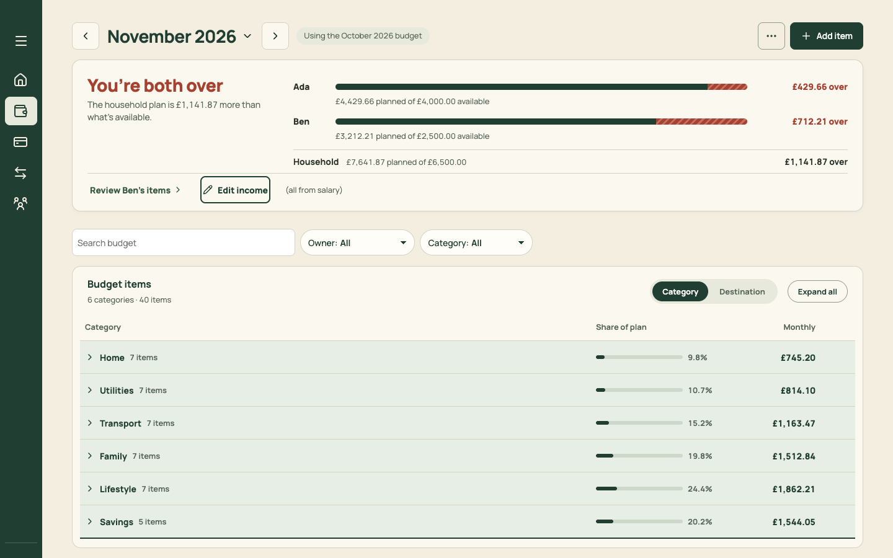
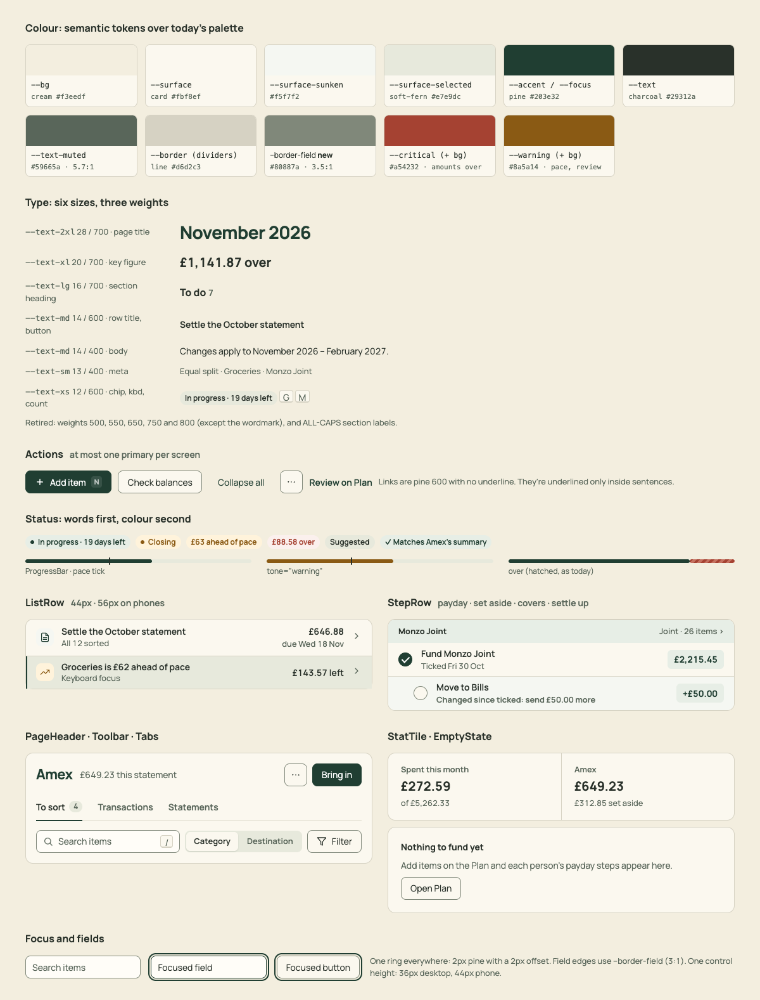

# PR 01 · Design tokens: semantic colours, three weights, field borders, one focus ring

| | |
| --- | --- |
| **Suggested PR title** | `Audit 3 · 01: semantic tokens, three type weights, 3:1 field edges, one focus ring` |
| **Size** | M (≈350 changed lines, mostly `styles.css`) |
| **Needs** | Nothing. Can start immediately, in parallel with PR 05. |
| **Unblocks** | 02, 03, 04, 21 |
| **Branch** | `audit3/01-tokens` |

## Goal

Give the app one set of design tokens that every later PR builds on, and fix the system-level accessibility gaps. After this PR:
- **Colours** have semantic names (`--surface`, `--text-muted`, `--critical`…) over today's palette.
- **Type** uses three weights.
- **Field edges** meet 3:1.
- **Focus** is one ring everywhere.
- **Controls** share one height.
- **Links** look one way.
- **CSS guards** cover these rules and every CSS file, so new component stylesheets (from PR 02 on) are checked too.

The visible change is deliberately small: slightly darker field borders, a pine focus ring instead of orange, links without underlines, and a more even weight hierarchy.

## Findings it fixes

- [F22 · Field edges fail non-text contrast, and focus has three looks](../review.md#f22)
- [F23 · The design system has drifted in code](../review.md#f23) (tokens and weights part)
- [F24 · Five link styles](../review.md#f24) (base link rule)

## Current behaviour



- **Weights:** `styles.css` uses eight font weights: 400 (×6), 500 (×15), 550 (×2), 600 (×59), 650 (×42), 700 (×58), 750 (×3) and 800 (×27). Count them with `grep -oE "font-weight:\s*[0-9]+|font:\s*[0-9]{3}" src/styles.css | sort | uniq -c`.
- **Field borders:** `input` and `select` use `--line` (#d6d2c3, 1.43:1 on `--card`) or `--line-strong` (#929b89, 2.72:1). WCAG 1.4.11 needs 3:1 for a control's edge.
- **Focus:** three looks. Header, sidebar and search get a 3px orange outline. In-page buttons get a 2px pine one. The Plan filter selects get none (`.monthly-budget-page .budget-v3-filter-select:focus-visible{outline:none}`). The Plan table region gets the browser's default blue ring.
- **Control heights:** four values, 40, 42, 44 and 46px.
- **Links and text buttons:** a mix of underlined, bold-with-chevron and bold-red-underlined.

## Target behaviour

See [mockups/07-design-system.html](../mockups/07-design-system.html):



### 1. Tokens to add to the `:root` block of `src/styles.css`

Keep every existing token; components move to the semantic names over time.

```css
/* Semantic layer: use these in new and touched code */
--bg: var(--cream);
--surface: var(--card);
--surface-sunken: var(--surface-subtle);
--surface-selected: var(--soft-fern);
--text: var(--charcoal);
--text-muted: var(--muted);
--accent: var(--pine);
--border: var(--line);
--border-field: #80887a;          /* 3.46:1 on --card, 3.17:1 on --cream, 3.61:1 on --surface-field */
--critical: var(--status-error);
--critical-bg: var(--status-error-bg);
--warning: var(--status-review);
--warning-bg: var(--status-review-bg);
--positive: var(--pine);
--focus: var(--pine);
/* Type: three weights */
--weight-regular: 400;
--weight-medium: 600;
--weight-bold: 700;
/* Sizes */
--control-h: 36px;
--control-h-touch: 44px;
--row-h: 44px;
--row-h-touch: 56px;
--space-7: 48px;
```

Change `--radius-lg` from 14px to 12px. Change `--text-xs` from 11px to 12px (chips, kbd and counts only).

### 2. Weights

Replace every `font-weight` (and the weight inside `font:` shorthands) with a token:

| Today | Becomes |
| --- | --- |
| 400, 500 | `var(--weight-regular)` |
| 550, 600, 650 | `var(--weight-medium)` |
| 700, 750 | `var(--weight-bold)` |
| 800 | `var(--weight-bold)`, **except** the wordmark selectors (`.desktop-sidebar-brand`, `.mobile-header-brand`, or whatever renders "north."), which keep `800` |

### 3. Focus

- Add one global rule: `:focus-visible { outline: 2px solid var(--focus); outline-offset: 2px }`.
- Inside tables and lists where an offset ring would clip (rows, `.sort-table-row`), use `outline-offset: -2px`.
- Delete the orange focus rules. Find them with `grep -n "outline" src/styles.css`.
- `--orange` is then unused by focus. Keep the token if anything else uses it; otherwise delete it.
- Delete `outline: none` everywhere **except** `h1:focus` and `.error-summary:focus`, which are programmatic focus targets (headings).
- Give `[tabindex="-1"]:focus` regions (the Plan table wrapper) `outline: none`, since they're programmatic focus. Only `:focus-visible` on interactive elements shows the ring.

### 4. Fields and buttons

- `input`, `select` and `textarea` take `border-color: var(--border-field)`.
- On desktop they take `min-height: var(--control-h)`. In the existing mobile query they take `var(--control-h-touch)`.
- `.primary-button`, `.secondary-button` and `.icon-button` take the same heights.
- Remove the per-component `min-height` overrides of 40/42/46px.

### 5. Links

`a` and `.text-button` become `color: var(--accent); font-weight: var(--weight-medium); text-decoration: none`, with an underline on `:hover`. Remove the per-component `text-decoration: underline` rules (search for `underline`). The one exception is `.prose a` (none exist yet), which keeps underline for links inside running sentences.

### 6. Guards: extend `src/styles.tokens.test.ts`

- Read **every** `src/**/*.css` file, not just `styles.css`. Only `styles.css` may hold `:root`.
- New test: `font-weight` (and `font` shorthand weights) must be `var(--weight-*)`, `inherit`, or `800` on a selector containing `brand`.
- New test: `outline: none|0` only on `h1:focus`, `.error-summary:focus` or `[tabindex="-1"]`.
- Keep every existing test.

### 7. Guards: extend `src/styles.contrast.test.ts`

Add a non-text contrast block. `--border-field` must be at least 3:1 on `cream`, `card` and `surface-field`, and `--focus` at least 3:1 on `cream` and `card`.

### 8. Docs

Update `docs/product-design-spec.md` › *Visual identity*. Add the semantic tokens, the three weights, and the focus, link and control-height rules. Remove "loaded in weights 500 and 600" (it's 400..800).

## Files

- **Change:** `src/styles.css` (`:root` and element rules; mechanical replacements elsewhere), `src/styles.tokens.test.ts`, `src/styles.contrast.test.ts`, `docs/product-design-spec.md`.
- **Reuse:** the existing token names. Semantic tokens point at them.
- **Don't touch:** component TSX files and layout. No visual redesign of any screen belongs here. If a weight swap makes a heading look wrong, note it for that screen's PR rather than restyling here.

## Acceptance criteria

- [ ] `grep -oE "font-weight:\s*[0-9]+" src/styles.css` finds only `800` on wordmark selectors.
- [ ] Every input, select and textarea edge is at least 3:1 against its background (the contrast test proves it).
- [ ] Tabbing through Home, Plan, Spending › To sort and Transfers on desktop shows the same 2px pine ring with an offset on every control, including the Plan filter selects. No blue browser ring appears on any region.
- [ ] At 375px, inputs, selects and buttons are 44px tall. At 1440 they're 36px. No control shrinks below 44px on phones.
- [ ] Links and text buttons aren't underlined until hovered. Destructive text actions ("Remove item") keep their danger colour.
- [ ] Before/after screenshots of the eight screens below show no layout shifts beyond about 2px, apart from the changed control heights.
- [ ] `npm run check` passes. The new token and contrast tests fail if you reintroduce `font-weight: 650` or `outline: none` on a button.

## How to check

1. Seed: open `http://localhost:5174/scripts/baseline-seed.html`.
2. Capture before (on `main`) and after (on the branch):
   ```sh
   node docs/audit-3/tools/capture.mjs plan "view=budget&budgetView=plan&month=2026-11"
   node docs/audit-3/tools/capture.mjs transfers "view=budget&budgetView=transfers&month=2026-11"
   node docs/audit-3/tools/capture.mjs home "view=home&month=2026-11"
   node docs/audit-3/tools/capture.mjs sort "view=spending&spendingView=sort&month=2026-11"
   node docs/audit-3/tools/capture.mjs month "view=spending&spendingView=month&month=2026-11"
   node docs/audit-3/tools/capture.mjs statement "view=spending&spendingView=statements&spendingStatement=amex:2026-10-24&month=2026-11"
   node docs/audit-3/tools/capture.mjs household "view=household"
   node docs/audit-3/tools/capture.mjs editor "view=budget&budgetView=plan&month=2026-11"   # then open an item by hand
   ```
3. Compare with `docs/audit-3/screenshots/{plan-desktop,transfers-desktop,home-desktop,spending-sort-desktop}.png`.
4. Keyboard: on Plan, press Tab 20 times and check the ring on each stop.
5. Tests: `npm test -- styles`.

## Working in this repo

- **Run it:** `npm run dev -- --port 5174 --strictPort --mode localonly` (local storage, no sign-in). Seed by opening `http://localhost:5174/scripts/baseline-seed.html`. It loads `docs/fixtures/plan-transfers-baseline.json` (Ada and Ben, 40 items, an Amex card with October and November statements and an Amex pot) and lands on Plan for November 2026. Re-seed before each check. Figures like "19 days left" depend on today's date.
- **Screenshots:** `node docs/audit-3/tools/capture.mjs <name> "<query>"` writes phone (375×812) and desktop (1440×900) PNGs, viewport and full height, to `/tmp/north-shots`. Add `--width 1100` for in-between widths. Playwright isn't a dependency; see the script header.
- **Check:** `npm run check` (eslint, vitest, build) must pass. CI runs the same.
- **CI guards:** `src/styles.tokens.test.ts` (no raw colours, sizes or spacing outside `:root`; breakpoints 640/768/1100 only), `src/styles.contrast.test.ts`, `src/copy.vocabulary.test.ts` (retired words; the glossary is in `docs/product-design-spec.md`), `src/styles.views.test.ts`.
- **Tests:** jsdom has no `matchMedia`, so components render their phone presentation. Stub `window.matchMedia` with `matches: false` to test desktop.
- **Docs:** update your screen's section of `docs/product-design-spec.md`, and any rules doc whose behaviour changes. Never `git add -A docs`: untracked review notes live there.
- **Style:** match the surrounding code (some files are dense one-liners) and don't reformat code you aren't changing. Design rules: [plan.md §2.3](../plan.md#design-system).
- **Branch:** `audit3/NN-short-name` from a fresh `main`. One PR, squash-merged.
