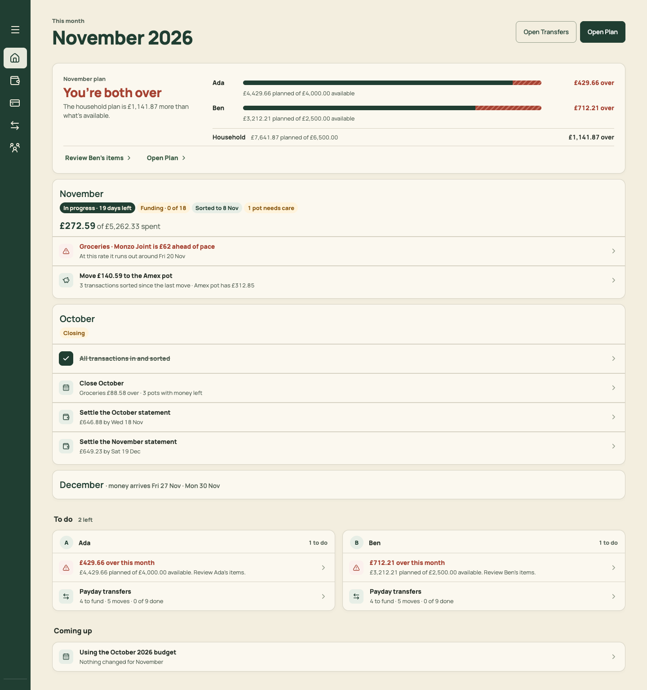
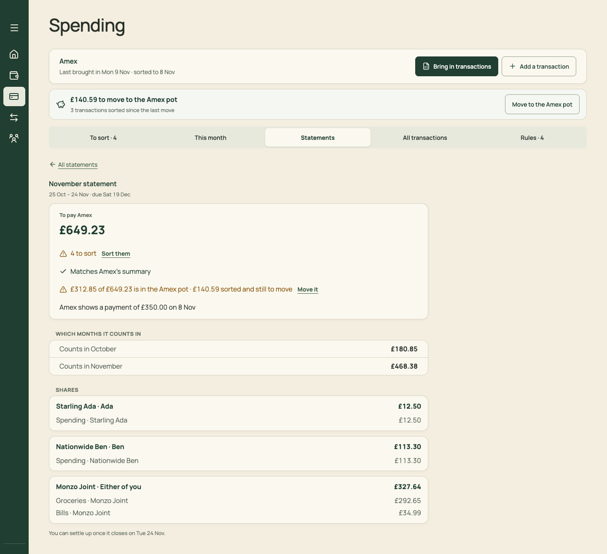
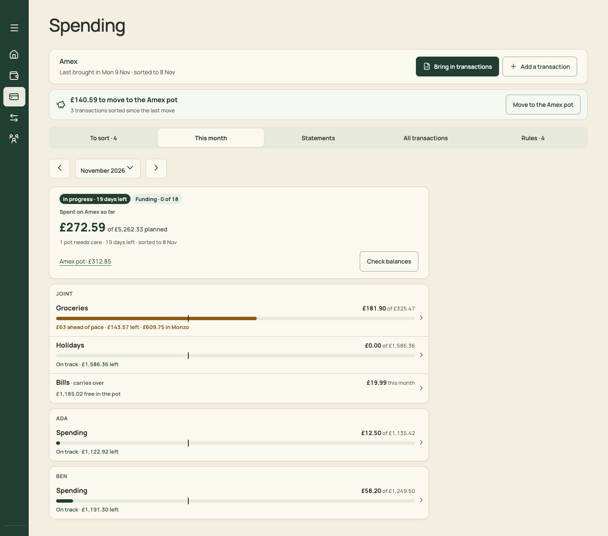
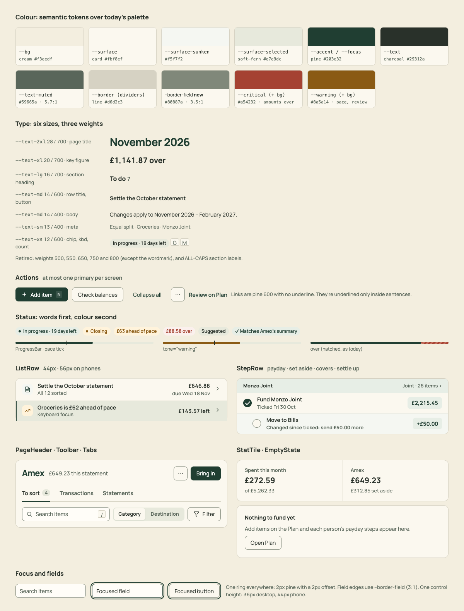

# PR 02 · Shared UI parts: PageHeader, Section, ListRow, StatTile, StatusChip, Meter, Tabs, EmptyState, Kbd

| | |
| --- | --- |
| **Suggested PR title** | `Audit 3 · 02: shared UI components (header, section, row, stat, chip, meter, tabs, empty state)` |
| **Size** | M (≈550 lines including tests; no screen changes) |
| **Needs** | PR 01 merged (semantic tokens and weights) |
| **Unblocks** | 06, 10, 16, and every screen PR |
| **Branch** | `audit3/02-ui-primitives` |

## Goal

Add the small set of components that every screen will be built from, so later PRs compose rather than invent. This PR adds them, their CSS and their tests, plus a dev-only gallery to screenshot them. It doesn't change any screen. It also deletes `SummaryTiles`, which is unused.

## Findings it fixes

- [F10 · Four page-header patterns and three month controls](../review.md#f10) (provides the one header)
- [F11 · Section headings come in six styles](../review.md#f11) (provides the one section heading)
- [F23 · The design system has drifted in code](../review.md#f23) (shared parts)

## Current behaviour

Each screen has its own version:
- **Headers:** `home-heading`, `budget-page-titlebar`, `spending-section-heading`, `page-frame-heading`…
- **Section headings:** 25 heading/title classes.
- **Rows:** Home's `Row`, `TransactionRow`, `budget-manage-row`, statement rows.
- **Bars:** `.allocation-meter-track`, `.spending-bar`, `.transfer-progress-track`, `.home-task-progress`, `.settle-progress`.
- **Chips:** `.spending-chip`, `.spending-stage`, `.spending-tag`, `.budget-filter-chip`, `.budget-manage-chip`.

| Home | Statement | This month |
| --- | --- | --- |
|  |  |  |

## Target behaviour

The components, as drawn in [mockups/07-design-system.html](../mockups/07-design-system.html):



Put each component in `src/components/ui/<Name>.tsx` with `src/components/ui/<Name>.css`, imported by the component. Use semantic tokens only (PR 01). Each component's API:

```ts
// PageHeader: the page's only h1. Sets document.title to `${titleText} · North` (or `${titleText} · ${monthLabel} · North`).
PageHeader({ title: ReactNode; titleText: string; monthLabel?: string; context?: ReactNode; chip?: ReactNode;
  breadcrumb?: { label: string; onClick: () => void }[]; actions?: ReactNode /* ⋯ menu + at most one primary */ })
// MonthTitle: renders the existing MonthControl (src/pages/MonthControl.tsx) as the h1 content with ‹ › around it.
MonthTitle({ month: string; onChange: (month: string) => void; markers?: …same props MonthControl takes… })
// Section: heading (h2, 16/700), muted count, right-hand aside; `collapsed` renders one row that expands on click.
Section({ title: string; count?: ReactNode; aside?: ReactNode; collapsed?: { summary: ReactNode; onExpand: () => void }; id?: string; children })
// ListRow: a full-width button or link row. 44px desktop / 56px in the mobile query.
ListRow({ icon?: ReactNode; tone?: 'neutral'|'warning'|'critical'|'done'; title: ReactNode; meta?: ReactNode; trailing?: ReactNode;
  trailingMeta?: ReactNode; onOpen?: () => void; href?: string; chevron?: boolean /* default true when clickable */ })
StatTile({ label: string; value: ReactNode; detail?: ReactNode; tone?: 'neutral'|'critical'|'warning'; onOpen?: () => void; openLabel?: string })
StatusChip({ tone?: 'neutral'|'positive'|'warning'|'critical'; dot?: boolean; children })
// Meter: one bar. value/max, optional over-portion hatch, pace tick at 0–1, tone. role="img" with an aria-label the caller supplies.
Meter({ value: number; max: number; over?: number; pace?: number; tone?: 'neutral'|'warning'|'critical'; label: string; width?: number|string })
// Tabs: ARIA tablist with an underline style; arrow keys move between tabs (as BudgetManagement does today).
Tabs({ tabs: { id: string; label: string; count?: ReactNode; badge?: ReactNode }[]; current: string; onSelect: (id: string) => void; label: string })
EmptyState({ title: string; children?: ReactNode /* one sentence */; action?: ReactNode })
Kbd({ children })              // <kbd> styled
Breadcrumb({ items: { label: string; onClick?: () => void }[] })   // the last item is the current page, not a link
Toast / useToast()             // polite role="status"; "Copied £2,215.45", "Saved"; 2.5s
```

### Visual spec

All values are tokens. Measure against the design-system PNG.

- **PageHeader:**
  - A flex row with min-height 44px and 12px gaps. Title 28/700 in `--accent`, letter-spacing −0.5px. Context 14/400 `--text-muted`. Actions sit right, 8px apart.
  - On phones (mobile query) the header renders nothing visible. It portals its title, context and actions into the existing phone header slot (`#mobile-header-page-slot`), as `MonthlyBudget` does today. Keep that mechanism and move it into PageHeader.
- **Section:** title 16/700 `--text`, count 14/600 `--text-muted`, 10px gap, aside right-aligned 13px. Collapsed: a card row, 48px, with summary text and a chevron.
- **ListRow:**
  - Grid `28px 1fr auto 16px`, 12px gap, padding 8×16, min-height `--row-h`, top border `--border` between rows. Icon tile 28×28, radius 8, `--surface-sunken`.
  - Title 14/600. Meta 13/400 muted. Trailing 14/600, right-aligned and nowrap.
  - Focused (`:focus-visible` or `[data-focused]`): `--surface-selected` with an inset 2px `--accent` left bar.
- **StatTile:** label 13/600 muted, value 20/700, detail 13/400 muted, 16×20 padding. Tiles in a row are separated by 1px `--border` lines.
- **StatusChip:** height 22, padding 0 8, pill, 12/600. Background and foreground per tone, with an optional 6px dot.
- **Meter:** height 6, pill, track `--surface-selected`, fill `--accent` (`--warning` for tone warning). The over part is hatched like today's `--status-error-hatch`. The pace tick is 2px × 12px in `--text`.
- **Tabs:** 24px gap, 600 weight, muted. The current tab is `--text` with a 2px `--accent` underline. Counts sit in a muted pill.
- **EmptyState:** card padding 20, title 14/700, sentence muted, one action below.

### Dev gallery

Add `src/pages/dev/UiGallery.tsx`, rendered by `App.tsx` only when `import.meta.env.DEV` and `?view=ui-gallery`. It shows every component in each state, including focused rows and each tone. The build must tree-shake it: guard the lazy import with the DEV check.

## Files

- **Add:** `src/components/ui/*.tsx` and `*.css` (11 components), `src/components/ui/index.ts`, `src/components/ui/ui.test.tsx`, `src/pages/dev/UiGallery.tsx`.
- **Change:** `src/App.tsx` (one DEV-only branch for the gallery).
- **Delete:** `src/components/SummaryTiles.tsx` and its CSS rules (`.summary-tile*`), after confirming with `grep -rn SummaryTile src` that nothing imports it.
- **Reuse:** `MonthControl` (inside MonthTitle), the tab keyboard handling in `BudgetManagement.tsx`, and the header-slot portal pattern in `MonthlyBudget.tsx` (`findHeaderSlot`, `createPortal`).
- **Don't touch:** any page's markup. Adoption happens in the screen PRs. `PageFrame` stays until 06 replaces its use.

## Acceptance criteria

- [ ] Each component renders in the gallery at 1440 and 375. Phone rows are 56px tall, desktop rows 44px.
- [ ] `PageHeader` renders exactly one `h1` and sets `document.title` (test). On phones its title shows in the pine header (gallery check).
- [ ] `ListRow` with `onOpen` is a `<button>`, and with `href` an `<a>`. Both have a visible pine focus ring and an inset left bar when focused.
- [ ] `Tabs` follow the ARIA tabs pattern: `role=tablist`/`tab`/`tabpanel`, `aria-selected`, and arrow keys move between tabs (test).
- [ ] `Meter` exposes `role="img"` with the caller's `aria-label` ("Ada: £4,429.66 planned of £4,000.00, £429.66 over").
- [ ] `StatusChip` text is always present. No tone relies on colour alone (test: renders its children).
- [ ] Every CSS file passes the extended token guard from PR 01.
- [ ] `npm run build` output contains no `UiGallery` code (`grep -r UiGallery dist` finds nothing).
- [ ] `npm run check` passes.

## How to check

- Open `http://localhost:5174/?view=ui-gallery` at 1440 and 375, and compare with `docs/audit-3/mockups/png/design-system.png`.
- `node docs/audit-3/tools/capture.mjs gallery "view=ui-gallery"`.
- Tests: `npm test -- ui`.

## Working in this repo

- **Run it:** `npm run dev -- --port 5174 --strictPort --mode localonly` (local storage, no sign-in). Seed by opening `http://localhost:5174/scripts/baseline-seed.html`. It loads `docs/fixtures/plan-transfers-baseline.json` (Ada and Ben, 40 items, an Amex card with October and November statements and an Amex pot) and lands on Plan for November 2026. Re-seed before each check. Figures like "19 days left" depend on today's date.
- **Screenshots:** `node docs/audit-3/tools/capture.mjs <name> "<query>"` writes phone (375×812) and desktop (1440×900) PNGs, viewport and full height, to `/tmp/north-shots`. Add `--width 1100` for in-between widths. Playwright isn't a dependency; see the script header.
- **Check:** `npm run check` (eslint, vitest, build) must pass. CI runs the same.
- **CI guards:** `src/styles.tokens.test.ts` (no raw colours, sizes or spacing outside `:root`; breakpoints 640/768/1100 only), `src/styles.contrast.test.ts`, `src/copy.vocabulary.test.ts` (retired words; the glossary is in `docs/product-design-spec.md`), `src/styles.views.test.ts`.
- **Tests:** jsdom has no `matchMedia`, so components render their phone presentation. Stub `window.matchMedia` with `matches: false` to test desktop.
- **Docs:** update your screen's section of `docs/product-design-spec.md`, and any rules doc whose behaviour changes. Never `git add -A docs`: untracked review notes live there.
- **Style:** match the surrounding code (some files are dense one-liners) and don't reformat code you aren't changing. Design rules: [plan.md §2.3](../plan.md#design-system).
- **Branch:** `audit3/NN-short-name` from a fresh `main`. One PR, squash-merged.
