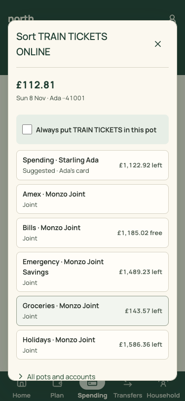
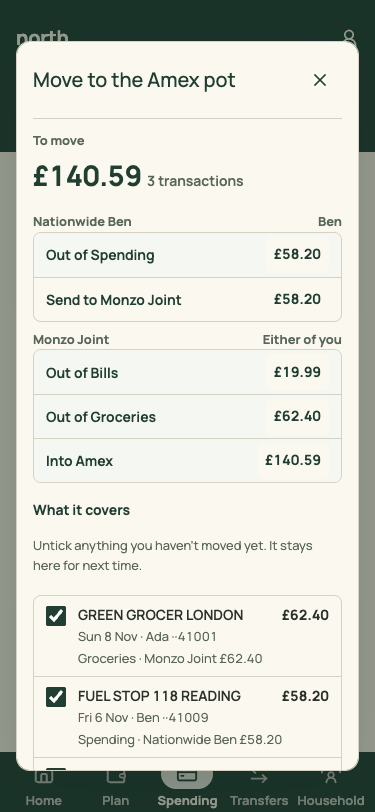
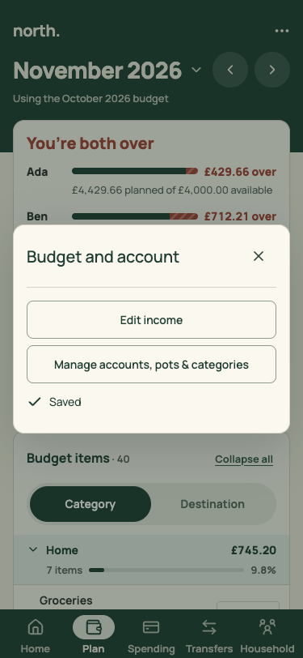

# PR 03 · One Sheet: a dialog on desktop, a bottom sheet on phones

| | |
| --- | --- |
| **Suggested PR title** | `Audit 3 · 03: one Sheet overlay (desktop dialog, phone bottom sheet)` |
| **Size** | M (≈400 lines) |
| **Needs** | PR 01 merged |
| **Unblocks** | 08, 09, 17 (they host their editors in Sheet) |
| **Branch** | `audit3/03-sheet` |

## Goal

Replace the five overlay implementations with one `Sheet`. It's a centred dialog on desktop and tablet, and a bottom sheet anchored to the bottom edge on phones. It has one focus trap, one close button, one scroll body and one footer for actions. `ModalDialog`'s API stays the same, so its ten users move over without edits.

## Findings it fixes

- [F12 · Five overlay types, and phone "sheets" that aren't sheets](../review.md#f12)

## Current behaviour

| Sort sheet, phone | Move sheet, phone | Budget and account, phone |
| --- | --- | --- |
|  |  |  |

The five implementations:
1. **`src/components/ModalDialog.tsx`** (`.budget-info-overlay`/`.budget-info-dialog`) is used by SortSheet, MoveToPotSheet, BringInSheet, ManualEntrySheet, SplitEditor, CheckBalancesSheet, CloseMonth's dialogs, SpendingMonth's CheckBalance, PlanFilters' phone sheet, MobileBudgetViews' `BudgetInfoDialog`, and `ConfirmDialog`. On phones it's a card floating mid-screen with margins.
2. **`PlannerHeader.tsx` `UtilitySheet`** (`.mobile-utility-sheet`) is a second copy of the same focus-trap code.
3. **`BudgetItemEditor.tsx`** has its own dialog (`.budget-batch-dialog`). PR 17 handles it.
4. **`BudgetManagement.tsx`** is a right-hand side panel (`.budget-v3-overlay`). PR 09 handles it.
5. **`MonthControl.tsx`** is a popover picker. It stays a popover, because a picker anchored to its button is correct.

## Target behaviour

### `src/components/ui/Sheet.tsx` (+ `Sheet.css`)

```ts
Sheet({ title: string; onClose: () => void; children: ReactNode; footer?: ReactNode;
  size?: 'sm' | 'md' | 'lg' | 'xl'   // desktop max-width 440 / 560 / 720 / 1220px; default 'md'
  returnFocusTo?: () => HTMLElement | null | undefined; className?: string; description?: ReactNode })
```

- **Behaviour:** move every behaviour from today's `ModalDialog` unchanged:
  - portal to `#root`;
  - make siblings `inert`;
  - lock body scroll;
  - trap Tab (include `select` and `textarea`);
  - Escape closes (`stopPropagation`);
  - focus `[data-autofocus]` or the first control;
  - restore focus, with the `returnFocusTo` fallback and the closed-`<details>` check.
- **Desktop (not the mobile query):**
  - scrim `--scrim`;
  - a dialog centred, width `min(size, 100% - 48px)` and max-height `calc(100dvh - 48px)`;
  - radius `--radius-lg`, `--shadow-dialog`;
  - **header:** title 20/700 with the × close (44×44, `aria-label="Close"`) and an optional description below;
  - **body:** scrolls independently;
  - **footer** (when given): sticky at the bottom, top border, actions right-aligned, 12px gaps.
- **Phone (`MOBILE_QUERY`):**
  - anchored to the bottom, full width, radius `--radius-lg --radius-lg 0 0`, max-height `90dvh`;
  - a 36×4 grab handle, decorative and `aria-hidden`;
  - bottom padding `calc(var(--space-5) + env(safe-area-inset-bottom))`;
  - enters with `transform: translateY(100%) → 0` over 180ms, and not at all under `prefers-reduced-motion`;
  - footer buttons are full width, primary last (nearest the thumb);
  - the bottom nav and docked mini meter stay hidden while it's open (today's `:has([aria-modal=true])` rules).
- **Accessibility:** `role="dialog"`, `aria-modal="true"`, `aria-labelledby` the title, and `aria-describedby` the description when present.

### Migration

- Rewrite `ModalDialog` as `export function ModalDialog(props) { return <Sheet {...props} /> }`, keeping its props. Every existing user then gets the new look without edits.
- Where a user renders its own action row at the end of `children` (e.g. `.confirm-dialog-actions`, `.bring-in-sheet` buttons), move it to `footer` **only in `ConfirmDialog`** in this PR. The others move in their screen PRs. Leave a code comment in `ModalDialog` saying so.
- Replace `PlannerHeader`'s `UtilitySheet` with `Sheet`, keeping its content and the status rules.
- Delete the now-unused CSS: `.budget-info-overlay`, `.budget-info-dialog` rules that `Sheet.css` replaces, and `.mobile-utility-overlay`/`.mobile-utility-sheet`.

## Files

- **Add:** `src/components/ui/Sheet.tsx`, `src/components/ui/Sheet.css`, `src/components/ui/Sheet.test.tsx`.
- **Change:** `src/components/ModalDialog.tsx`, `src/components/ConfirmDialog.tsx`, `src/components/PlannerHeader.tsx` (UtilitySheet only), `src/styles.css` (delete only).
- **Reuse:** all of `ModalDialog`'s focus logic. Copy it; don't rewrite it.
- **Don't touch:** `BudgetItemEditor.tsx` (PR 17), `BudgetManagement.tsx` (PR 09), `MonthControl.tsx` (stays a popover), and the content of any sheet.

## Acceptance criteria

- [ ] Every `ModalDialog` user opens as a bottom sheet at 375×812 and a centred dialog at 1440×900. Check: sort sheet, Move to the Amex pot, Bring in, Add a transaction, Split, Check balances, Filter (phone Plan), Budget and account (phone ⋯), and Remove item confirm.
- [ ] On phones the sheet's bottom edge sits on the screen edge with safe-area padding, and its primary action is the last, full-width button.
- [ ] Escape closes. Tab cycles inside. Focus returns to the opener, or to `returnFocusTo` when the opener was in a closed menu (existing tests in `MonthlyBudget.test.tsx` and `Spending.test.tsx` pass unchanged).
- [ ] With reduced motion on, there's no slide.
- [ ] Only one focus-trap implementation remains: `grep -rn "addEventListener('focusin'" src` shows `Sheet.tsx` only.
- [ ] `npm run check` passes.

## How to check

Seed, then capture each overlay open. The script captures the page only, so open each sheet by hand in Chrome and use the device toolbar at 375×812 and 1440×900:
- `?view=spending&spendingView=sort&month=2026-11`: tap a To sort row (phone) for the sort sheet, then Move to the Amex pot, Bring in transactions, Add a transaction.
- `?view=spending&spendingView=month&month=2026-11`: Check balances.
- `?view=budget&budgetView=plan&month=2026-11` (phone): Filter, and ⋯ (Budget and account). On desktop, open an item, then Remove item.

Compare with `docs/audit-3/screenshots/{sort-sheet-phone,move-sheet-phone,plan-options-phone,move-sheet-desktop}.png`. Tests: `npm test`. Add `Sheet.test.tsx` for the trap, Escape, inert, focus restore and footer rendering.

## Working in this repo

- **Run it:** `npm run dev -- --port 5174 --strictPort --mode localonly` (local storage, no sign-in). Seed by opening `http://localhost:5174/scripts/baseline-seed.html`. It loads `docs/fixtures/plan-transfers-baseline.json` (Ada and Ben, 40 items, an Amex card with October and November statements and an Amex pot) and lands on Plan for November 2026. Re-seed before each check. Figures like "19 days left" depend on today's date.
- **Screenshots:** `node docs/audit-3/tools/capture.mjs <name> "<query>"` writes phone (375×812) and desktop (1440×900) PNGs, viewport and full height, to `/tmp/north-shots`. Add `--width 1100` for in-between widths. Playwright isn't a dependency; see the script header.
- **Check:** `npm run check` (eslint, vitest, build) must pass. CI runs the same.
- **CI guards:** `src/styles.tokens.test.ts` (no raw colours, sizes or spacing outside `:root`; breakpoints 640/768/1100 only), `src/styles.contrast.test.ts`, `src/copy.vocabulary.test.ts` (retired words; the glossary is in `docs/product-design-spec.md`), `src/styles.views.test.ts`.
- **Tests:** jsdom has no `matchMedia`, so components render their phone presentation. Stub `window.matchMedia` with `matches: false` to test desktop.
- **Docs:** update your screen's section of `docs/product-design-spec.md`, and any rules doc whose behaviour changes. Never `git add -A docs`: untracked review notes live there.
- **Style:** match the surrounding code (some files are dense one-liners) and don't reformat code you aren't changing. Design rules: [plan.md §2.3](../plan.md#design-system).
- **Branch:** `audit3/NN-short-name` from a fresh `main`. One PR, squash-merged.
