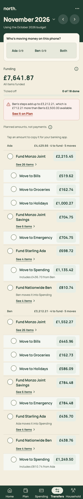
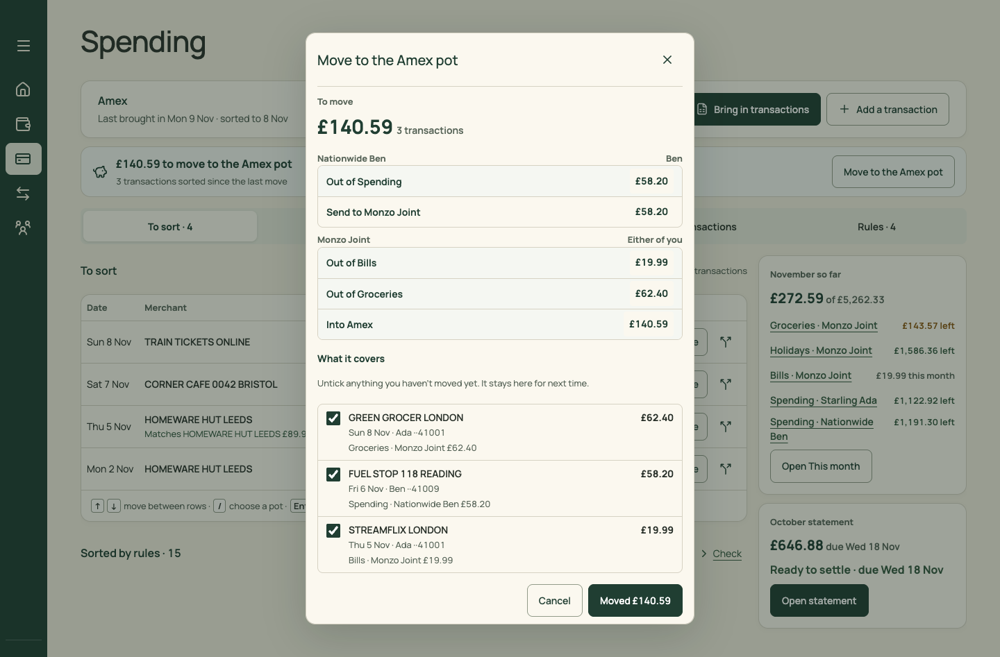
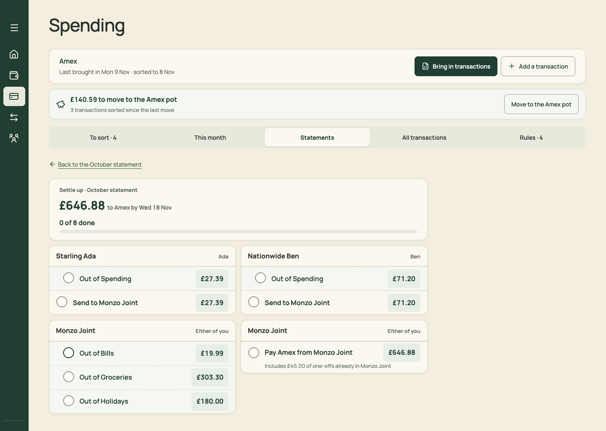
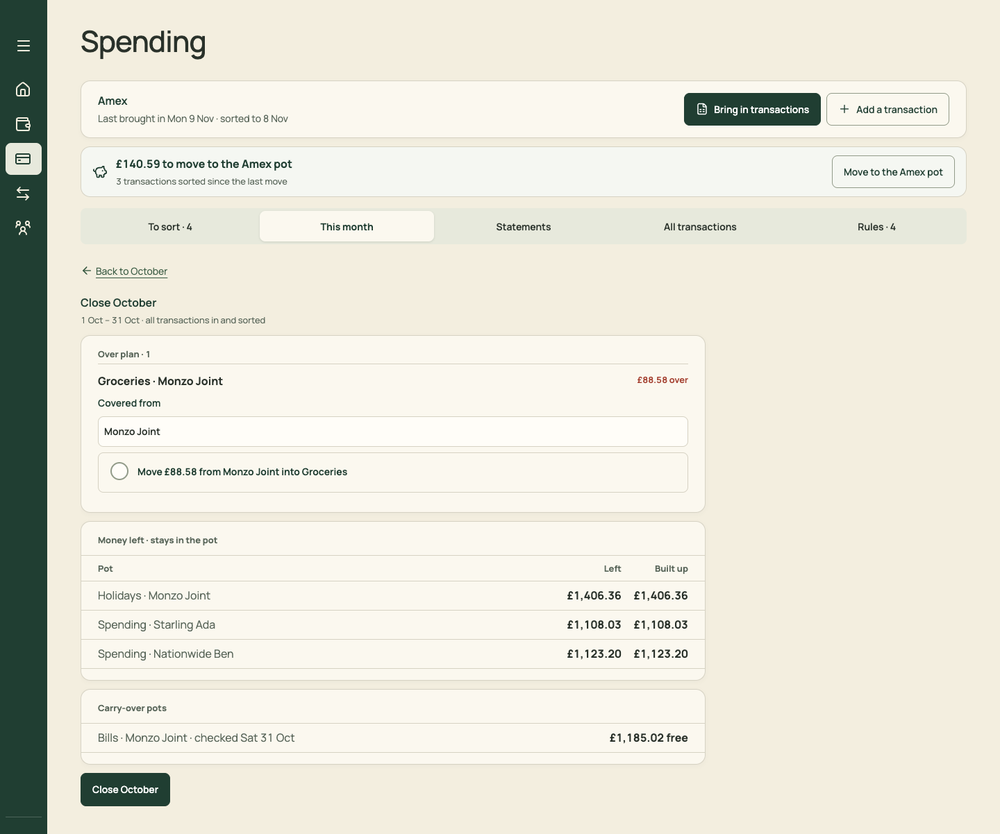
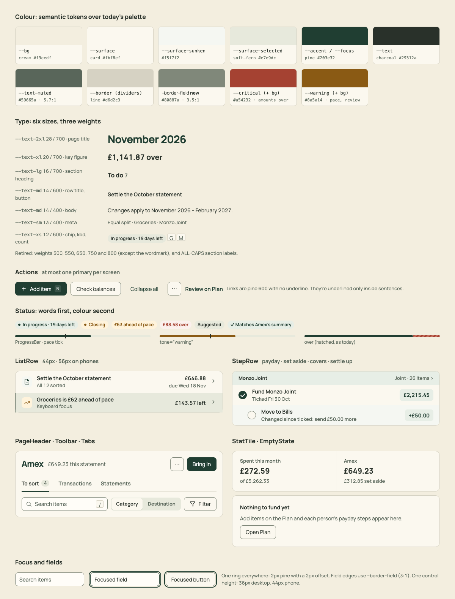

# PR 04 · One StepRow for every money move

| | |
| --- | --- |
| **Suggested PR title** | `Audit 3 · 04: one StepRow and StepGroup for payday, set aside, covers and settle up` |
| **Size** | M (≈500 lines; mostly moving markup) |
| **Needs** | PR 01 merged |
| **Unblocks** | 11, 13, 14 |
| **Branch** | `audit3/04-step-row` |

## Goal

"Move £X from A to B, copy the amount for the banking app, and tick it off" happens in four places and is built four ways. Extract one `StepRow` (tick, label, caption, copyable amount, changed-since-ticked state) and one `StepGroup` (the account band), then use them in all four places. Tick behaviour and tick keys must not change.

## Findings it fixes

- [F03 · "Move money and tick it" has four different UIs](../review.md#f03)

## Current behaviour

| Payday (`PaydaySteps.tsx`) | Move to the Amex pot (`MoveToPotSheet.tsx`) | Settle up (`StatementsPanel.tsx` › `SettleUp`) | Close-month cover (`CloseMonth.tsx`) |
| --- | --- | --- | --- |
|  |  |  |  |

- **`PaydaySteps.tsx`** defines `tick()`, `amount()` (copy on click, with the hint and "Copied £X"), `changedNote()` and `affected()` inline, and renders `li.payday-step` rows.
- **`StatementsPanel.tsx`** (SettleUp, around line 146) and **`CloseMonth.tsx`** (around line 65) copy the same `payday-step*` markup by hand.
- **`MoveToPotSheet.tsx`** has its own `move-step` rows: static, not copyable.

## Target behaviour



### `src/components/ui/StepRow.tsx` (+ `StepRow.css`)

```ts
StepGroup({ title: ReactNode; aside?: ReactNode; link?: { label: string; onClick: () => void }; children })   // the account band + its rows (<ul>)
StepRow({ stepKey: string; label: ReactNode; caption?: ReactNode; amountPence: number;
  mode?: 'tick' | 'copy'            // 'copy': no tick column, the amount still copies (Set aside before "Mark moved")
  ticks?: Readonly<Record<string, StepTick>>; onTick?: (key: string, amountPence: number | null) => void
  indent?: boolean                  // pot moves under their fund step
  emphasis?: 'pay'                  // the final "Pay Amex" step: --surface-band background
  affected?: boolean                // "Changed by recent edit" label (today's budget-affected-label)
  tickedAt?: string })              // "Ticked Wed 18 Nov" caption when done
```

- **Behaviour, moved verbatim from `PaydaySteps.tsx`:**
  - `stepStatus(ticks, key, pence)` decides done, changed or open.
  - The tick button is 44×44, with `aria-pressed` and the same aria-labels. In the changed state it accepts the new amount.
  - The amount button copies the plain number (`(pence/100).toFixed(2)`), shows "Copied £X" via the `Toast` from PR 02 (or the existing inline status if PR 02 isn't merged; keep one `role="status"` per list), and marks the copy hint seen (`copyHint.ts`).
  - Changed shows "+£50.00" or "−£10.00" and copies the difference. The changed note reads as today ("Changed since ticked: you sent £959.00, it's now £1,009.00. Send £50.00 more.").
- **Layout:**
  - Grid `24px 1fr auto` (no tick column in copy mode), min-height 48px, padding 6×16. Indent adds 24px left padding on `--surface-sunken`.
  - Label 14/600, caption 13/400 muted.
  - The amount is a 30px-high chip on `--surface-band`, 14/700 `--accent`.
  - Band: `--surface-band`, 13/700 title, 13/400 muted aside, with an optional link "26 items ›" at the right.

### Use it in four places

Visible changes are noted for each.

1. **`PaydaySteps.tsx`:** render fund steps as `StepRow` and pot moves as `StepRow indent`, inside one `StepGroup` per account (desktop already has bands; phones get the same bands). Keep "See N items" where it is for now, rendered as `StepGroup`'s link. PR 11 moves it. Captions ("Includes £436.70 from Ben", "Ben moves it into Spending") become `caption`.
2. **`StatementsPanel.tsx` › `SettleUp`:** each account card becomes a `StepGroup`. Pot outs are `indent`. Pay Amex is `emphasis="pay"`. Merge the two "Monzo Joint · Either of you" cards into one group.
3. **`CloseMonth.tsx` › covers:** the cover step becomes a `StepRow` (no bordered box). The "Covered from" select stays above it.
4. **`MoveToPotSheet.tsx`:** the moves list becomes `StepGroup`s of `StepRow mode="copy"`, so each amount copies. The transaction checklist and the "Moved £X" button stay as they are.

### Tick keys must not change

The rows take the same `key` strings their screens pass today (`fundKey`/`moveKey` in PaydaySteps, the settle-up step keys, the cover keys). Add a test that renders the baseline fixture's November payday (18 steps) and October settle-up (8 steps). It should tick each one through `StepRow` and assert the stored `document.ticks` keys match the keys produced on `main` before the change (snapshot them in the test).

## Files

- **Add:** `src/components/ui/StepRow.tsx`, `StepRow.css`, `StepRow.test.tsx`.
- **Change:** `src/pages/PaydaySteps.tsx`, `src/pages/StatementsPanel.tsx` (SettleUp rows only), `src/pages/CloseMonth.tsx` (cover rows only), `src/pages/MoveToPotSheet.tsx` (moves list only), and `src/styles.css` (delete the `payday-step*`, `move-step*`, `payday-tick*` and `payday-step-amount` rules once unused).
- **Reuse:** `domain/transferTicks.ts` (`stepStatus`, `setStepTick`), `pages/copyHint.ts`, `formatting/money.ts`.
- **Don't touch:** the domain (`transferTicks`, `setAside`, `cardStatements`, `monthStages`), the page layouts around the rows, the person switch, and the progress headers. Those belong to PRs 11, 13 and 14.

## Acceptance criteria

- [ ] Payday (desktop and phone), the Move sheet, Settle up and Close October covers all render the same row: same heights, tick, amount chip and changed note.
- [ ] Clicking an amount copies the plain number and announces "Copied £X" once. Clicking the tick never copies, and the reverse holds too.
- [ ] Tick a step, change the plan amount for that destination, and the row shows "Changed since ticked …" with "+£X". Ticking accepts it. (The existing tests in `MonthlyBudget.test.tsx` and `Spending.test.tsx` pass.)
- [ ] The tick-key snapshot test passes. Ticks saved before this PR still show as ticked after it (seed, tick three steps on `main`, switch branch, reload).
- [ ] The Move sheet's moves are copyable. Its "Moved £140.59" still records the move, and Undo still works.
- [ ] The two Monzo Joint cards in Settle up are now one group, with Pay Amex last.
- [ ] Keyboard: Tab reaches each tick and each amount in order, with a visible ring.
- [ ] `npm run check` passes.

## How to check

```sh
node docs/audit-3/tools/capture.mjs transfers "view=budget&budgetView=transfers&month=2026-11"
node docs/audit-3/tools/capture.mjs close-oct "view=spending&spendingView=month&spendingClose=1&month=2026-10"
node docs/audit-3/tools/capture.mjs statement-oct "view=spending&spendingView=statements&spendingStatement=amex:2026-10-24&month=2026-11"
```

Then click Settle up on the October statement, and open Move to the Amex pot from Spending › To sort. Compare with `docs/audit-3/screenshots/{transfers-desktop,transfers-phone,settle-up-desktop,move-sheet-desktop,close-october-desktop}.png`.

## Working in this repo

- **Run it:** `npm run dev -- --port 5174 --strictPort --mode localonly` (local storage, no sign-in). Seed by opening `http://localhost:5174/scripts/baseline-seed.html`. It loads `docs/fixtures/plan-transfers-baseline.json` (Ada and Ben, 40 items, an Amex card with October and November statements and an Amex pot) and lands on Plan for November 2026. Re-seed before each check. Figures like "19 days left" depend on today's date.
- **Screenshots:** `node docs/audit-3/tools/capture.mjs <name> "<query>"` writes phone (375×812) and desktop (1440×900) PNGs, viewport and full height, to `/tmp/north-shots`. Add `--width 1100` for in-between widths. Playwright isn't a dependency; see the script header.
- **Check:** `npm run check` (eslint, vitest, build) must pass. CI runs the same.
- **CI guards:** `src/styles.tokens.test.ts` (no raw colours, sizes or spacing outside `:root`; breakpoints 640/768/1100 only), `src/styles.contrast.test.ts`, `src/copy.vocabulary.test.ts` (retired words; the glossary is in `docs/product-design-spec.md`), `src/styles.views.test.ts`.
- **Tests:** jsdom has no `matchMedia`, so components render their phone presentation. Stub `window.matchMedia` with `matches: false` to test desktop.
- **Docs:** update your screen's section of `docs/product-design-spec.md`, and any rules doc whose behaviour changes. Never `git add -A docs`: untracked review notes live there.
- **Style:** match the surrounding code (some files are dense one-liners) and don't reformat code you aren't changing. Design rules: [plan.md §2.3](../plan.md#design-system).
- **Branch:** `audit3/NN-short-name` from a fresh `main`. One PR, squash-merged.
