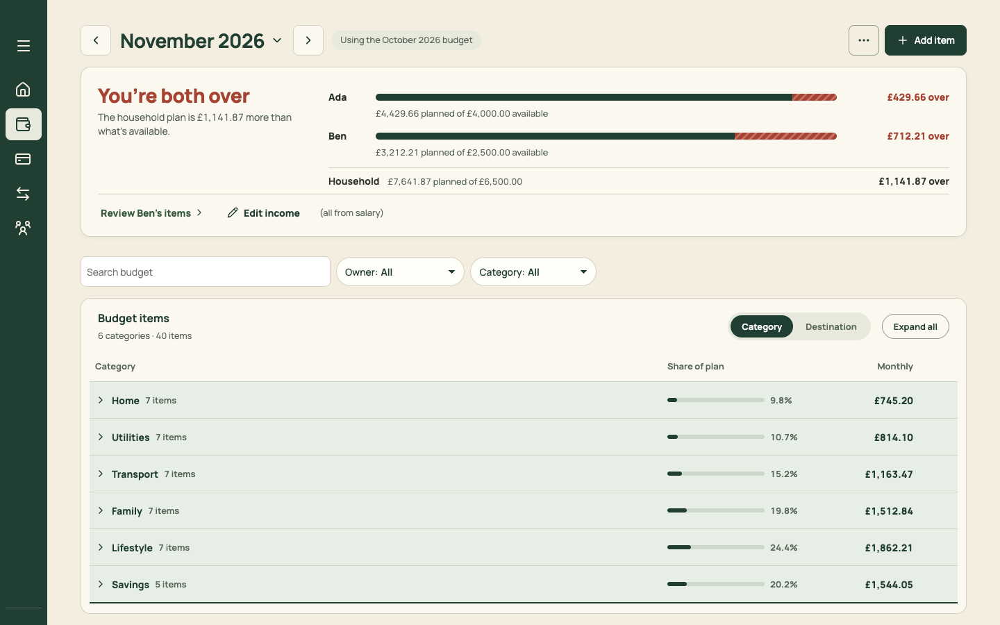

# PR 05 · Split MonthlyBudget into PlanPage and PaydayPage (no visible change)

| | |
| --- | --- |
| **Suggested PR title** | `Audit 3 · 05: split MonthlyBudget into PlanPage and PaydayPage (refactor, no visible change)` |
| **Size** | M (≈600 moved lines, ≈150 new) |
| **Needs** | Nothing. Can run in parallel with PR 01. |
| **Unblocks** | 06 (Month hosts PaydayPage), 11, 16 (Plan and Month work in different files) |
| **Branch** | `audit3/05-split-budget-page` |

## Goal

`src/pages/MonthlyBudget.tsx` (214 dense lines) renders **both** Plan and Transfers and hides one with CSS (`budget-view-plan` / `budget-view-transfers`, guarded by `styles.views.test.ts`). It holds the state for both: the editor, filters, open groups, the person switch, ticks, review-person, affected transfers and the header portal. While that's true, the Plan work (PRs 16–17) and the Month work (PRs 11–12) would edit the same file and conflict.

Split it into a shared hook and two pages, **with no visible or behavioural change**.

## Findings it fixes

None directly. It enables F02, F06 and F17 to be fixed in parallel lanes. See [plan.md §3.2](../plan.md#32-what-can-run-in-parallel).

## Current behaviour



`App.tsx` renders `<MonthlyBudget mobileBudgetView={navigation.budgetView} …/>` for `view=budget`. Inside, `PageFrame` gets:
- `summary`: `AllocationMeter` for Plan, `MobileBudgetSummary` for Transfers;
- `afterSummary`: `TransfersPanel`;
- `children`: the Plan workspace.

The title bar, ⋯ menu and phone header portal are shared.

## Target behaviour

The same pixels and the same behaviour. The new structure:

```
src/pages/budget/useMonthBudget.ts   // pure derivations both screens need: resolved budget, items, incomes, transfers,
                                     // instructions, labels (short + option), transferAccounts, personPlans, available/basis,
                                     // meterPeople, editScopeLabel, revertLabel/removeDate, and the income/manage open state
src/pages/budget/BudgetPageHeader.tsx // month control, carried-over note, ⋯ options, phone header portal (moved as-is)
src/pages/PlanPage.tsx               // the Plan workspace: meter, filters, PlanTable, editor, confirm, save result, mini meter
src/pages/PaydayPage.tsx             // MobileBudgetSummary + TransfersPanel (steps, Funding by account), tick handler
src/pages/MonthlyBudget.tsx          // thin: renders BudgetPageHeader + (view === 'plan' ? <PlanPage/> : <PaydayPage/>)
```

- **Shared state.** State used only by Plan moves to `PlanPage`: the editor, filters, open groups, grouping, search, confirm, inline-saved and batch messages. State used only by Transfers moves to `PaydayPage`: the stored transfer person and the info dialog for transfers. State both need (income and manage dialogs, the options handoff ref) stays in `MonthlyBudget` or the hook.
- **Cross-screen callbacks** keep working through the same props: "Review on Plan" from Transfers (`reviewPerson` plus `onOpenPlan`) and "View affected transfers" from Plan (`onViewAffectedTransfers`). `reviewPerson` sets Plan state, so implement it the way Home does today: navigate with the `northReviewPerson` history state (`reviewPersonOnPlan` in `App.tsx`) instead of calling Plan's setters directly.
- **Rendering.** Only the active page renders. The CSS hide rule becomes dead: delete `.budget-view-plan …{display:none}` and its test in `styles.views.test.ts`. Replace that test with a component test asserting `MonthlyBudget` renders exactly one of `#budget-plan-panel` or the transfers panel for each `mobileBudgetView`.
- **Behaviour to preserve exactly:**
  - Focus return to the ⋯ trigger after Edit income or Manage closes (the `optionsHandoff` layout effect).
  - Plan item focus when arriving from Transfers with `northPlanItem`, including opening its group.
  - `planDestination` scoped Plan with Back to Transfers / View Transfers and heading focus.
  - Docked mini meter on phones once the meter scrolls off (IntersectionObserver).
  - The search scroll-capture and restore in `usePlanSearch`.
  - Inline amount feedback text driven by `saveStatus`.

## Files

- **Add:** `src/pages/budget/useMonthBudget.ts`, `src/pages/budget/BudgetPageHeader.tsx`, `src/pages/PlanPage.tsx`, `src/pages/PaydayPage.tsx`.
- **Change:** `src/pages/MonthlyBudget.tsx` (thin), `src/App.tsx` (only if a prop moves; keep `MonthlyBudget`'s props identical if you can), `src/styles.css` (delete the hide rule), `src/styles.views.test.ts`.
- **Reuse:** every existing child (`PlanTable`, `PlanFilters`, `TransfersPanel`, `AllocationMeter`, `MobileBudgetViews`, `BudgetItemEditor`, `IncomeDialog`, `BudgetManagement`), unchanged.
- **Don't touch:** markup, class names, copy, domain code, or the children's internals. If you find a bug, note it in the PR description and leave it.

## Acceptance criteria

- [ ] `MonthlyBudget.test.tsx` (1,359 lines), `MonthlyBudget.filters.test.tsx` and `App.test.tsx` pass with **no assertion changes**. Only imports or render helpers may change.
- [ ] A DOM-and-screenshot diff of the 25 states below shows no difference, apart from removing the hidden panel's DOM. Use `outerHTML` of `main`, normalised for React ids.
- [ ] Only one of Plan or Transfers is in the DOM at a time.
- [ ] `PlanPage.tsx` imports nothing from `TransfersPanel`, and `PaydayPage.tsx` imports nothing from `PlanTable` or `PlanFilters`.
- [ ] `npm run check` passes.

### The 25 states to diff (1440×900 and 375×812, seeded, `month=2026-11` unless stated)

Plan:
1. Cold open.
2. The Home group open.
3. Search "ins".
4. Owner = Ada.
5. Category = Lifestyle.
6. Destination grouping with Expand all.
7. Quick edit open on Groceries (desktop).
8. Editor open on Groceries.
9. Add items open.
10. Arrived from Home's "Review Ben's items".
11. Arrived from Transfers' "See 26 items" (Back to Transfers).
12. Month picker open.
13. ⋯ menu open.
14. December (carried over).
15. First-run (clear snapshots).
16. A month with no items.

Transfers:
17. Both.
18. Ada.
19. Ben.
20. One step ticked.
21. Changed since ticked (tick Fund Monzo Joint, then raise Groceries by £10).
22. After "View affected transfers".
23. An account with no owner (needs review; edit the fixture to clear an account's owners).
24. No items.
25. The phone ⋯ "Budget and account" sheet.

## How to check

On `main` and on the branch:

```sh
node docs/audit-3/tools/capture.mjs plan "view=budget&budgetView=plan&month=2026-11"
node docs/audit-3/tools/capture.mjs transfers "view=budget&budgetView=transfers&month=2026-11"
node docs/audit-3/tools/capture.mjs plan-dec "view=budget&budgetView=plan&month=2026-12"
```

States that need interaction: script them with Playwright, or check them by hand against the list. Run `npm test` and `npm run check`.

## Working in this repo

- **Run it:** `npm run dev -- --port 5174 --strictPort --mode localonly` (local storage, no sign-in). Seed by opening `http://localhost:5174/scripts/baseline-seed.html`. It loads `docs/fixtures/plan-transfers-baseline.json` (Ada and Ben, 40 items, an Amex card with October and November statements and an Amex pot) and lands on Plan for November 2026. Re-seed before each check. Figures like "19 days left" depend on today's date.
- **Screenshots:** `node docs/audit-3/tools/capture.mjs <name> "<query>"` writes phone (375×812) and desktop (1440×900) PNGs, viewport and full height, to `/tmp/north-shots`. Add `--width 1100` for in-between widths. Playwright isn't a dependency; see the script header.
- **Check:** `npm run check` (eslint, vitest, build) must pass. CI runs the same.
- **CI guards:** `src/styles.tokens.test.ts` (no raw colours, sizes or spacing outside `:root`; breakpoints 640/768/1100 only), `src/styles.contrast.test.ts`, `src/copy.vocabulary.test.ts` (retired words; the glossary is in `docs/product-design-spec.md`), `src/styles.views.test.ts`.
- **Tests:** jsdom has no `matchMedia`, so components render their phone presentation. Stub `window.matchMedia` with `matches: false` to test desktop.
- **Docs:** update your screen's section of `docs/product-design-spec.md`, and any rules doc whose behaviour changes. Never `git add -A docs`: untracked review notes live there.
- **Style:** match the surrounding code (some files are dense one-liners) and don't reformat code you aren't changing. Design rules: [plan.md §2.3](../plan.md#design-system).
- **Branch:** `audit3/NN-short-name` from a fresh `main`. One PR, squash-merged.
