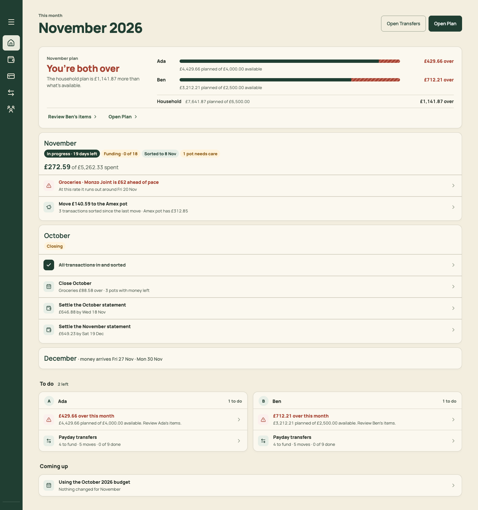
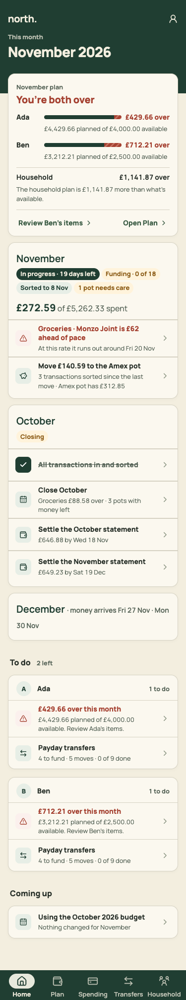
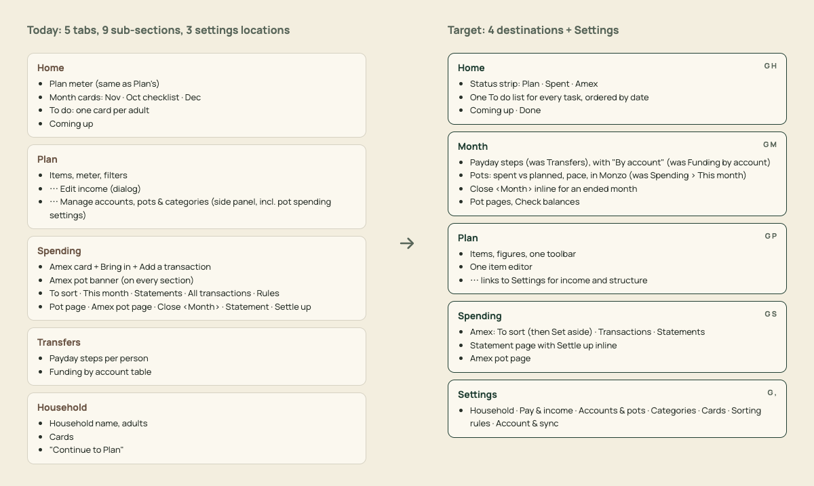
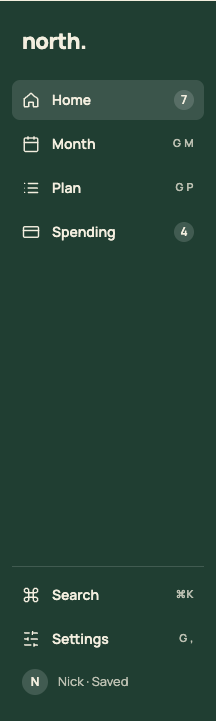
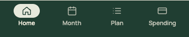

# PR 06 · Navigation: Home · Month · Plan · Spending, plus Settings

| | |
| --- | --- |
| **Suggested PR title** | `Audit 3 · 06: four destinations (Home, Month, Plan, Spending) + Settings, legacy links, page titles` |
| **Size** | M, at the upper end (≈650 lines). If it passes 700, split into **06a** (`navigation.ts` + redirects + tests, no UI) and **06b** (shell, pages, header). |
| **Needs** | PR 02 (PageHeader, MonthTitle) and PR 05 (PaydayPage) merged. **Decision D1** (and D2 for naming). |
| **Unblocks** | 07, 08, 10, 11, 13 |
| **Branch** | `audit3/06-nav-shell` |

## Goal

Reorganise the app around the household's routine:
- **Home** (what to do), **Month** (fund it, watch it, close it), **Plan** (the budget) and **Spending** (the card).
- **Settings** at the sidebar foot, and behind the account button on phones.

This PR changes the **structure** only. Month and Settings host today's panels (interim compositions), so the content is familiar while the navigation changes. Later PRs redesign each screen. Every old link keeps working.

## Findings it fixes

- [F02 · The month's lifecycle is split across four screens](../review.md#f02) (structure)
- [F08 · Settings are in four places](../review.md#f08) (shell; content in 08 and 09)
- [F10 · Four page-header patterns and three month controls](../review.md#f10)
- [F25 · The phone header changes per screen, and titles are generic](../review.md#f25)
- [F27 · The sidebar is unlabelled by default](../review.md#f27)

## Current behaviour

| Desktop | Phone |
| --- | --- |
|  |  |

- **Destinations:** five, Home · Plan · Spending · Transfers · Household (`PlannerHeader.tsx` `destinations`).
- **Sidebar:** collapsed to unlabelled icons.
- **Routing:** `state/navigation.ts` parses `view=home|household|budget|spending` with `budgetView` and `spendingView`, plus `spendingPot`, `spendingStatement`, `spendingClose` and `planDestination`.
- **Spending sections:** `sort|all|month|statements|rules`.
- **Phone header:** a person icon on Home and Spending, ⋯ on Plan and Transfers.
- **Document title:** always "North Planner".

## Target behaviour

See [mockups/01-navigation.html](../mockups/01-navigation.html):



| Sidebar | Phone tab bar |
| --- | --- |
|  |  |

### 1. Routing (`src/state/navigation.ts`)

- `PlannerView = 'home' | 'month' | 'plan' | 'spending' | 'settings'`.
- `NavigationState = { view, month, section, pot, statement, close, planDestination }`.
  - `section`: Spending `'sort' | 'transactions' | 'statements'`, or Settings `'household' | 'income' | 'accounts' | 'categories' | 'cards' | 'rules' | 'account'`.
  - `pot`: Month only.
  - `statement`: Spending only.
  - `close`: Month only.
  - `planDestination`: Plan only.
- `parseNavigation` accepts every legacy form and maps it to the new state. `navigateTo` writes only new params, so a legacy URL is rewritten with `replaceState` on load.

| Legacy | New |
| --- | --- |
| no `view` | `home` (unchanged) |
| `view=budget&budgetView=plan` or a bare `budgetView=plan` | `plan` |
| `view=budget&budgetView=transfers` | `month` |
| `view=budget` with no `budgetView` | `plan`. Drop `lastBudgetView` and the `north.budgetView` key. |
| `view=spending&spendingView=month[&spendingPot=x][&spendingClose=1]` | `month[&pot=x][&close=1]` |
| `view=spending&spendingView=sort` | `spending&section=sort` |
| `spendingView=all` | `spending&section=transactions` |
| `spendingView=statements[&spendingStatement=k]` | `spending&section=statements[&statement=k]` |
| `spendingView=rules` | `settings&section=rules` |
| `view=household` | `settings&section=household` |

- Keep the history-state helpers and re-point them from Transfers to Month: `markStepsOrigin`, `stepsReturnFromState`, `transfersOriginState`, `hasLiveTransfersOrigin`, `northReviewPerson`, `northPlanItem`, `northAffectedTransfers`. Button text changes from "Back to Transfers" to "Back to Month", and "View Transfers" to "View Month".

### 2. Shell (`src/components/PlannerHeader.tsx`, `AppLayout.tsx`)

- **Destinations:**
  - Home (`House`), Month (`CalendarDays`), Plan (`ListTodo` or `Rows3`, chosen from lucide-react), Spending (`CreditCard`).
  - Settings (`Settings2`) sits **in the sidebar foot**, above the account and save status, and is reached on phones from the account sheet.
- **Desktop sidebar:**
  - Expanded by default at ≥1280px (216px wide) and collapsed below. A toggle that persists the choice in `localStorage` `north.sidebar` (`'expanded' | 'collapsed'`) overrides the default.
  - Each item shows icon + label, plus either a **count** or the shortcut hint "G H". Counts: Home's open tasks arrive in PR 10; Spending's is the To sort count.
  - Put the counts in a new hook, `src/state/navCounts.ts`, `useNavCounts(document) → { home?: number; spending?: number }`. This PR fills `spending` (`transactionsToSort`). PR 10 adds `home` there without touching App or PlannerHeader.
- **Phone bottom nav:** four items, each at least 48px tall.
- **Phone header:** the right-most button is always the **account button** (`UserRound`, `aria-label="Account and settings"`). It opens the Sheet (PR 03) with **Settings** (link), save status and Sign out. The page's own ⋯ sits to its left when the page passes actions through the header slot (Plan's options).
  - Retire the phone ⋯ "Budget and account" sheet. Its Edit income and Manage entries move to Plan's own ⋯ (phone) and to Settings.
- **One-time note on Home** (dismissible; `localStorage` `north.whatMoved`): "Transfers is now Payday, on Month. Household is in Settings." Use a quiet `ListRow`-style notice with a × (not a banner colour).

### 3. Pages

- **`src/pages/MonthPage.tsx` (new, interim):**
  - `PageHeader` with `MonthTitle` and a stage `StatusChip` from `domain/monthStages`.
  - Body:
    1. a **Payday** `Section` containing `PaydayPage`'s transfers UI (from PR 05);
    2. a **Pots** `Section` containing today's `ThisMonthPanel` (from `SpendingMonth.tsx`).
  - With `pot` set, render today's `PotDetail` instead (Back → Month). With `close` set, render today's `CloseMonth`.
  - Check balances keeps working (move its trigger into the header actions).
- **`src/pages/SettingsPage.tsx` (new, interim):**
  - `PageHeader` "Settings", then one `Section` per area:
    - Household (today's `HouseholdSetup` fields, **without** "Continue to Plan");
    - Pay & income (a button that opens today's `IncomeDialog`);
    - Accounts, pots & categories (a button that opens today's `BudgetManagement`);
    - Cards (`CardSettings`);
    - Sorting rules (`RulesPanel`);
    - Account & sync (`AccountStatusPanel`).
  - `section` scrolls to its Section. PRs 08 and 09 replace this with the real layout.
- **Spending:** remove the **This month** and **Rules** sections from `Spending.tsx`'s `sections`. On phones, the ⋯ "More Spending sections" keeps only All transactions. Everything else in Spending stays as it is (PR 13 redesigns it).
- **Plan:** the page title is the month (`MonthTitle`). Its `h1` reads "Plan, November 2026", with the "Plan, " prefix visually hidden. The ⋯ keeps Edit income and Manage for now.
- **Home:** "Open Transfers" becomes "Open Month". Links to Spending's This month (pot rows, Close) point at Month.
- **Setup:** `SetupWizard` is unchanged. After setup, land on Home (today it lands on Plan).
- **Document titles** come from `PageHeader`:

| Screen | Title |
| --- | --- |
| Home | "Home · North" |
| Month | "Month · November 2026 · North" |
| Plan | "Plan · November 2026 · North" |
| Spending | "Spending · North" |
| Settings | "Settings · North" |
| Pot page | "Groceries · November 2026 · North" |
| Statement page | "October statement · North" |

### 4. Docs

Restructure `docs/product-design-spec.md` › *Interface patterns* headings to Home, Month, Plan, Spending and Settings. Move the Transfers text under Month › Payday and This month under Month › Pots. Add **Month**, **Payday** and **Settings** to the glossary, and retire "Transfers" as a screen name (keep it in historical notes). Later PRs edit within these sections.

## Files

- **Change:**
  - `src/state/navigation.ts` (+ `navigation.test.ts`)
  - `src/App.tsx`
  - `src/components/PlannerHeader.tsx` (+ test)
  - `src/components/AppLayout.tsx`
  - `src/pages/MonthlyBudget.tsx` (Plan only now; or route Plan to `PlanPage` directly)
  - `src/pages/Spending.tsx` (sections list only)
  - `src/pages/Home.tsx` (link targets and labels only)
  - `src/pages/PaydaySteps.tsx` / `TransfersPanel.tsx` (Back labels)
  - `docs/product-design-spec.md`
- **Add:** `src/pages/MonthPage.tsx`, `src/pages/SettingsPage.tsx`, `src/state/navCounts.ts`.
- **Reuse:** `PageHeader`, `MonthTitle`, `Section`, `StatusChip`, `Sheet`, `PaydayPage`, `ThisMonthPanel`, `PotDetail`, `CloseMonth`, `CheckBalancesSheet`, `HouseholdSetup`, `IncomeDialog`, `BudgetManagement`, `CardSettings`, `RulesPanel`, `AccountStatusPanel`, and `monthStages`.
- **Don't touch:** the internals of those panels, any domain code, Home's content or layout (PR 10), and Spending's layout (PR 13).

## Acceptance criteria

- [ ] The sidebar shows Home, Month, Plan and Spending, with Settings at the foot. It's expanded by default at 1440 and 1280 and collapsed at 1100. The toggle persists across reloads.
- [ ] The phone tab bar has four tabs. The account button is top right on every screen and opens Settings, save status and Sign out.
- [ ] Every legacy URL in the table opens the right screen and is rewritten to the new form. The address bar shows new params, and Back and Forward behave.
- [ ] Month shows today's payday steps and today's This month pots for the selected month. Pot rows open the pot page and Back returns. Close October opens for `month=2026-10`. Check balances opens.
- [ ] Plan › Transfers round trip: "26 items" on a Month account band opens Plan filtered to Monzo Joint, and "Back to Month" returns to the same step (`northStepsReturn`).
- [ ] Home › "Review Ben's items" and the Payday task still land correctly. They now go to Month.
- [ ] Settings shows Household, Pay & income, Accounts…, Cards, Sorting rules and Account. Household has no "Continue to Plan". Spending has no This month or Rules tabs.
- [ ] Each screen has exactly one `h1`, and `document.title` follows the table.
- [ ] `npm run check` passes. `navigation.test.ts` covers every legacy row. `PlannerHeader.test.tsx` covers the destinations, the Settings foot item, and the account button on every screen.

## How to check

```sh
node docs/audit-3/tools/capture.mjs home "view=home&month=2026-11"
node docs/audit-3/tools/capture.mjs month "view=month&month=2026-11"
node docs/audit-3/tools/capture.mjs month-oct-close "view=month&month=2026-10&close=1"
node docs/audit-3/tools/capture.mjs pot "view=month&month=2026-11&pot=groceries"
node docs/audit-3/tools/capture.mjs settings "view=settings"
node docs/audit-3/tools/capture.mjs legacy-transfers "view=budget&budgetView=transfers&month=2026-11"   # expect Month
node docs/audit-3/tools/capture.mjs legacy-household "view=household"                                    # expect Settings
node docs/audit-3/tools/capture.mjs sidebar-1280 "view=home" --desktop --width 1280
```

Compare the sidebar and tab bar with `docs/audit-3/mockups/png/nav-sidebar.png` and `nav-tabbar.png`. Tests: `npm test -- navigation PlannerHeader App Home`.

## Working in this repo

- **Run it:** `npm run dev -- --port 5174 --strictPort --mode localonly` (local storage, no sign-in). Seed by opening `http://localhost:5174/scripts/baseline-seed.html`. It loads `docs/fixtures/plan-transfers-baseline.json` (Ada and Ben, 40 items, an Amex card with October and November statements and an Amex pot) and lands on Plan for November 2026. Re-seed before each check. Figures like "19 days left" depend on today's date.
- **Screenshots:** `node docs/audit-3/tools/capture.mjs <name> "<query>"` writes phone (375×812) and desktop (1440×900) PNGs, viewport and full height, to `/tmp/north-shots`. Add `--width 1100` for in-between widths. Playwright isn't a dependency; see the script header.
- **Check:** `npm run check` (eslint, vitest, build) must pass. CI runs the same.
- **CI guards:** `src/styles.tokens.test.ts` (no raw colours, sizes or spacing outside `:root`; breakpoints 640/768/1100 only), `src/styles.contrast.test.ts`, `src/copy.vocabulary.test.ts` (retired words; the glossary is in `docs/product-design-spec.md`), `src/styles.views.test.ts`.
- **Tests:** jsdom has no `matchMedia`, so components render their phone presentation. Stub `window.matchMedia` with `matches: false` to test desktop.
- **Docs:** update your screen's section of `docs/product-design-spec.md`, and any rules doc whose behaviour changes. Never `git add -A docs`: untracked review notes live there.
- **Style:** match the surrounding code (some files are dense one-liners) and don't reformat code you aren't changing. Design rules: [plan.md §2.3](../plan.md#design-system).
- **Branch:** `audit3/NN-short-name` from a fresh `main`. One PR, squash-merged.
