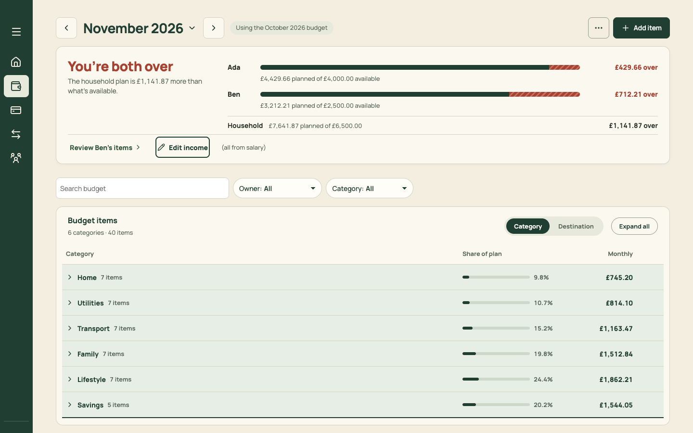

# PR 07 · Keyboard: skip link, go-to keys, `/`, `N`, `[ ]` and the `?` sheet

| | |
| --- | --- |
| **Suggested PR title** | `Audit 3 · 07: keyboard core (skip link, G-then-key navigation, / search, N new, [ ] month, ? shortcuts)` |
| **Size** | M (≈400 lines) |
| **Needs** | PR 06 merged (the new destinations). **Decision D6.** |
| **Unblocks** | 18 (list keys), 19 (⌘K) |
| **Branch** | `audit3/07-keyboard-core` |

## Goal

Make North drivable from the keyboard, the way Linear and Things are: one shortcut registry, a skip link, go-to keys for every destination, `/` to search, `N` for the page's new action, `[` and `]` to change month, `⌘\` for the sidebar, and `?` to list everything. Every action stays clickable; shortcuts are an enhancement.

## Findings it fixes

- [F07 · Outside To sort there's no keyboard model](../review.md#f07) (core; lists in 18, palette in 19)

## Current behaviour



- There are six tab stops before any content (Expand sidebar plus five nav items), with no skip link.
- Plan's search is the 14th tab stop.
- No global shortcuts exist. Pressing `/` or `n` on Plan does nothing.
- The only shortcuts in the app are To sort's table keys (`SortTable.tsx`: ↑/↓, `/`, Enter, A, S).

## Target behaviour

### Registry: `src/state/shortcuts.ts`

```ts
type Shortcut = { keys: string /* 'g h', '/', 'n', '[', 'mod+\\', '?' */; description: string; group: 'Go to' | 'This page' | 'Lists' | 'General';
  run: () => void; when?: () => boolean }
useShortcut(shortcut: Shortcut, deps?)     // registers while mounted
useShortcuts(): Shortcut[]                 // for the ? sheet
```

- **One** `keydown` listener on `window`.
- It ignores events when:
  - the target is an `input`, `textarea`, `select` or `[contenteditable]`;
  - `event.isComposing` is set;
  - a `[aria-modal="true"]` dialog is open (except Escape, which the Sheet handles);
  - modifiers other than the shortcut's own are held;
  - the event is already `defaultPrevented`, so component-level keys win. `SortTable`'s own `/`, Enter, A and S keep working; make sure its handler calls `preventDefault()`.
- **Sequences:** `g` then a key within 1,000ms. While `g` is pending, show a small `Kbd` hint ("G …") bottom-left on desktop.
- `mod` is ⌘ on macOS and Ctrl elsewhere.

### Bindings

| Keys | Action | Registered by |
| --- | --- | --- |
| <kbd>G</kbd> <kbd>H</kbd> / <kbd>M</kbd> / <kbd>P</kbd> / <kbd>S</kbd> / <kbd>,</kbd> | `navigateTo` Home / Month / Plan / Spending / Settings | `AppLayout` |
| <kbd>/</kbd> | Focus the element with `data-shortcut="search"` on the current page (Plan's search; later Transactions). Does nothing if absent. | `AppLayout` |
| <kbd>N</kbd> | The page's "new" action: Plan → Add item; Spending → Add a transaction | the page |
| <kbd>I</kbd> | Spending → Bring in | Spending |
| <kbd>[</kbd> / <kbd>]</kbd> | Previous / next month (Month, Plan; Home if PR 10 adds a month control) | `MonthTitle` (PR 02) |
| <kbd>⌘\\</kbd> | Toggle the desktop sidebar (persists) | `PlannerHeader` |
| <kbd>?</kbd> | Open the Shortcuts sheet | `AppLayout` |

### Skip link

The first element in `AppLayout` is `<a class="skip-link" href="#content">Skip to content</a>`. It's visually hidden until focused, then shows top-left as a pine pill. `main` gets `id="content" tabIndex={-1}`.

### Shortcuts sheet: `src/components/ui/ShortcutsSheet.tsx`

A `Sheet` (PR 03), size `md`, titled "Keyboard shortcuts". It lists `useShortcuts()` grouped by `group`, each as a row of description then `Kbd` keys. It includes the list keys PR 18 will add (registered by those lists when mounted), and To sort's existing keys, written down as static rows for now.

### Hints

- Sidebar items show "G H" and so on (PR 06 left room for it).
- The primary button shows its key: "Add item `N`", "Bring in `I`".
- The search field shows a `/` `Kbd` at its right edge.
- Hints are hidden at phone widths and when `(hover: none)`.

## Files

- **Add:** `src/state/shortcuts.ts` (+ test), `src/components/ui/ShortcutsSheet.tsx`.
- **Change:** `src/components/AppLayout.tsx` (skip link, global bindings), `src/components/PlannerHeader.tsx` (⌘\, hints), `src/pages/PlanPage.tsx` (N, `data-shortcut="search"` on the search input), `src/pages/Spending.tsx` (N, I), `src/components/ui/MonthTitle.tsx` (`[` `]`), and `docs/product-design-spec.md` (a new "Keyboard" subsection under *Controls*).
- **Reuse:** `navigateTo`, `Sheet`, `Kbd`.
- **Don't touch:** `SortTable.tsx`'s own keys (PR 18 aligns them), and the list navigation (PR 18).

## Acceptance criteria

- [ ] On every screen, the first Tab focuses "Skip to content", and Enter moves focus to the main content.
- [ ] <kbd>G</kbd> then <kbd>M</kbd> opens Month, and likewise for H, P, S and comma. Pressing <kbd>G</kbd> alone and waiting does nothing.
- [ ] On Plan, <kbd>/</kbd> focuses the search field, and typing "/" inside it types a slash. <kbd>N</kbd> opens Add item. <kbd>]</kbd> goes to December, <kbd>[</kbd> back to November.
- [ ] On Spending, <kbd>I</kbd> opens Bring in and <kbd>N</kbd> opens Add a transaction.
- [ ] With any sheet open, letter shortcuts don't fire, and Escape closes the sheet.
- [ ] <kbd>?</kbd> opens the shortcuts sheet listing every binding active on that page.
- [ ] <kbd>⌘\\</kbd> collapses and expands the sidebar, and the choice persists.
- [ ] No shortcut fires while typing in any input, select or textarea, or during IME composition (tests).
- [ ] Phone layout: no hints shown, and no change in behaviour.
- [ ] `npm run check` passes.

## How to check

- Run the app at 1440, seeded, and do the acceptance list by hand.
- `node docs/audit-3/tools/capture.mjs plan "view=plan&month=2026-11" --desktop`, then press `?` by hand to see the sheet.
- Tests: `shortcuts.test.ts`, covering the sequence timeout, the ignored targets and the modal guard. Extend `App.test.tsx` with `userEvent.keyboard('gm')` → Month.

## Working in this repo

- **Run it:** `npm run dev -- --port 5174 --strictPort --mode localonly` (local storage, no sign-in). Seed by opening `http://localhost:5174/scripts/baseline-seed.html`. It loads `docs/fixtures/plan-transfers-baseline.json` (Ada and Ben, 40 items, an Amex card with October and November statements and an Amex pot) and lands on Plan for November 2026. Re-seed before each check. Figures like "19 days left" depend on today's date.
- **Screenshots:** `node docs/audit-3/tools/capture.mjs <name> "<query>"` writes phone (375×812) and desktop (1440×900) PNGs, viewport and full height, to `/tmp/north-shots`. Add `--width 1100` for in-between widths. Playwright isn't a dependency; see the script header.
- **Check:** `npm run check` (eslint, vitest, build) must pass. CI runs the same.
- **CI guards:** `src/styles.tokens.test.ts` (no raw colours, sizes or spacing outside `:root`; breakpoints 640/768/1100 only), `src/styles.contrast.test.ts`, `src/copy.vocabulary.test.ts` (retired words; the glossary is in `docs/product-design-spec.md`), `src/styles.views.test.ts`.
- **Tests:** jsdom has no `matchMedia`, so components render their phone presentation. Stub `window.matchMedia` with `matches: false` to test desktop.
- **Docs:** update your screen's section of `docs/product-design-spec.md`, and any rules doc whose behaviour changes. Never `git add -A docs`: untracked review notes live there.
- **Style:** match the surrounding code (some files are dense one-liners) and don't reformat code you aren't changing. Design rules: [plan.md §2.3](../plan.md#design-system).
- **Branch:** `audit3/NN-short-name` from a fresh `main`. One PR, squash-merged.
