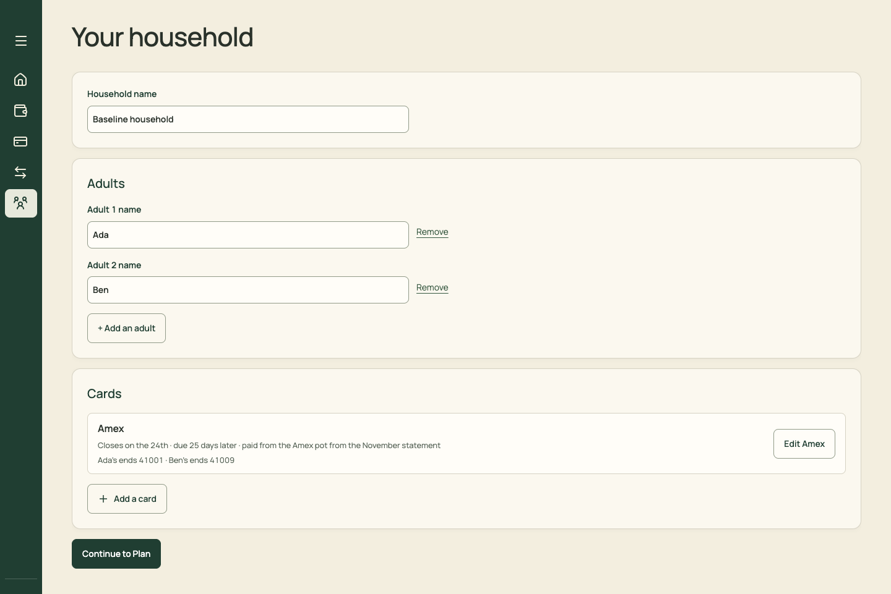
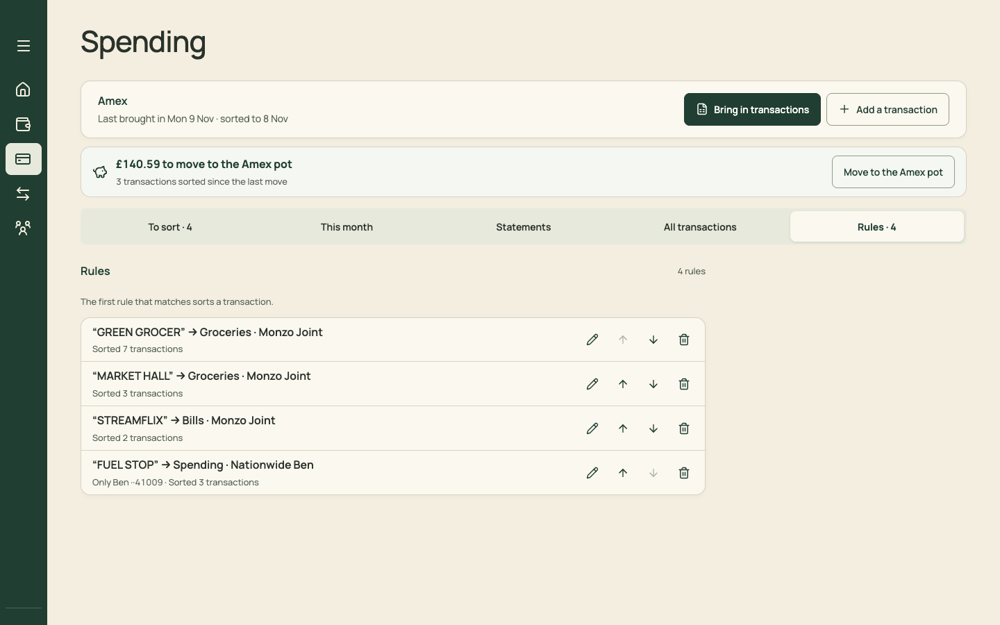
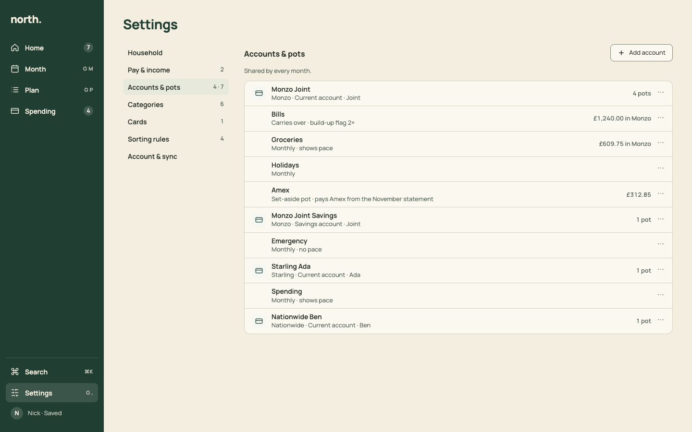

# PR 08 · Settings: household, cards, sorting rules, account

| | |
| --- | --- |
| **Suggested PR title** | `Audit 3 · 08: Settings page with section nav — household, cards, sorting rules, account & sync` |
| **Size** | M (≈450 lines) |
| **Needs** | PR 03 (Sheet) and PR 06 (the interim Settings page and `section` routing) merged |
| **Unblocks** | 09 |
| **Branch** | `audit3/08-settings-page` |

## Goal

Turn PR 06's interim Settings page into the real one. It gets a section list (a left column on desktop, a list on phones), and each section is a calm list of rows whose editors open in the shared `Sheet`. This PR covers **Household**, **Cards**, **Sorting rules** and **Account & sync**. PR 09 adds Pay & income, Accounts & pots, and Categories.

## Findings it fixes

- [F08 · Settings are in four places, and Household takes a nav slot](../review.md#f08) (with PR 09)

## Current behaviour

| Household tab | Rules tab |
| --- | --- |
|  |  |

- **Household** (today's tab, interim in PR 06): a big "Your household" h1, a name field in a card, "Adult 1 name" fields with underlined "Remove" links, "+ Add an adult", a Cards card, and "Continue to Plan".
- **Rules** (Spending tab, interim in PR 06): rows with pencil, ↑, ↓ and bin icon buttons.

## Target behaviour

See [mockups/06-settings.html](../mockups/06-settings.html):



### Layout (`src/pages/SettingsPage.tsx`)

- `PageHeader` "Settings".
- **Desktop (≥768):** a two-column grid `220px 1fr`, 32px gap.
  - Left: a section nav as a list of links, each 34px high, 600 weight, with a right-aligned muted count. The current item is on `--surface-selected`, and the column is sticky.
  - Right: the current section only. Sections are separate views selected by `section`; the page doesn't scroll through all of them.
- **Phone:** with no `section`, the page is a list of `ListRow`s (Household, Pay & income, Accounts & pots, Categories, Cards, Sorting rules, Account & sync), each with a muted summary ("Ada, Ben", "1 card", "4 rules"). Tapping one pushes `section=…`. The section page shows a `Breadcrumb` "Settings › Cards", and the browser's Back returns.
- Sections not built until PR 09 keep PR 06's interim buttons.

### Household section

- **Household name:** an input (`--control-h`), saved on blur and on Enter. On save, a polite `Toast` says "Saved".
- **Adults:** one row per adult, with the name input and a 44×44 icon button `aria-label="Remove Ada"`. Removing confirms through `ConfirmDialog`, keeping today's rules and copy from `AdultsFields`. Below the rows, a "+ Add an adult" secondary button.
- No "Continue to Plan".

### Cards section

- Each card is a `ListRow`:
  - **Title:** "Amex".
  - **Meta:** "Closes on the 24th · due 25 days later · paid from the Amex pot from the November statement · Ada ··41001 · Ben ··41009".
  - **Trailing:** ⋯ with Edit and Remove.
- Below the list, "Add a card".
- Edit and Add open today's `CardSettings` form inside a `Sheet` (size `lg`), with its preview line and validation unchanged. Move the form markup out of `CardSettings.tsx` into a `CardForm` component that the Sheet renders.

### Sorting rules section

- A heading line: "The first rule that matches sorts a transaction."
- Each rule is a `ListRow`:
  - **Title:** `"GREEN GROCER" → Groceries · Monzo Joint`.
  - **Meta:** "Only Ben ··41009 · Sorted 3 transactions".
  - **Trailing:** ⋯ with Edit, Move up, Move down and Delete.
- Edit opens today's rule form in a `Sheet`. Delete confirms.
- Keyboard: <kbd>⌥↑</kbd>/<kbd>⌥↓</kbd> on a focused row move it, as an addition to the menu items.
- Empty: `EmptyState` "No sorting rules yet", with the sentence "Tick "Always put … in this pot" when you sort a transaction to make one."

### Account & sync section

Today's `AccountStatusPanel`: email, save status (Saved / Saving… / Not saved / Choose a version, plus warnings) and Sign out. In local-only mode it says "Saved on this device".

### Entry points

- **Desktop:** the sidebar foot's Settings item (PR 06), shortcut <kbd>G</kbd> <kbd>,</kbd>.
- **Phone:** the account button's sheet lists "Settings" first.
- **Spending:** its ⋯ gets "Sorting rules" (`view=settings&section=rules`) and "Card settings" (`section=cards`). Add those two menu items to `Spending.tsx`'s existing ⋯ in this PR; it's a small edit. If PR 13 has merged, add them to its header ⋯ instead.
- **Sort sheet:** keep its "Change the rule too" behaviour, which edits in place.

## Files

- **Change:** `src/pages/SettingsPage.tsx`, `src/pages/HouseholdSetup.tsx` (or fold its fields into the section, then delete it once `App.tsx` no longer routes to it), `src/pages/AdultsFields.tsx`, `src/pages/CardSettings.tsx` (split out `CardForm`), `src/pages/RulesPanel.tsx`, `src/components/AccountStatusPanel.tsx` (layout only), `src/pages/Spending.tsx` (two ⋯ items only), and the Settings section of `docs/product-design-spec.md`.
- **Reuse:** `PageHeader`, `ListRow`, `Section`, `Sheet`, `Breadcrumb`, `EmptyState`, `Toast`, `ConfirmDialog`; the domain functions these panels already call.
- **Don't touch:** `SetupWizard.tsx` (first run stays as it is; it shares `AdultsFields`, so keep that component's API), the card domain, and the rule-matching logic.

## Acceptance criteria

- [ ] Desktop: Settings shows the section nav with counts. Each section is its own view, the URL follows (`section=cards`), and reload keeps it.
- [ ] Phone: Settings is a list. A section page has a breadcrumb, and Back returns to the list.
- [ ] Household: renaming saves on blur and Enter with a "Saved" toast. Removing an adult confirms. There's no "Continue to Plan".
- [ ] Cards: add, edit and remove work as they do today, including the preview "Statements run from the 25th to the 24th…" and the validation messages. All of it happens in a Sheet.
- [ ] Rules: edit, move and delete work, and the order changes how new transactions sort (existing `Spending.test.tsx` rule tests pass, moved to the new location).
- [ ] Account & sync shows the save status and Sign out (cloud mode) or "Saved on this device" (local).
- [ ] Empty: a card-less household shows "No cards yet" with "Add a card". No rules shows the EmptyState above.
- [ ] Keyboard: Tab order runs section nav, then section content. Arrow keys aren't needed in the nav (plain links). <kbd>G</kbd> <kbd>,</kbd> opens Settings.
- [ ] `npm run check` passes. Move `CardSettings.test.tsx` and the rule tests, and add a `SettingsPage.test.tsx` for section routing.

## How to check

```sh
node docs/audit-3/tools/capture.mjs settings "view=settings"
node docs/audit-3/tools/capture.mjs settings-household "view=settings&section=household"
node docs/audit-3/tools/capture.mjs settings-cards "view=settings&section=cards"
node docs/audit-3/tools/capture.mjs settings-rules "view=settings&section=rules"
```

Compare with `docs/audit-3/mockups/png/settings-desktop.png` (layout; that mock shows Accounts & pots, which is PR 09) and the before screenshots `docs/audit-3/screenshots/household-desktop.png` and `spending-rules-desktop.png`.

## Working in this repo

- **Run it:** `npm run dev -- --port 5174 --strictPort --mode localonly` (local storage, no sign-in). Seed by opening `http://localhost:5174/scripts/baseline-seed.html`. It loads `docs/fixtures/plan-transfers-baseline.json` (Ada and Ben, 40 items, an Amex card with October and November statements and an Amex pot) and lands on Plan for November 2026. Re-seed before each check. Figures like "19 days left" depend on today's date.
- **Screenshots:** `node docs/audit-3/tools/capture.mjs <name> "<query>"` writes phone (375×812) and desktop (1440×900) PNGs, viewport and full height, to `/tmp/north-shots`. Add `--width 1100` for in-between widths. Playwright isn't a dependency; see the script header.
- **Check:** `npm run check` (eslint, vitest, build) must pass. CI runs the same.
- **CI guards:** `src/styles.tokens.test.ts` (no raw colours, sizes or spacing outside `:root`; breakpoints 640/768/1100 only), `src/styles.contrast.test.ts`, `src/copy.vocabulary.test.ts` (retired words; the glossary is in `docs/product-design-spec.md`), `src/styles.views.test.ts`.
- **Tests:** jsdom has no `matchMedia`, so components render their phone presentation. Stub `window.matchMedia` with `matches: false` to test desktop.
- **Docs:** update your screen's section of `docs/product-design-spec.md`, and any rules doc whose behaviour changes. Never `git add -A docs`: untracked review notes live there.
- **Style:** match the surrounding code (some files are dense one-liners) and don't reformat code you aren't changing. Design rules: [plan.md §2.3](../plan.md#design-system).
- **Branch:** `audit3/NN-short-name` from a fresh `main`. One PR, squash-merged.
