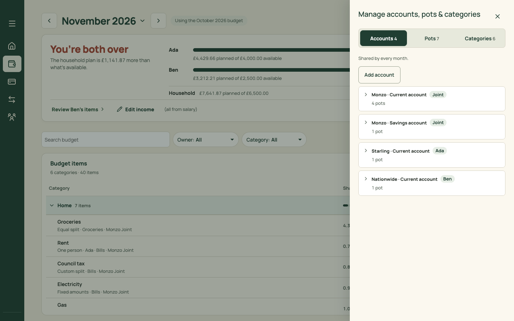
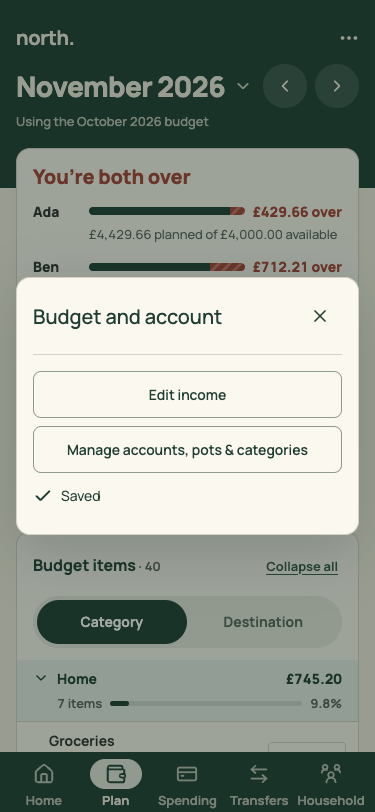
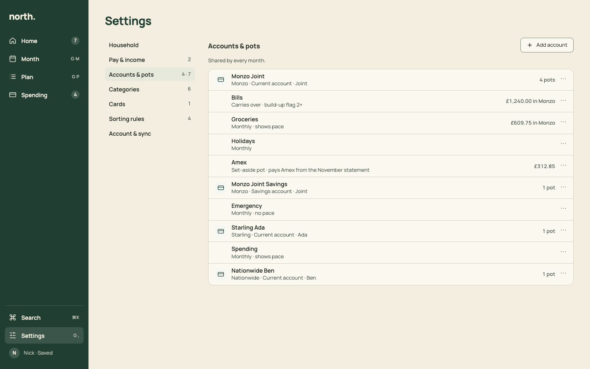

# PR 09 · Settings: pay & income, accounts & pots, categories (retire the Manage panel)

| | |
| --- | --- |
| **Suggested PR title** | `Audit 3 · 09: Settings for pay & income, accounts & pots, categories; retire the Manage side panel` |
| **Size** | M (≈600 lines, mostly re-hosting existing forms) |
| **Needs** | PR 08 merged |
| **Unblocks** | — |
| **Branch** | `audit3/09-settings-budget` |

## Goal

Move the budget's structure into Settings, so nothing configurable hides behind Plan's ⋯:
- income sources, with paydays and month-scoped amounts;
- accounts, and pots nested under their account, with the pot's spending settings shown as meta;
- categories.

Retire the right-hand **Manage accounts, pots & categories** side panel and the **Edit income** dialog as entry points. Plan's ⋯ and its "Edit income" link deep-link into Settings.

## Findings it fixes

- [F08 · Settings are in four places](../review.md#f08)
- [F12 · Five overlay types](../review.md#f12) (removes the side panel)

## Current behaviour

| Manage (side panel, Accounts tab) | Phone: Plan ⋯ |
| --- | --- |
|  |  |

- **`BudgetManagement.tsx`:** a side panel (`.budget-v3-overlay` / `.budget-v3-panel`) with ARIA tabs Accounts 4 · Pots 7 · Categories 6. Rows expand to an inline form. A pot's form has "Carries over from month to month", "Show pace…" and "Flag a build-up over (months' worth)". Pots are listed A–Z (`sortPotsForManage`), separately from accounts.
- **`IncomeDialog.tsx`:** a month-scoped dialog. It edits each source's amount for that month, with the scope "Changes apply: …". It sets paydays (day, and previous/next working day), which are shared by all months. "Add income source" reveals the add form.

## Target behaviour



### Pay & income (`section=income`)

- **Month context:** a `MonthTitle` at the top of the section, defaulting to the app's selected month (URL `month`). Income amounts change by month (`updateIncomeAtMonth`), so this keeps today's meaning. The scope line sits above save, exactly as in `IncomeDialog`.
- **Sources:** one `ListRow` per source.
  - **Title:** "Ada · Salary".
  - **Meta:** "£4,000.00 a month · paid on the 28th (or the working day before)".
  - **Trailing:** ⋯ with Edit and Remove.
- **Edit:** opens a `Sheet` holding today's per-source fields: amount for the month, type, and payday. The scope and impact preview come from `ImpactPreview`, as today.
- **Add:** "Add income source" opens the add form in a Sheet.
- **Empty:** `EmptyState` "No income yet", with the sentence "Add each person's pay so North can split the plan." and the action "Add income source".

### Accounts & pots (`section=accounts`)

- "Shared by every month." as the section's sentence. **Add account** (secondary) and **Add pot** (secondary) sit in the section aside.
- **List:** one card, ordered by owner (Joint, then each adult, then any needing an owner), as `orderTransferAccounts` / `accountOwnerGroups` do.
  - **Account rows:** an icon tile.
    - **Title:** the short name ("Monzo Joint").
    - **Meta:** "Monzo · Current account · Joint", or a "Needs owner" warning chip.
    - **Trailing:** "4 pots", then ⋯.
  - **Pot rows:** directly under their account, indented 56px with no icon.
    - **Title:** the pot name.
    - **Meta:** the settings in words ("Carries over · build-up flag 2×", "Monthly · shows pace", "Set-aside pot · pays Amex from the November statement").
    - **Trailing:** the worked-out balance "£609.75 in Monzo", when known (`potBalance`).
- **Edit:** opens today's account form (`AccountFields`) or pot form in a `Sheet`.
- **Remove:** confirms with today's dependency explanation.
- **Bulk pots:** today's multi-account "Add pot to several accounts" (`bulkPots`) stays, as a choice inside "Add pot".

### Categories (`section=categories`)

- One `ListRow` per category: title, meta "7 items in November", ⋯ with Rename and Remove. Remove confirms, with today's dependency rule.
- "Add category" in the section aside.

### Entry points

- **Plan's ⋯:** "Edit income" goes to `view=settings&section=income&month=<month>`. "Accounts, pots & categories" goes to `section=accounts`. "Go back to the … budget" stays.
- **Plan's figures row:** its "Edit income" link deep-links the same way.
- **Month's Pots:** a pot's page "⋯ › Pot settings" goes to `section=accounts` with that pot's editor open (`&edit=pot:<id>` is optional; if you skip it, just scroll to the row).
- **First-run Plan:** "Add income" goes to Settings' Pay & income. `SetupWizard` is unchanged.

### Retire

- Delete the side-panel shell from `BudgetManagement.tsx` (`.budget-v3-overlay`, `.budget-v3-panel`, `.budget-manage-panel`, the tabs). Keep its forms as components the Settings sections render.
- Delete `IncomeDialog`'s dialog shell, keeping its form logic.
- Remove both from `PlanPage` / `MonthlyBudget` state (`management`, `incomeOpen`, the options handoff).

## Files

- **Change:**
  - `src/pages/SettingsPage.tsx`
  - `src/pages/BudgetManagement.tsx` → `src/pages/settings/AccountsAndPots.tsx` and `Categories.tsx` (forms kept)
  - `src/pages/IncomeDialog.tsx` → `src/pages/settings/PayAndIncome.tsx` (form logic kept)
  - `src/pages/AccountFields.tsx`
  - `src/pages/PlanPage.tsx` (⋯ entries and the Edit income link only)
  - `src/pages/budget/BudgetPageHeader.tsx` (⋯ entries)
  - `src/styles.css` (delete the panel rules)
  - the Settings section of `docs/product-design-spec.md`
- **Move tests:** `BudgetManagement.test.tsx` and `IncomeDialog.test.tsx` move to the new components. Keep every assertion about scope, impact, dependencies and pot settings.
- **Reuse:** `ImpactPreview`, `budgetLabels` (`shortAccountLabels`, `accountOptionLabels`, `sortPotsForManage`), `bulkPots`, `potBalance`, `Sheet`, `ListRow`, `MonthTitle`.
- **Don't touch:** the domain (`monthlyBudget.ts` income and structure functions), `SetupWizard.tsx`, and Plan's table.

## Acceptance criteria

- [ ] Plan's ⋯ has no Manage panel or income dialog. Its entries open Settings at the right section and month, and Back returns to Plan.
- [ ] Pay & income: change Ada's salary for December. The scope line reads "Changes apply: December 2026 onwards" (or the range) before saving. After saving, Plan for December shows the new Available and November doesn't change.
- [ ] Paydays edit as they do today, and Home's "money arrives" line follows.
- [ ] Accounts & pots: pots appear under their account. Pot meta reflects carries over, pace and build-up. Editing a pot's settings changes Month's Pots (pace, carries over) as today.
- [ ] Removing an account or category that's in use explains the dependency and blocks or moves as today.
- [ ] Phone: each section is reached from the Settings list, and the editors open as bottom sheets.
- [ ] Empty: no income → the EmptyState with "Add income source". No accounts → "No accounts yet · Add account".
- [ ] Keyboard: every row's ⋯ is reachable, and Escape closes the editor and returns focus to the row.
- [ ] `npm run check` passes.

## How to check

```sh
node docs/audit-3/tools/capture.mjs settings-accounts "view=settings&section=accounts"
node docs/audit-3/tools/capture.mjs settings-income "view=settings&section=income&month=2026-12"
node docs/audit-3/tools/capture.mjs settings-categories "view=settings&section=categories"
node docs/audit-3/tools/capture.mjs plan "view=plan&month=2026-11"
```

On Plan, open ⋯ to check the new entries. Compare with `docs/audit-3/mockups/png/settings-desktop.png` and the before screenshots `docs/audit-3/screenshots/plan-manage-desktop.png` and `plan-options-phone.png`.

## Working in this repo

- **Run it:** `npm run dev -- --port 5174 --strictPort --mode localonly` (local storage, no sign-in). Seed by opening `http://localhost:5174/scripts/baseline-seed.html`. It loads `docs/fixtures/plan-transfers-baseline.json` (Ada and Ben, 40 items, an Amex card with October and November statements and an Amex pot) and lands on Plan for November 2026. Re-seed before each check. Figures like "19 days left" depend on today's date.
- **Screenshots:** `node docs/audit-3/tools/capture.mjs <name> "<query>"` writes phone (375×812) and desktop (1440×900) PNGs, viewport and full height, to `/tmp/north-shots`. Add `--width 1100` for in-between widths. Playwright isn't a dependency; see the script header.
- **Check:** `npm run check` (eslint, vitest, build) must pass. CI runs the same.
- **CI guards:** `src/styles.tokens.test.ts` (no raw colours, sizes or spacing outside `:root`; breakpoints 640/768/1100 only), `src/styles.contrast.test.ts`, `src/copy.vocabulary.test.ts` (retired words; the glossary is in `docs/product-design-spec.md`), `src/styles.views.test.ts`.
- **Tests:** jsdom has no `matchMedia`, so components render their phone presentation. Stub `window.matchMedia` with `matches: false` to test desktop.
- **Docs:** update your screen's section of `docs/product-design-spec.md`, and any rules doc whose behaviour changes. Never `git add -A docs`: untracked review notes live there.
- **Style:** match the surrounding code (some files are dense one-liners) and don't reformat code you aren't changing. Design rules: [plan.md §2.3](../plan.md#design-system).
- **Branch:** `audit3/NN-short-name` from a fresh `main`. One PR, squash-merged.
