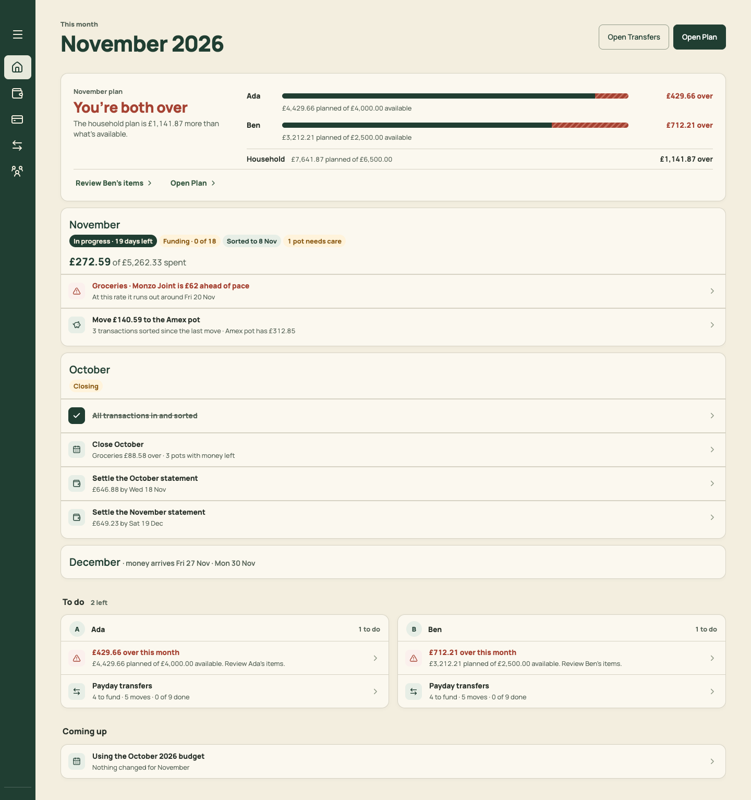
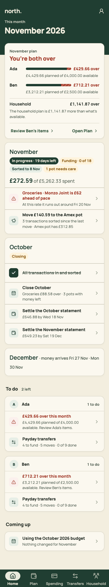
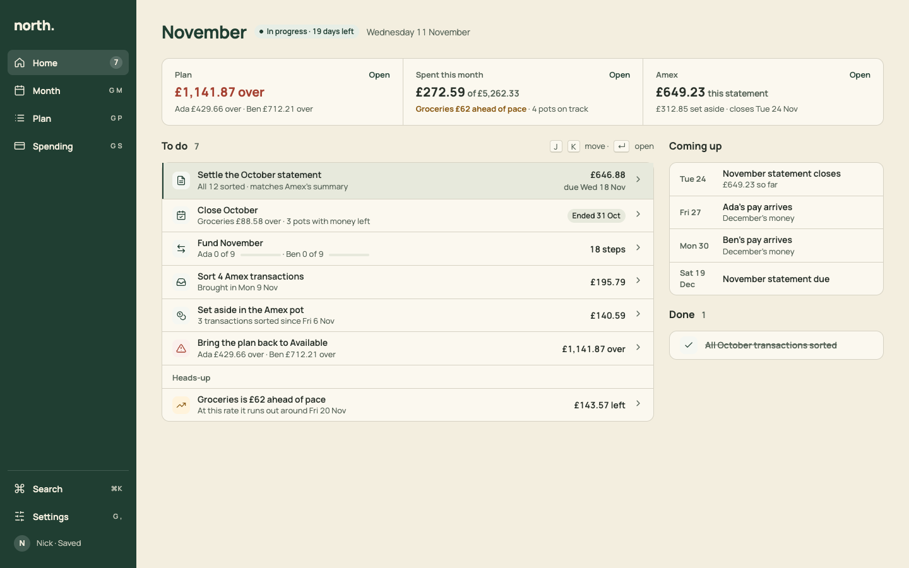
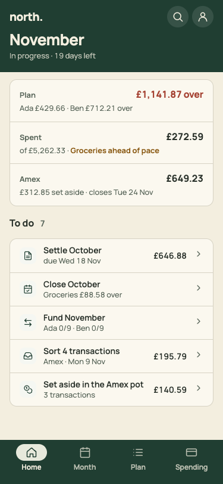

# PR 10 · Home: a status strip and one To do list

| | |
| --- | --- |
| **Suggested PR title** | `Audit 3 · 10: Home as an inbox — status strip, one To do list by date, Coming up` |
| **Size** | M (≈600 lines; half of it the pure `homeInbox` builder and its tests) |
| **Needs** | PR 02 (StatTile, ListRow, Section) and PR 06 (destinations, `navCounts`) merged. **Decision D7.** |
| **Unblocks** | 18, 20 |
| **Branch** | `audit3/10-home-inbox` |

## Goal

Make Home answer "where do we stand, and what do we do next?" in one screen at both sizes:
- a **three-figure strip** (Plan · Spent · Amex), each figure a link;
- **one To do list** holding every task type, ordered by when it matters, with heads-ups last;
- **Coming up** (dates) and **Done**.

The per-person cards, the month cards and the plan meter go.

## Findings it fixes

- [F01 · Home has two task systems, and its count is wrong](../review.md#f01)
- [F04 · Home fails the "in seconds" test](../review.md#f04)
- [F09 · The same status is restated on three to five screens](../review.md#f09) (Home part)

## Current behaviour

| Desktop · 1,496px | Phone · 2,014px |
| --- | --- |
|  |  |

Top to bottom, Home today has:
- **`AllocationMeter`:** "November plan · You're both over" with per-person bars.
- **`HomeMonths`:** month cards (November with chips and pace and move rows; the October checklist; December).
- **"To do · 2 left":** one card per adult (over-plan warning, Payday transfers).
- **"Coming up":** "Using the October 2026 budget · Nothing changed for November".

Tasks are built in two places:
- `src/domain/monthStages.ts` › `homeMonths()` returns `HomeTask` kinds `sorted | close | settle | bring-in | final-export | transfers | closes-soon | move`.
- `src/pages/Home.tsx` builds the per-person `Task`s (over-plan, payday transfers, changed since ticked, accounts that need review).

There's **no "Sort N transactions" task** for the current month, and the November statement's settle task appears under October before the statement has closed.

## Target behaviour

See [mockups/02-home.html](../mockups/02-home.html):

| Desktop | Phone |
| --- | --- |
|  |  |

### Data: `src/domain/homeInbox.ts` (pure, tested)

```ts
type InboxTask = { key: string; kind: 'settle' | 'close' | 'fund' | 'sort' | 'set-aside' | 'bring-in' | 'final-export' | 'over-plan' | 'review-accounts' | 'pace';
  title: string; meta: string; trailing?: string; trailingMeta?: string; tone?: 'warning' | 'critical'; due?: string /* yyyy-mm-dd */;
  target: HomeTarget /* where it opens */; progress?: { personId: string; done: number; total: number }[] }
type Upcoming = { date: string; title: string; meta?: string }
homeInbox(document, today): { strip: { plan: {...}; spent?: {...}; amex?: {...} }; todo: InboxTask[]; headsUp: InboxTask[]; comingUp: Upcoming[]; done: InboxTask[] }
```

Build it from `homeMonths()` (keep that function; `homeInbox` maps its tasks) plus what `Home.tsx` computes today. **Rules:**

| Kind | When it shows | Title / meta / trailing | Opens |
| --- | --- | --- | --- |
| `settle` | A statement has **closed**, is ready or needs action, and isn't settled | "Settle the October statement" / "All 12 sorted · matches Amex's summary" (or what's missing) / "£646.88", "due Wed 18 Nov" | Spending › that statement |
| `final-export` | Closed, waiting for the final export | "Bring in the final October export" / … | Spending › statement |
| `close` | The month has ended and isn't closed | "Close October" / "Groceries £88.58 over · 3 pots with money left" / chip "Ended 31 Oct" | Month `month=2026-10&close=1` |
| `fund` | The current month has unticked steps after its payday, or next month's payday is within 7 days, or its steps have started | "Fund November" / "Ada 0 of 9 · Ben 0 of 9" with mini meters, plus "1 changed since ticked" when relevant / "18 steps" | Month (Payday) |
| `sort` | Any transactions to sort (new kind) | "Sort 4 Amex transactions" / "Brought in Mon 9 Nov" / total | Spending › To sort |
| `set-aside` | From `move` | "Set aside in the Amex pot" / "3 transactions sorted since Fri 6 Nov" / "£140.59" | Spending › To sort (the Set aside block, PR 13; before that, the Move sheet) |
| `bring-in` | Last bring-in 3 or more days ago | "Bring in Amex transactions" / "Last done Mon 9 Nov" | Spending, with the Bring in sheet opened |
| `over-plan` | The household or anyone is over | "Bring the plan back to Available" / "Ada £429.66 over · Ben £712.21 over" / "£1,141.87 over" (critical) | Plan, reviewing the worst person (`northReviewPerson`) |
| `review-accounts` | Accounts need review (today's "Either of you" card) | "2 accounts need an owner" / names | Settings › Accounts & pots |
| `pace` (heads-up) | Pots needing care | "Groceries is £62 ahead of pace" / "At this rate it runs out around Fri 20 Nov" / "£143.57 left" (warning) | Month › that pot |

- **Order of `todo`:**
  1. Anything with a `due` date, ascending (settle and final-export by due date; close by the month's end; fund by payday).
  2. Then `sort`, `set-aside`, `bring-in`.
  3. Then `over-plan` and `review-accounts`.
- `headsUp` is the `pace` items. `done` is tasks whose `done` flag is true in `homeMonths()` for the current or previous month (e.g. "All October transactions sorted").
- `comingUp` lists, for the next 45 days:
  - statement close dates ("November statement closes · £649.23 so far");
  - each salary's next payday ("Ada's pay arrives · December's money", from `incomeSources[].payday` and `workingDays`);
  - due dates of statements not yet closed;
  - "December budget: new items" **only** if the next month has an explicit budget change. Drop "Nothing changed".
- A statement that hasn't closed never appears in `todo`; its close date goes in `comingUp`.

### UI: `src/pages/Home.tsx` (replace the content; delete `HomeMonths.tsx` once nothing imports it)

- **`PageHeader`:** the title is the month name ("November"), with a stage `StatusChip` ("In progress · 19 days left") and context "Wednesday 11 November". No actions, since Home's action is the first task. The `h1` reads "Home, November", with "Home, " visually hidden.
- **Strip:** a card with three `StatTile`s separated by vertical rules (desktop); on phones, three stacked rows (label left, value right, detail below).
  - **Plan:** value "£1,141.87 over" (critical), "£X left" or "Balanced". Detail "Ada £429.66 over · Ben £712.21 over" (or each person's left). Opens Plan.
  - **Spent this month:** value "£272.59", sub "of £5,262.33". Detail: the worst pace pot ("Groceries £62 ahead of pace") or "On track". Opens Month. Hidden without a card.
  - **Amex** (the card's name): value "£649.23 this statement". Detail "£312.85 set aside · closes Tue 24 Nov". Opens Spending. Hidden without a card.
- **Desktop ≥1100:** a two-column grid `1fr 340px`, 24px gap.
  - Left: `Section` "To do" with its count and an aside "J K move · ↵ open" (the keys arrive in PR 18; show the hint only once 18 has merged, behind a flag). Then a card of `ListRow`s, with a "Heads-up" group label before the pace rows.
  - Right: `Section` "Coming up" (rows with a 56px date column), then `Section` "Done" (rows struck through, muted).
- **Phone:** strip, then To do, then Coming up, then Done. Phone rows are 56px.
- **Sidebar count:** add `home: todo.length` to `src/state/navCounts.ts` (from PR 06).
- **Remove:** the AllocationMeter on Home, `HomeMonths`, the per-person To do cards, the "You're up to date for November" banner (an empty To do covers it, see below), and the Coming up card "Using the October 2026 budget · Nothing changed".
- **Empty To do:** `EmptyState` "Nothing to do" with the sentence "You're set for November. Next: Ada's pay arrives Fri 27 Nov." (the first `comingUp` item). No action.
- **First run** (no items): the strip shows only Plan, "Nothing planned for November yet", with To do containing "Plan November" (opens Plan). It must not say "Everyone's planned spending fits." (F21).
- The one-time "what moved" note from PR 06 stays above the strip.

## Files

- **Add:** `src/domain/homeInbox.ts` (+ `homeInbox.test.ts`).
- **Change:** `src/pages/Home.tsx` (+ `Home.test.tsx`), `src/state/navCounts.ts`, and the Home section of `docs/product-design-spec.md`.
- **Delete:** `src/pages/HomeMonths.tsx` and its CSS (`.home-*` rules no longer used; check with `grep`).
- **Reuse:** `homeMonths`, `closeMonthPlan`, `statementSummary`, `moveState`/`toMove`, `transactionsToSort`, `personProgress`, `budgetTransfers`, `personTransferPlans`, `formatMonth`, `workingDays`; `PageHeader`, `StatTile`, `ListRow`, `Section`, `StatusChip`, `Meter`, `EmptyState`.
- **Don't touch:** the domain rules for stages, settling or pace. Map their outputs; don't recompute them.

## Acceptance criteria

- [ ] Desktop 1440×900: the strip, all seven tasks and Coming up are visible without scrolling on the seed data. On phone, the strip and the first five tasks fit above the tab bar.
- [ ] The To do count equals the number of rows, heads-ups included: 7 on the seed (settle October, close October, fund November, sort 4, set aside £140.59, over plan, and the Groceries heads-up). The sidebar's Home count shows the same number.
- [ ] Order: "Settle the October statement" (due Wed 18 Nov) comes before "Close October", which comes before "Fund November".
- [ ] The November statement (open until 24 Nov) isn't in To do. "November statement closes Tue 24 Nov" is in Coming up.
- [ ] Each row opens the right place (table above), and Back returns to Home.
- [ ] Red appears only on "£1,141.87 over". No red or amber headline remains.
- [ ] Every task kind that `homeMonths()` can emit has a test proving it appears in `homeInbox` (sorted, close, settle, bring-in, final-export, transfers, closes-soon, move), plus over-plan, fund-with-changed, review-accounts and pace.
- [ ] Empty: with everything done, the EmptyState shows the next Coming up item. First run shows "Nothing planned for November yet" and no false "fits".
- [ ] Keyboard: Tab reaches the strip links, then each task row, in order. Enter opens.
- [ ] `npm run check` passes. Home.test is updated, with its scenarios kept.

## How to check

```sh
node docs/audit-3/tools/capture.mjs home "view=home&month=2026-11"
```

Compare with `docs/audit-3/mockups/png/home-desktop.png` and `home-phone.png`, and the before images `docs/audit-3/screenshots/home-desktop.png` and `home-phone.png`. For the empty and first-run states, edit `localStorage['north.budget.v3']` in devtools (clear `budget.snapshots`, or tick every step) and reload. Tests: `npm test -- homeInbox Home`.

## Working in this repo

- **Run it:** `npm run dev -- --port 5174 --strictPort --mode localonly` (local storage, no sign-in). Seed by opening `http://localhost:5174/scripts/baseline-seed.html`. It loads `docs/fixtures/plan-transfers-baseline.json` (Ada and Ben, 40 items, an Amex card with October and November statements and an Amex pot) and lands on Plan for November 2026. Re-seed before each check. Figures like "19 days left" depend on today's date.
- **Screenshots:** `node docs/audit-3/tools/capture.mjs <name> "<query>"` writes phone (375×812) and desktop (1440×900) PNGs, viewport and full height, to `/tmp/north-shots`. Add `--width 1100` for in-between widths. Playwright isn't a dependency; see the script header.
- **Check:** `npm run check` (eslint, vitest, build) must pass. CI runs the same.
- **CI guards:** `src/styles.tokens.test.ts` (no raw colours, sizes or spacing outside `:root`; breakpoints 640/768/1100 only), `src/styles.contrast.test.ts`, `src/copy.vocabulary.test.ts` (retired words; the glossary is in `docs/product-design-spec.md`), `src/styles.views.test.ts`.
- **Tests:** jsdom has no `matchMedia`, so components render their phone presentation. Stub `window.matchMedia` with `matches: false` to test desktop.
- **Docs:** update your screen's section of `docs/product-design-spec.md`, and any rules doc whose behaviour changes. Never `git add -A docs`: untracked review notes live there.
- **Style:** match the surrounding code (some files are dense one-liners) and don't reformat code you aren't changing. Design rules: [plan.md §2.3](../plan.md#design-system).
- **Branch:** `audit3/NN-short-name` from a fresh `main`. One PR, squash-merged.
