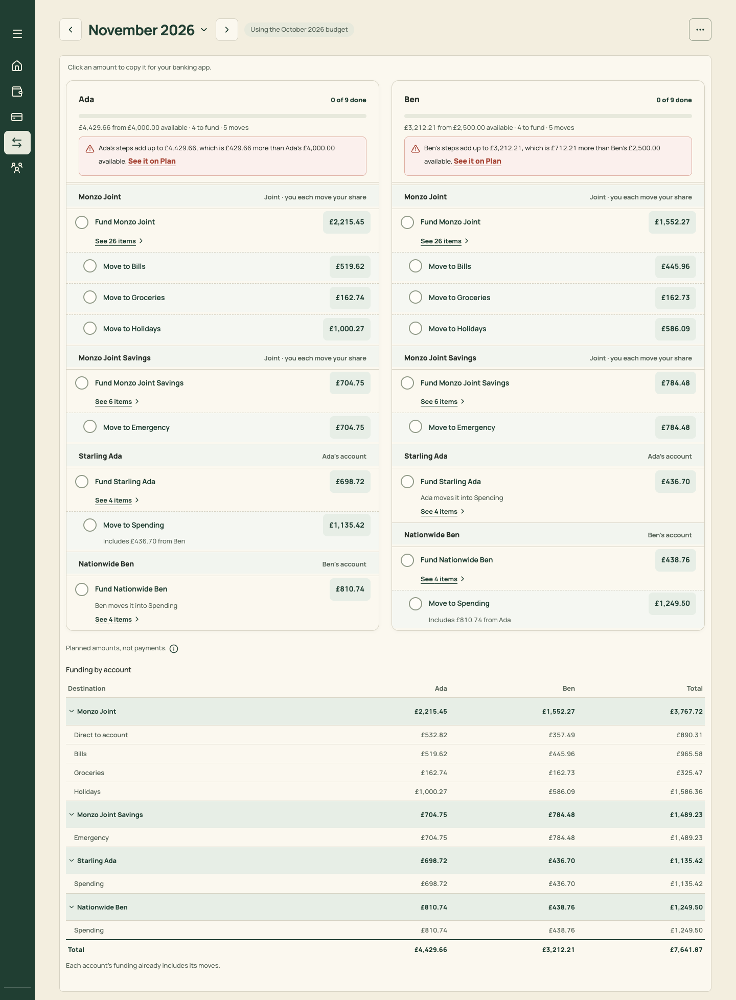
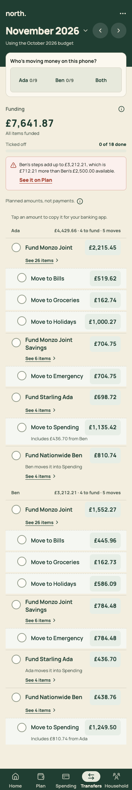
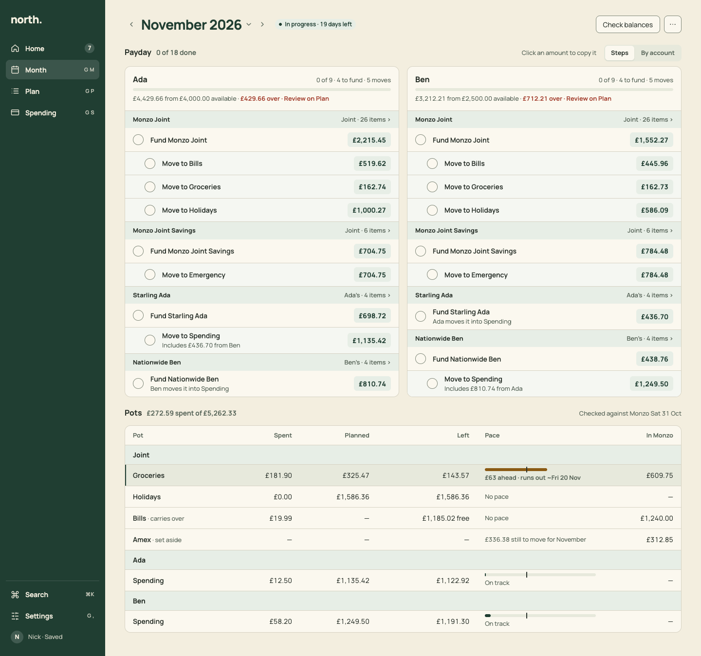
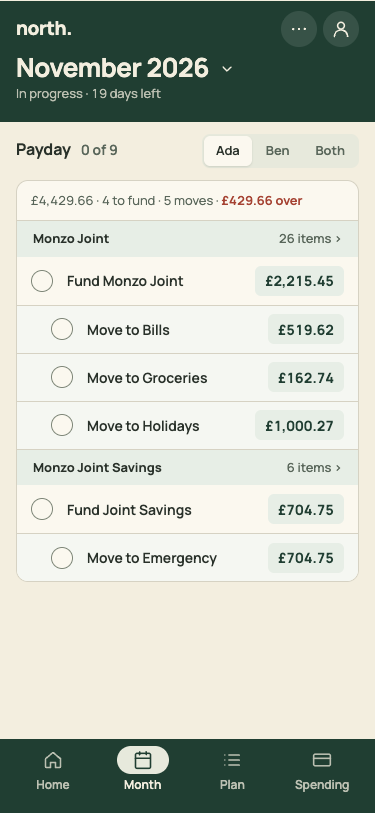

# PR 11 · Month: header and Payday section

| | |
| --- | --- |
| **Suggested PR title** | `Audit 3 · 11: Month header and Payday section (person columns, StepRows, By account, stage order)` |
| **Size** | M (≈550 lines) |
| **Needs** | PR 04 (StepRow) and PR 06 (MonthPage shell) merged. **Decision D2** (naming). |
| **Unblocks** | 12, 18, 22 |
| **Branch** | `audit3/11-month-payday` |

## Goal

Make Month's first job, **funding the month at payday**, quick and quiet:
- a stage-aware header;
- a **Payday** section with one column per person on desktop and a compact person switch on phones;
- account bands carrying the item count (no "See N items" under every step);
- each person's over-available warning as one line, not a red box;
- "By account" as a toggle instead of a table 700px below.

The page orders its sections by the month's stage. Finished payday folds to one line.

## Findings it fixes

- [F02 · The month's lifecycle is split across four screens](../review.md#f02) (Payday part)
- [F03 · "Move money and tick it" has four different UIs](../review.md#f03) (uses StepRow)
- [F14 · Alarm colour on headlines](../review.md#f14) (Transfers' red boxes)
- [F17 · Payday steps carry noise](../review.md#f17)

## Current behaviour

PR 06 hosts today's Transfers UI inside Month:

| Desktop · 1,950px | Phone · 2,225px |
| --- | --- |
|  |  |

- **Desktop:**
  - "Click an amount to copy it for your banking app." above everything.
  - Two person cards, each with a red bordered warning ("Ada's steps add up to £4,429.66, which is £429.66 more than Ada's £4,000.00 available. See it on Plan").
  - Account bands with "Joint · you each move your share".
  - "See 26 items ›" under every fund step.
  - "Planned amounts, not payments. ⓘ", then the Funding by account table.
- **Phone:**
  - "Who's moving money on this phone?" (110px).
  - The hero "Funding £7,641.87 · All items funded · Ticked off 0 of 18 done".
  - **Only the worst person's** warning, in Both.

## Target behaviour

See [mockups/04-month.html](../mockups/04-month.html):

| Desktop | Phone |
| --- | --- |
|  |  |

### Header (`src/pages/MonthPage.tsx`)

- `PageHeader`, title `MonthTitle` (‹ November 2026 ⌄ ›).
- **Chip:** the stage from `domain/monthStages`, "In progress · 19 days left" (positive). Before the 1st with steps started: "Funding · 3 of 18". After the month ends: "Closing · ended Sat 31 Oct" (warning). Then "Settled".
- **Actions:**
  - "Check balances" (secondary). It opens the existing `CheckBalancesSheet`.
  - ⋯ with "Funding by account" (phone only; on desktop it's the toggle), "How funding is worked out" (opens today's `TransferCalculationNotes` content in a Sheet), and "Plan for this month ↗".
  - **No primary** while the month is in progress. PR 12 adds "Close October" as primary for an ended month.

### Section order (stage logic, in `MonthPage`)

1. **Payday is expanded and first** if any step is unticked, or the month hasn't started (it's next month).
2. Otherwise **Pots** comes first, and Payday folds to a one-line `Section collapsed` row at the end: "Payday · 18 of 18 done · last ticked Fri 30 Oct ›". Expanding shows the steps.
3. For an ended, unclosed month, PR 12 puts Close first.

### Payday section

- **`Section`:** title "Payday", count "0 of 18 done".
  - **Aside (desktop):** a one-time hint "Click an amount to copy it" (hidden after the first copy, via `copyHint.ts`), then `Segmented` **Steps | By account**.
  - **Aside (phone):** `Segmented` **Ada 0/9 | Ben 0/9 | Both** in the section head, remembered per device (`state/transferPerson.ts`). The progress per option replaces today's switch labels.
- **Person columns (Steps, desktop ≥1100):** a grid of one card per person, 16px gap. Between 768 and 1099, the cards stack. Each card:
  - **Head:**
    - Line 1: name (16/700) left; "0 of 9 · 4 to fund · 5 moves" muted right.
    - A `Meter` of ticked/total.
    - Line 2 (13px muted): "£4,429.66 from £4,000.00 available".
    - When over, append " · **£429.66 over** · Review on Plan" ("£429.66 over" in `--critical` 600; "Review on Plan" a link that runs today's `onReviewPerson`). No bordered box.
    - Changed since ticked: " · 1 changed since ticked" (warning text).
  - **Body:** one `StepGroup` per account in today's order (`orderTransferAccounts`).
    - Band title: the short name ("Monzo Joint").
    - Band aside: the owner ("Joint", "Ada's"), then the items link "26 items ›". It runs today's `onSeeItems(accountId)` (Plan filtered, with Back to Month).
    - Rows: `StepRow` for the fund step, then `StepRow indent` for each pot move, with today's captions ("Includes £436.70 from Ben", "Ben moves it into Spending").
- **Phone (Both):** the two lists stack, each headed by the person line above. **Both** people's warnings show (fixes F17).
- **Needs-review accounts:** today's withheld list stays at the end of the section ("Not calculated" plus the reason).
- **Footnote** under the section, 13px muted: "Planned amounts, not payments." with the ⓘ. Keep it; it's the spec's standing caveat.
- **By account:** renders today's `TransferTable` (Funding by account) in place of the person columns. Keep its caption "Funding by account". The vocabulary test looks for it.
- **All ticked:** today's pine banner ("You're both up to date") is replaced by the folded section row. "Up to date" stays in Home's Done list (PR 10).

### Remove

- The phone hero (`MobileBudgetSummary` for Transfers: "Funding £7,641.87 / All items funded / Ticked off").
- The "Who's moving money on this phone?" prompt.
- The per-person red boxes.
- "See N items" under each step.
- The page-level copy hint line.
- `PaydaySteps`' desktop/phone forks, now that `StepGroup` covers both.

## Files

- **Change:** `src/pages/MonthPage.tsx`, `src/pages/PaydayPage.tsx` (from PR 05; it becomes `PaydaySection`), `src/pages/PaydaySteps.tsx`, `src/pages/TransfersPanel.tsx` (retire, or keep only the needs-review list), `src/pages/MobileBudgetViews.tsx` (remove `MobileBudgetSummary`'s transfers mode and the person prompt), `src/pages/TransferTable.tsx` (styling to tokens), the Month › Payday section of `docs/product-design-spec.md`, and `src/styles.css` (delete only).
- **Add:** `src/pages/month/PaydaySection.tsx` (+ css) if you prefer a new file.
- **Reuse:** `StepRow`/`StepGroup` (PR 04), `Section`, `Segmented` (or `Tabs` with a pill style), `Meter`, `StatusChip`, `MonthTitle`; `personTransferPlans`, `personProgress`, `setStepTick`, `transferPerson.ts`, `copyHint.ts`, `TransferCalculationNotes`.
- **Don't touch:** transfer maths (`budgetTransfers`, `transferInstructions`, `personTransfers`), tick keys, Plan, and the Pots part of Month (PR 12).

## Acceptance criteria

- [ ] Desktop 1440: the header, the Payday section heading and both people's first account band are above y≈260. Both columns align their bands. No red boxes.
- [ ] Phone: the first step is above y=300. The person switch is in the section heading and shows "0/9" progress. Both shows both people's over lines.
- [ ] Ticking, copying and changed-since-ticked behave as before (existing tests pass), and the section count and each person's meter update live.
- [ ] "26 items ›" opens Plan filtered to Monzo Joint, and "Back to Month" returns to the same band (`northStepsReturn`).
- [ ] "By account" shows the Funding by account table, with today's numbers. On phone it's in ⋯.
- [ ] With every step ticked, Payday folds to "Payday · 18 of 18 done · last ticked …" after Pots. Clicking it expands.
- [ ] Next month (`month=2026-12`) shows Payday first, with "Funding" or "money arrives" context in the chip.
- [ ] Empty: no items gives an `EmptyState` "Nothing to fund yet" with the sentence "Add items on the Plan and each person's payday steps appear here." and the action "Open Plan".
- [ ] Keyboard: Tab goes header → switch → steps (tick, amount) in order. <kbd>[</kbd>/<kbd>]</kbd> change month.
- [ ] `npm run check` passes. Port the Transfers tests in `MonthlyBudget.test.tsx` to Month.

## How to check

```sh
node docs/audit-3/tools/capture.mjs month "view=month&month=2026-11"
node docs/audit-3/tools/capture.mjs month-dec "view=month&month=2026-12"
node docs/audit-3/tools/capture.mjs month-1100 "view=month&month=2026-11" --desktop --width 1100
```

Compare with `docs/audit-3/mockups/png/month-desktop.png` (top half) and `month-phone.png`, and the before images `docs/audit-3/screenshots/transfers-desktop.png` and `transfers-phone.png`. For the folded state, tick all 18 steps by hand.

## Working in this repo

- **Run it:** `npm run dev -- --port 5174 --strictPort --mode localonly` (local storage, no sign-in). Seed by opening `http://localhost:5174/scripts/baseline-seed.html`. It loads `docs/fixtures/plan-transfers-baseline.json` (Ada and Ben, 40 items, an Amex card with October and November statements and an Amex pot) and lands on Plan for November 2026. Re-seed before each check. Figures like "19 days left" depend on today's date.
- **Screenshots:** `node docs/audit-3/tools/capture.mjs <name> "<query>"` writes phone (375×812) and desktop (1440×900) PNGs, viewport and full height, to `/tmp/north-shots`. Add `--width 1100` for in-between widths. Playwright isn't a dependency; see the script header.
- **Check:** `npm run check` (eslint, vitest, build) must pass. CI runs the same.
- **CI guards:** `src/styles.tokens.test.ts` (no raw colours, sizes or spacing outside `:root`; breakpoints 640/768/1100 only), `src/styles.contrast.test.ts`, `src/copy.vocabulary.test.ts` (retired words; the glossary is in `docs/product-design-spec.md`), `src/styles.views.test.ts`.
- **Tests:** jsdom has no `matchMedia`, so components render their phone presentation. Stub `window.matchMedia` with `matches: false` to test desktop.
- **Docs:** update your screen's section of `docs/product-design-spec.md`, and any rules doc whose behaviour changes. Never `git add -A docs`: untracked review notes live there.
- **Style:** match the surrounding code (some files are dense one-liners) and don't reformat code you aren't changing. Design rules: [plan.md §2.3](../plan.md#design-system).
- **Branch:** `audit3/NN-short-name` from a fresh `main`. One PR, squash-merged.
