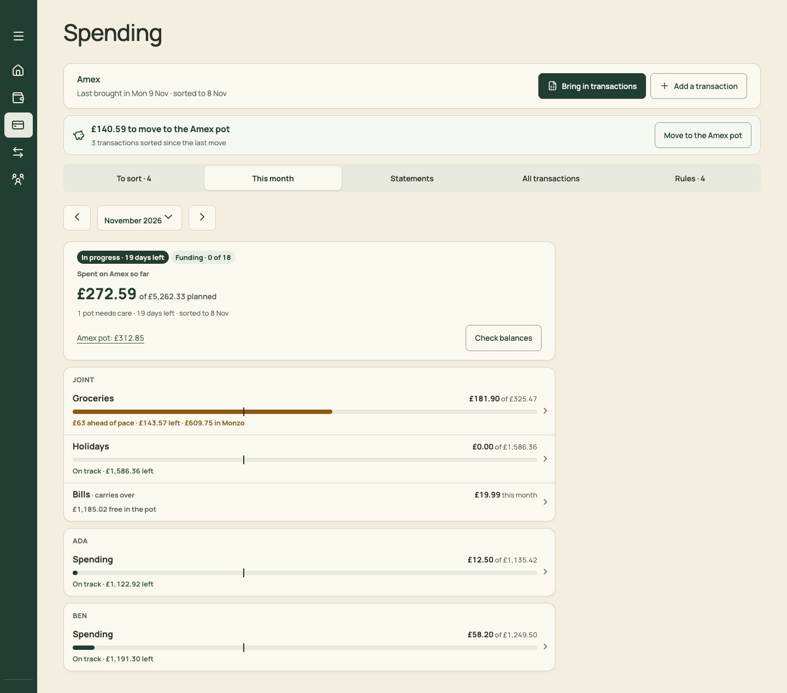
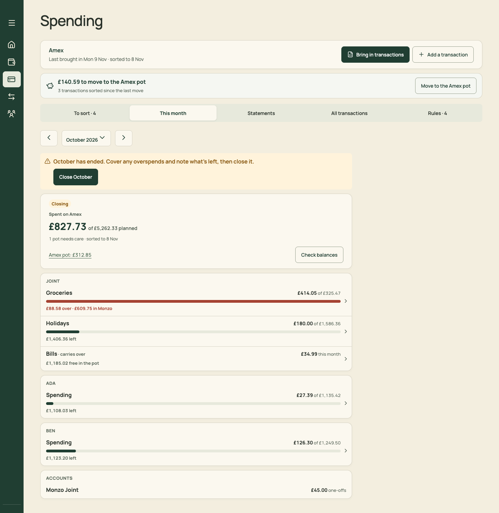
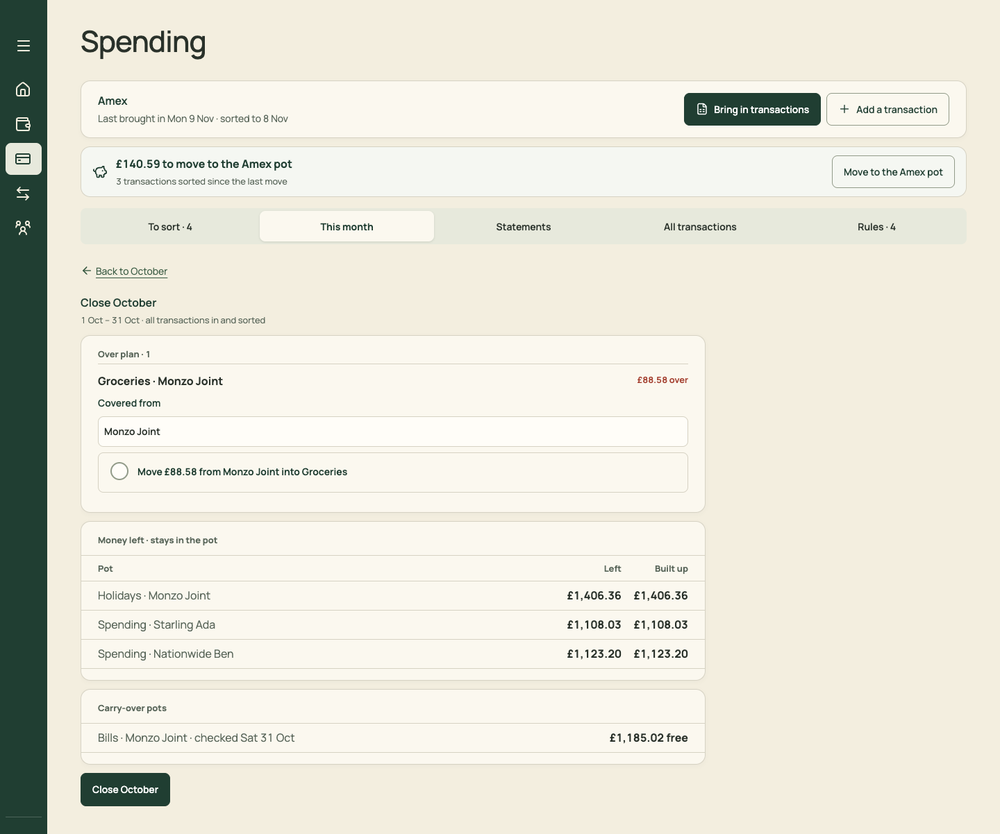
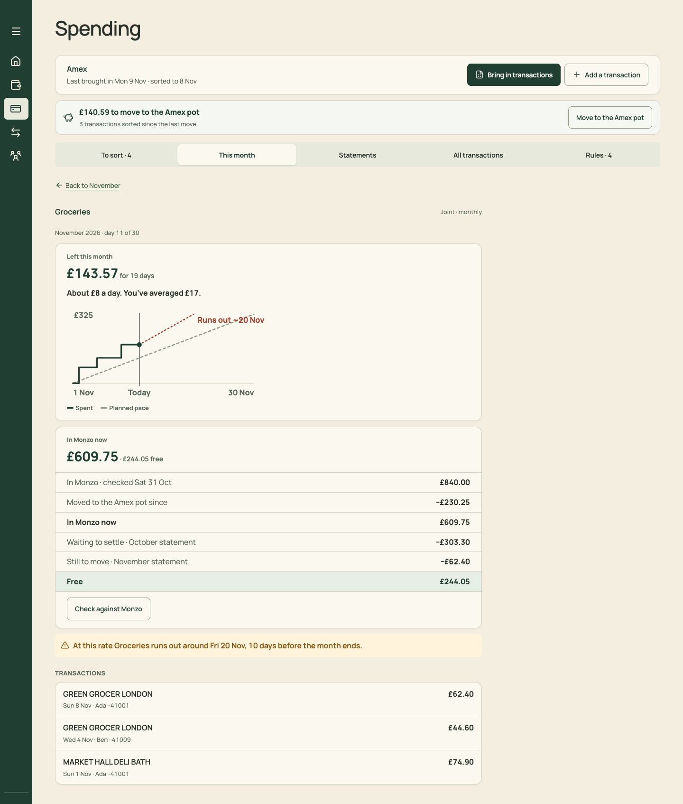
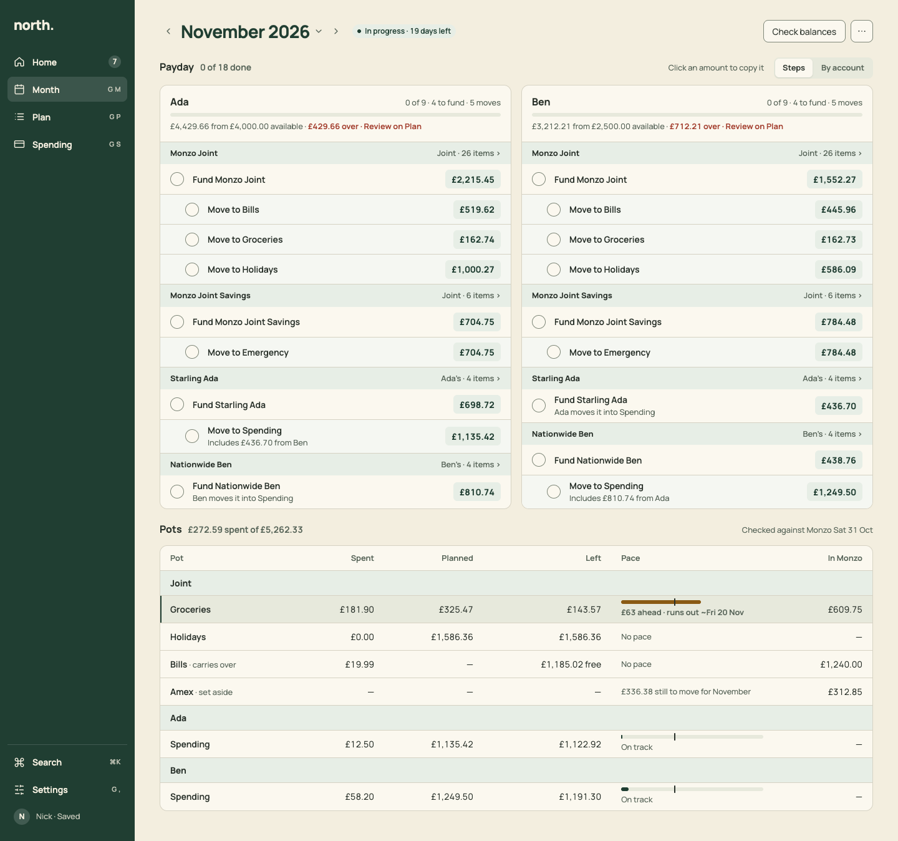
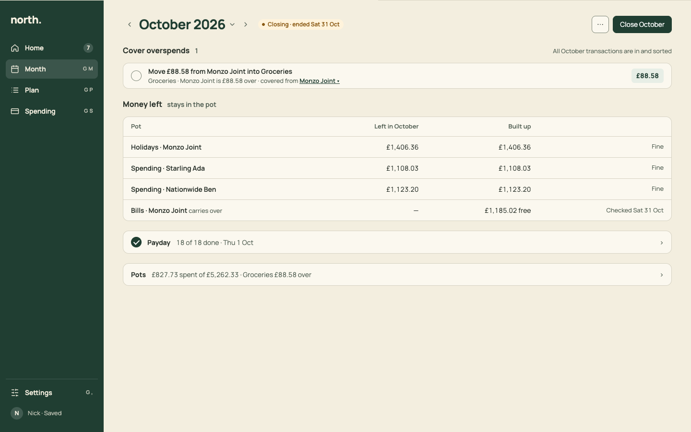

# PR 12 · Month: pots table, pot page, and Close inline

| | |
| --- | --- |
| **Suggested PR title** | `Audit 3 · 12: Month pots as one table, a calmer pot page, Close <Month> inline` |
| **Size** | M (≈600 lines) |
| **Needs** | PR 11 merged (same files) |
| **Unblocks** | 20 |
| **Branch** | `audit3/12-month-pots-close` |

## Goal

Finish Month:
- **Pots** become one aligned table on desktop (Spent · Planned · Left · Pace · In Monzo) and compact rows on phones.
- A **pot's page** leads with this month's question (what's left, and how fast) and folds the balance reconciliation.
- An **ended month's screen is the close checklist:** Close &lt;Month&gt; is inline at the top, with its button as the header's primary action, not a sub-page with the button at the bottom.

## Findings it fixes

- [F02 · The month's lifecycle is split across four screens](../review.md#f02) (Pots and Close part)
- [F13 · Competing primaries, with the key action at the bottom](../review.md#f13) (Close)
- [F20 · Desktop space is used inconsistently](../review.md#f20) (pots)
- [F26 · A pot's page mixes three measures](../review.md#f26)

## Current behaviour

| This month (hosted in Month by PR 06) | October (ended) | Close October | Groceries page |
| --- | --- | --- | --- |
|  |  |  |  |

- **`ThisMonthPanel`** (`SpendingMonth.tsx`) has:
  - its own month control (‹ November 2026 ⌄ › as three separate buttons);
  - a summary card ("In progress · 19 days left", "Funding · 0 of 18", "Spent on Amex so far £272.59 of £5,262.33 planned", "1 pot needs care · 19 days left · sorted to 8 Nov", "Amex pot: £312.85", Check balances);
  - then cards per owner (JOINT / ADA / BEN in capitals) with stacked bars. It's fixed at about 900px wide.
- **October** adds an amber banner, "October has ended. Cover any overspends and note what's left, then close it.", with Close October.
- **Close October** is a sub-page (`spendingClose`, Back to October): Over plan · 1 with a "Covered from" select and a bordered tick, a Money left table, Carry-over pots, and the **Close October** button at the end.
- **The pot page** (`PotDetail`) has:
  - "Left this month £143.57 for 19 days · About £8 a day. You've averaged £17.";
  - the chart, with "Runs out ~20 Nov";
  - "In Monzo now £609.75 · £244.05 free" and a six-line reconciliation;
  - an amber banner repeating the runs-out date;
  - TRANSACTIONS in capitals.

## Target behaviour

See [mockups/04-month.html](../mockups/04-month.html) (Pots in the lower half, and the October artboard):

| November, Pots | October, closing |
| --- | --- |
|  |  |

### Pots section (desktop ≥768)

- **`Section`:** title "Pots", count "£272.59 spent of £5,262.33", aside "Checked against Monzo Sat 31 Oct" (the oldest `checkedBalance` date; "Not checked yet" if none). Remove the month control (the header has it) and the summary card (Home's strip has it).
- **Table:** one card. Columns: **Pot** | **Spent** (num) | **Planned** (num) | **Left** (num) | **Pace** (260px) | **In Monzo** (num).
- **Band rows** use the grouping of `ThisMonthPanel`: "Joint", then each adult, then "Accounts" for one-offs. Sentence case, not capitals.
- **Row content:**
  - **Paced monthly pot:**
    - Pace cell: a `Meter` of spent/planned with the even-spending tick.
    - Status line under it: "On track", "£63 ahead · runs out ~Fri 20 Nov" (warning) or "£12.50 over · covered when November closes" (critical, amount only).
    - Left: "£143.57".
  - **Monthly pot without pace:** the Pace cell reads "No pace".
  - **Carry-over pot:** "Bills · carries over". Spent "£19.99", Planned "—", Left "£1,185.02 free", In Monzo "£1,240.00".
  - **Set-aside pot (Amex):** "Amex · set aside". Pace cell "£336.38 still to move for November" (from `setAside`), In Monzo "£312.85". It opens the Amex pot page.
  - **Account one-offs:** "Monzo Joint · one-offs", with Spent only.
  - **In Monzo:** the worked-out balance (`potBalance`), or "—".
- **Visibility:** the same rules as today (paced pots with a plan always; others once something is spent). Add a final quiet row, "3 more pots with nothing spent ›", that expands them.
- **Rows** are focusable and open the pot page (`pot=<id>`).

### Pots section (phone)

One card per group, with rows of 64px:
- Line 1: name left, "£143.57 left" right.
- Line 2: the `Meter`.
- Line 3: status in words, muted.

### Pot page (`pot=<id>`, `PotDetail` restyle)

- **`PageHeader`:**
  - Breadcrumb "Month › Groceries".
  - Title "Groceries", context "Joint · monthly · November 2026".
  - Actions: "Check against Monzo" (secondary) and ⋯ (Pot settings ↗ `view=settings&section=accounts`).
- **Lead card:**
  - "Left this month" 13/600 muted, then "£143.57" 28/700 with "for 19 days".
  - "About £8 a day · you've averaged £17" 14/400.
  - The pace chart (today's `PaceChart`, unchanged, with its accessible description).
  - **One** runs-out line under the chart, in warning: "At this rate it runs out around Fri 20 Nov, 10 days before the month ends." Remove the separate banner and the chart's red label.
- **`Section` "Balance":**
  - One line: "In Monzo £609.75 · £244.05 free · checked Sat 31 Oct".
  - A disclosure "How it's worked out" holds today's `BalanceSums` lines.
- **Carry-over pots** lead with "Free in the pot" as today, and keep "Annual costs from the Plan".
- **`Section` "Transactions"** (sentence case): `ListRow`s with merchant, "Sun 8 Nov · Ada ··41001", amount, and "on December statement" where it applies.
- **Amex pot page** (`SetAsidePot`):
  - Title "Amex pot", context "Pays the Amex from the November statement". Fixes "Amex · Pays Amex".
  - The balance line, then `Section` "Statements it pays" as `ListRow`s ("November statement · £312.85 moved in · £336.38 still to move · £649.23").

### Close (ended month, not closed)

- **Header:** chip "Closing · ended Sat 31 Oct". Primary action **"Close October"**, disabled with a reason in its `title` and an inline line while anything is waiting. Remove the amber banner.
- **Sections, in order, before Pots:**
  1. **Waiting** (only if not ready): today's readiness states as `ListRow`s with actions. "4 transactions to sort · Sort them" opens Spending › To sort. "Last brought in Mon 2 Nov. Late October transactions can take a few days to post." comes with "Bring in transactions" and "All October transactions are in".
  2. **"Cover overspends · 1":**
     - Each overspent pot as a `StepRow`: label "Move £88.58 from Monzo Joint into Groceries".
     - Caption "Groceries · Monzo Joint is £88.58 over · covered from **Monzo Joint ▾**". The "Covered from" choice becomes an inline menu button opening today's options ("Monzo Joint", "Holidays · £1,406.36 left", "November's Groceries (moves no money)"), so there's no bordered box or full-width select.
     - For a next-month cover, the caption adds "Leaves Groceries £88.58 short in November."
  3. **"Money left · stays in the pot":** today's table (Pot, Left, Built up), plus a fourth column for the build-up flag ("Move £100.00…" / "Keep it") where it applies.
  4. **"Carry-over pots":** rows with what's free.
- **After closing:** the chip becomes "To settle · closed Thu 3 Dec", and the sections fold to one-line rows. "Changed since closed: Groceries · Monzo Joint £500.00 → £511.80." shows as a warning line with "Close again" (secondary) in the header.
- The legacy `close=1` param scrolls to and focuses the Close section.

## Files

- **Change:**
  - `src/pages/MonthPage.tsx`
  - `src/pages/SpendingMonth.tsx` (`ThisMonthPanel` → `PotsSection`; `PotDetail`, `CarryOver`, `SetAsidePot`, `PotBalanceSection`, `BalanceSums`)
  - `src/pages/CloseMonth.tsx` (→ `CloseSection`, no own page chrome)
  - `src/pages/CheckBalancesSheet.tsx` (footer to Sheet `footer`)
  - the Month › Pots and Close sections of `docs/product-design-spec.md`
  - `src/styles.css` (delete only)
- **Reuse:** `closeMonthPlan`, `cardSpending`, `potBalance`, `setAside`, `monthStages`, `PaceChart`, `StepRow`, `Section`, `Meter`, `ListRow`, `Breadcrumb`, `StatusChip`.
- **Don't touch:** pace, cover or balance maths; the Payday section (PR 11); and Spending.

## Acceptance criteria

- [ ] Desktop November: Pots is one table, and Spent, Planned and Left line up across every pot. Groceries shows "£63 ahead · runs out ~Fri 20 Nov" in warning colour, and nothing else on the page is amber or red.
- [ ] Phone November: the first pot row is visible within the first screen, once Payday is folded or ticked.
- [ ] Pot page: one runs-out message. Balance is one line with a disclosure. The breadcrumb returns to Month at the same scroll position.
- [ ] Amex pot page: titled "Amex pot", with "Statements it pays" listing November with moved-in and still-to-move figures.
- [ ] October (`month=2026-10`): the header primary is Close October. Cover overspends comes first, with a StepRow and an inline "Covered from" menu. Money left and Carry-over follow, and Pots is last. Closing sets the chip to "To settle".
- [ ] A waiting state (make one by un-sorting an October transaction) disables Close October and shows "1 transaction to sort · Sort them".
- [ ] `close=1` from Home focuses the Close section.
- [ ] Empty: a month with nothing spent and no plan shows `EmptyState` "No pot spending yet" with the sentence "Bring in Amex transactions to see each pot against the plan." and the action "Open Spending".
- [ ] Keyboard: table rows are reachable and Enter opens a pot. The cover menu opens with Enter and Space.
- [ ] `npm run check` passes. Port the `Spending.test.tsx` cases for This month, pot detail, carry-over, set-aside and close to Month.

## How to check

```sh
node docs/audit-3/tools/capture.mjs month "view=month&month=2026-11"
node docs/audit-3/tools/capture.mjs month-oct "view=month&month=2026-10"
node docs/audit-3/tools/capture.mjs pot-groceries "view=month&month=2026-11&pot=groceries"
node docs/audit-3/tools/capture.mjs pot-bills "view=month&month=2026-11&pot=bills"
node docs/audit-3/tools/capture.mjs pot-amex "view=month&month=2026-11&pot=amex-pot"
```

Compare with `docs/audit-3/mockups/png/month-desktop.png` (lower half) and `month-close-desktop.png`, and the before images in `docs/audit-3/screenshots/` (`spending-month-*`, `close-october-desktop`, `pot-*`).

## Working in this repo

- **Run it:** `npm run dev -- --port 5174 --strictPort --mode localonly` (local storage, no sign-in). Seed by opening `http://localhost:5174/scripts/baseline-seed.html`. It loads `docs/fixtures/plan-transfers-baseline.json` (Ada and Ben, 40 items, an Amex card with October and November statements and an Amex pot) and lands on Plan for November 2026. Re-seed before each check. Figures like "19 days left" depend on today's date.
- **Screenshots:** `node docs/audit-3/tools/capture.mjs <name> "<query>"` writes phone (375×812) and desktop (1440×900) PNGs, viewport and full height, to `/tmp/north-shots`. Add `--width 1100` for in-between widths. Playwright isn't a dependency; see the script header.
- **Check:** `npm run check` (eslint, vitest, build) must pass. CI runs the same.
- **CI guards:** `src/styles.tokens.test.ts` (no raw colours, sizes or spacing outside `:root`; breakpoints 640/768/1100 only), `src/styles.contrast.test.ts`, `src/copy.vocabulary.test.ts` (retired words; the glossary is in `docs/product-design-spec.md`), `src/styles.views.test.ts`.
- **Tests:** jsdom has no `matchMedia`, so components render their phone presentation. Stub `window.matchMedia` with `matches: false` to test desktop.
- **Docs:** update your screen's section of `docs/product-design-spec.md`, and any rules doc whose behaviour changes. Never `git add -A docs`: untracked review notes live there.
- **Style:** match the surrounding code (some files are dense one-liners) and don't reformat code you aren't changing. Design rules: [plan.md §2.3](../plan.md#design-system).
- **Branch:** `audit3/NN-short-name` from a fresh `main`. One PR, squash-merged.
