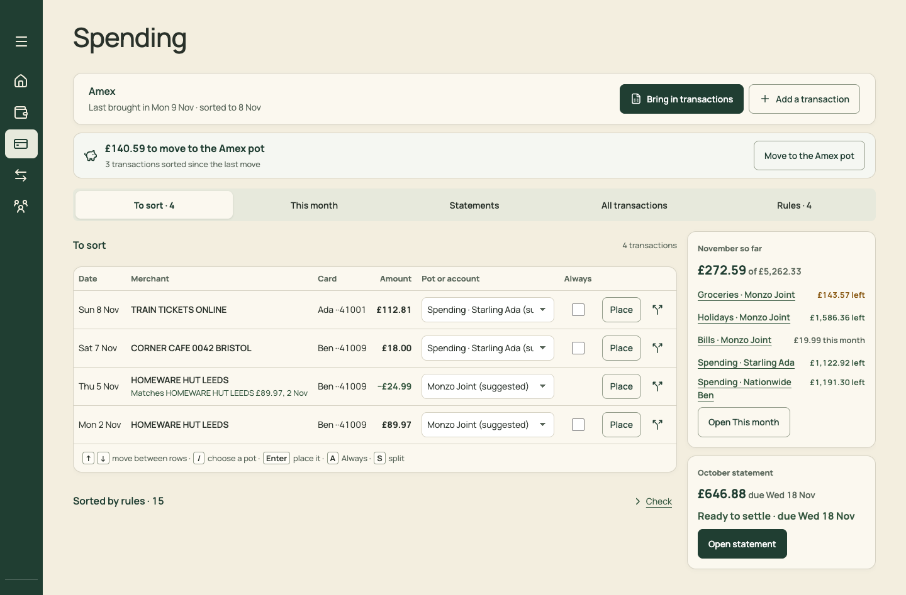
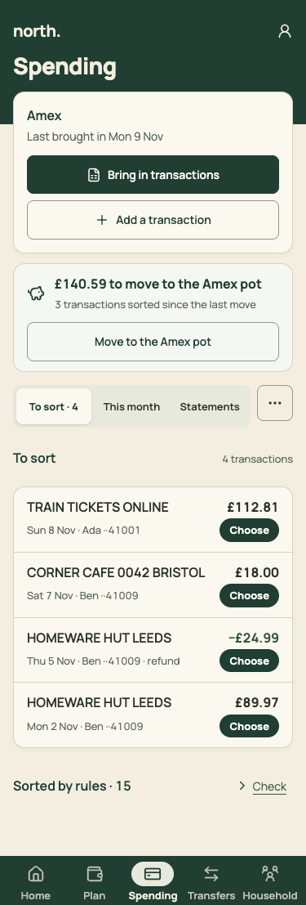
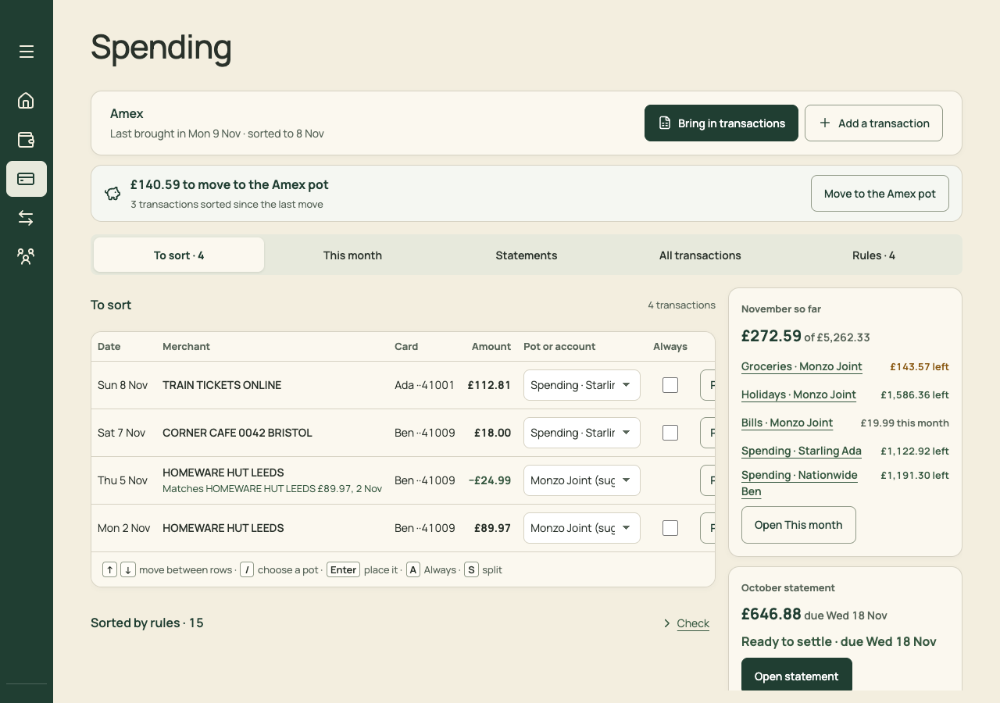
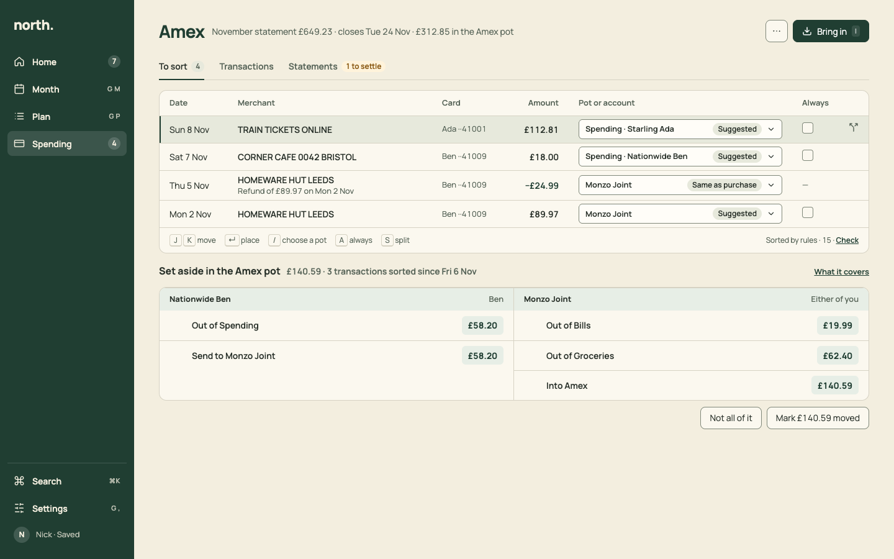
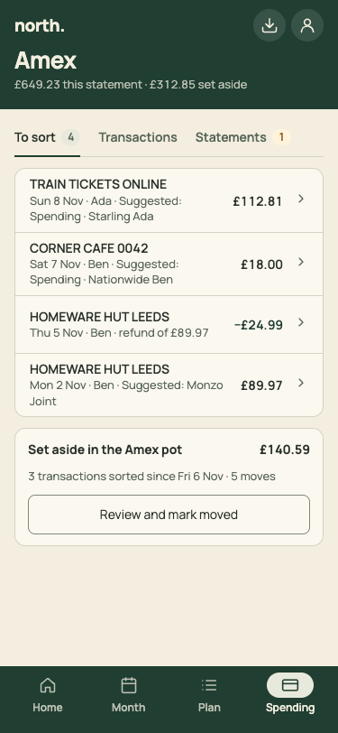

# PR 13 · Spending: one header, three tabs, Set aside after To sort

| | |
| --- | --- |
| **Suggested PR title** | `Audit 3 · 13: Spending — card header with one action, three tabs, Set aside after To sort, no rail` |
| **Size** | M (≈600 lines) |
| **Needs** | PR 04 (StepRow) and PR 06 (This month and Rules already moved out) merged. **Decisions D3, D12.** |
| **Unblocks** | 14, 15, 18 |
| **Branch** | `audit3/13-spending-shell` |

## Goal

Spending becomes the card's own workspace:
- **One header line:** the card name, its status, and one primary action (Bring in).
- **Three tabs:** To sort, Transactions, Statements.
- **Setting money aside** is the natural last step of sorting, under the To sort list, not a banner on every sub-page.
- **The right-hand rail goes,** which fixes the table clipping at 1100–1280px.
- **On phones,** rows are the tap target. No stacked "Choose" pills.

## Findings it fixes

- [F05 · Spending pins three blocks above every sub-page](../review.md#f05)
- [F13 · Competing primaries, with the key action at the bottom](../review.md#f13) (To sort)
- [F19 · The To sort table clips below 1440px](../review.md#f19)
- [F09 · The same status is restated](../review.md#f09) (Spending part)

## Current behaviour

| Desktop | Phone | 1280px |
| --- | --- | --- |
|  |  |  |

- **Above every section** (`Spending.tsx`):
  - an h1 "Spending" (42px);
  - the summary card: "Amex · Last brought in Mon 9 Nov · sorted to 8 Nov", plus **Bring in transactions** (filled) and **Add a transaction**;
  - the banner "£140.59 to move to the Amex pot · 3 transactions sorted since the last move", with **Move to the Amex pot**;
  - the five tabs (PR 06 leaves three: To sort, Statements, All transactions).
- **Desktop To sort:** a `SortTable` with a native select ("Spending · Starling Ada (su…"), Always, **Place** and Split per row, and the `SpendingSide` rail ("November so far", the October statement with **Open statement**, filled).
- **Phone:** each row has a filled **Choose** pill.

## Target behaviour

See [mockups/05-spending.html](../mockups/05-spending.html):

| Desktop | Phone |
| --- | --- |
|  |  |

### Header

- `PageHeader` title: the card's name ("Amex"). With more than one card, title "Spending", with a card switch in the context line (none exist today; keep it simple).
- **Context line:** "November statement £649.23 · closes Tue 24 Nov · £312.85 in the Amex pot". The statement-so-far comes from `statementSummary` for the open statement. The pot balance comes from `potBalance` and shows only with a set-aside pot. "Brought in Mon 9 Nov" moves to the To sort tab's aside.
- **Actions:**
  - ⋯ with "Add a transaction (N)", "Sorting rules ↗" (`view=settings&section=rules`) and "Card settings ↗" (`section=cards`).
  - **Primary: "Bring in"** (`I`), with an icon.
  - On phones the header shows a Bring in icon button (`aria-label="Bring in transactions"`) left of the account button.
- **Delete:** the `.spending-summary` card, the Amex pot banner (`MoveBanner` or its markup), the "Spending" h1, and `SpendingSide.tsx` with its CSS.

### Tabs

`Tabs` (PR 02):
- **To sort** (count);
- **Transactions** (the rename of All transactions; PR 15 redesigns it);
- **Statements**, with a warning badge "1 to settle" when any statement is ready and unsettled.

Phones show all three; there's no ⋯ "More Spending sections". Routing: `section=sort|transactions|statements` (PR 06).

### To sort (desktop)

- **`Section`:** "To sort · 4", aside "Brought in Mon 9 Nov · sorted to 8 Nov".
- **Table:** full width, since the rail has gone. Columns: Date (110) | Merchant | Card (110) | Amount (110, num) | **Pot or account (360)** | Always (70) | Split (44).
- **Pot cell:** keep `SortTable`'s select and its `/` behaviour. Remove "(suggested)" from the option text, and render a `StatusChip` "Suggested" (or "Same as purchase" for a refund) beside the select, inside the cell. The select takes the rest of the width (`min-width: 0; flex: 1`).
- **Placing:**
  - **Remove the Place column.** Enter places the focused row (as today).
  - For mouse users, the focused or hovered row shows a quiet icon button ✓ "Place" (`aria-label="Place TRAIN TICKETS ONLINE in Spending · Starling Ada"`) at the right of the pot cell.
  - Clicking a row's date or merchant focuses the row.
- **Footer:** keys as `Kbd` ("J K move · ↵ place · / choose a pot · A always · S split"). Add <kbd>J</kbd>/<kbd>K</kbd> as aliases for ↓/↑ in `SortTable`. Right side: "Sorted by rules · 15 · Check" (today's disclosure trigger).
- **Empty:** "Everything is sorted." (with transactions) or `EmptyState` "Nothing to sort" with the sentence "Bring in the Excel export from Amex to start." and the action "Bring in".

### To sort (phone)

- `ListRow`s of 64px:
  - **Title:** merchant.
  - **Meta:** "Sun 8 Nov · Ada · Suggested: Spending · Starling Ada" (or "refund of £89.97").
  - **Trailing:** amount, then a chevron.
- Tapping a row opens the existing `SortSheet` (a bottom sheet since PR 03). **No Choose pill.**

### Set aside block (both layouts)

- **When it shows:** after the To sort list, whenever `moveState`/`toMove` has anything to move. If nothing is left to sort, it moves to the top of the tab.
- **`Section`:** "Set aside in the Amex pot", count "£140.59 · 3 transactions sorted since Fri 6 Nov", aside link "What it covers".
- **Body:** a card with one `StepGroup` per account (desktop: side by side in a 2-column grid; phone: stacked). Each holds `StepRow mode="copy"` rows: "Out of Spending £58.20", "Send to Monzo Joint £58.20", "Out of Bills £19.99", "Out of Groceries £62.40", "Into Amex £140.59". These are exactly the moves `MoveToPotSheet` lists today.
- **Actions** (right-aligned, **secondary** buttons, because the header holds the primary):
  - "Not all of it" opens today's `MoveToPotSheet` checklist, so you can untick transactions not yet moved.
  - "Mark £140.59 moved" records the move as the sheet's "Moved £X" does today, then shows today's Undo, as a `Toast` with Undo.
- **Phone:** the block collapses to a card ("Set aside in the Amex pot · £140.59 · 3 transactions sorted since Fri 6 Nov · 5 moves") with one button, "Review and mark moved", which opens the sheet.
- "What it covers" opens the same sheet, read-only.

## Files

- **Change:** `src/pages/Spending.tsx`, `src/pages/SortTable.tsx`, `src/pages/MoveToPotSheet.tsx` (expose its move list for the block; keep the sheet), the Spending section of `docs/product-design-spec.md`, and `src/styles.css` (delete only).
- **Delete:** `src/pages/SpendingSide.tsx` and its CSS.
- **Reuse:** `PageHeader`, `Tabs`, `Section`, `ListRow`, `StatusChip`, `StepRow`/`StepGroup`, `Toast`, `Kbd`, `EmptyState`; `transactionsToSort`, `moveState`, `toMove`, `undoMove`, `statementSummary`, `potBalance`, `BringInSheet`, `ManualEntrySheet`, `SortSheet`, `SplitEditor`.
- **Don't touch:** sorting, rules, splits, refunds or import logic; `StatementsPanel` (PR 14); the All transactions list (PR 15 rebuilds it, so only rename the tab).

## Acceptance criteria

- [ ] Desktop 1440: the To sort table starts above y≈200. There's exactly one filled button on screen (Bring in). The pot select shows the full pot name, with a "Suggested" chip.
- [ ] At 1100 and 1280: no column is clipped and there's no horizontal scroll inside the table (capture at both widths).
- [ ] Enter places the focused row and focus moves to the next. J and K move. The ✓ icon places for mouse users.
- [ ] Phone: the first transaction is above y≈230. There are no Choose pills. Tapping a row opens the sort sheet as a bottom sheet.
- [ ] Set aside appears under To sort with five copyable moves. "Mark £140.59 moved" records it and offers Undo. "Not all of it" opens the checklist. The Home task and Statement figures update as before.
- [ ] Statements tab badge: "1 to settle" on the seed (the October statement).
- [ ] ⋯ reaches Add a transaction, Sorting rules (Settings) and Card settings (Settings). <kbd>I</kbd> opens Bring in, if PR 07 has merged.
- [ ] No card: today's "Add your card first" becomes `EmptyState` "Add your card first" with the action "Set up a card" (to `view=settings&section=cards`), at page width.
- [ ] `npm run check` passes. Update `Spending.test.tsx`: the summary-card assertions become header assertions, and "Choose" becomes row buttons.

## How to check

```sh
node docs/audit-3/tools/capture.mjs sort "view=spending&section=sort"
node docs/audit-3/tools/capture.mjs sort-1100 "view=spending&section=sort" --desktop --width 1100
node docs/audit-3/tools/capture.mjs sort-1280 "view=spending&section=sort" --desktop --width 1280
node docs/audit-3/tools/capture.mjs statements "view=spending&section=statements"
```

Compare with `docs/audit-3/mockups/png/spending-desktop.png` and `spending-phone.png`, and the before images `docs/audit-3/screenshots/spending-sort-{desktop,phone,1100,1280}.png`. Then walk Job 3 by hand: Bring in `docs/fixtures/amex-export-sample.xlsx` → Sort 7 (Enter ×7) → Mark moved. Target: 4 clicks plus Enter per row.

## Working in this repo

- **Run it:** `npm run dev -- --port 5174 --strictPort --mode localonly` (local storage, no sign-in). Seed by opening `http://localhost:5174/scripts/baseline-seed.html`. It loads `docs/fixtures/plan-transfers-baseline.json` (Ada and Ben, 40 items, an Amex card with October and November statements and an Amex pot) and lands on Plan for November 2026. Re-seed before each check. Figures like "19 days left" depend on today's date.
- **Screenshots:** `node docs/audit-3/tools/capture.mjs <name> "<query>"` writes phone (375×812) and desktop (1440×900) PNGs, viewport and full height, to `/tmp/north-shots`. Add `--width 1100` for in-between widths. Playwright isn't a dependency; see the script header.
- **Check:** `npm run check` (eslint, vitest, build) must pass. CI runs the same.
- **CI guards:** `src/styles.tokens.test.ts` (no raw colours, sizes or spacing outside `:root`; breakpoints 640/768/1100 only), `src/styles.contrast.test.ts`, `src/copy.vocabulary.test.ts` (retired words; the glossary is in `docs/product-design-spec.md`), `src/styles.views.test.ts`.
- **Tests:** jsdom has no `matchMedia`, so components render their phone presentation. Stub `window.matchMedia` with `matches: false` to test desktop.
- **Docs:** update your screen's section of `docs/product-design-spec.md`, and any rules doc whose behaviour changes. Never `git add -A docs`: untracked review notes live there.
- **Style:** match the surrounding code (some files are dense one-liners) and don't reformat code you aren't changing. Design rules: [plan.md §2.3](../plan.md#design-system).
- **Branch:** `audit3/NN-short-name` from a fresh `main`. One PR, squash-merged.
