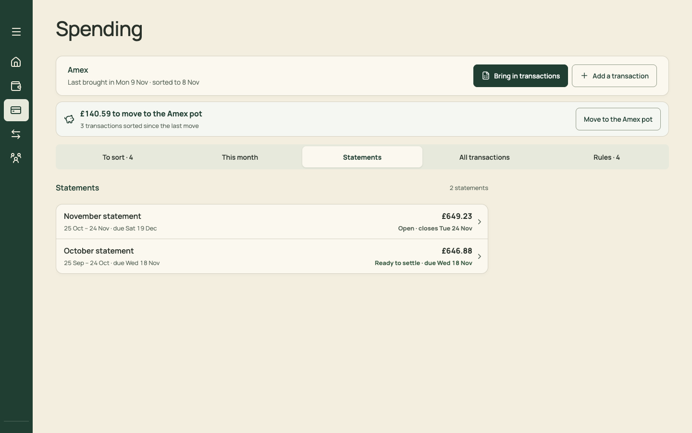
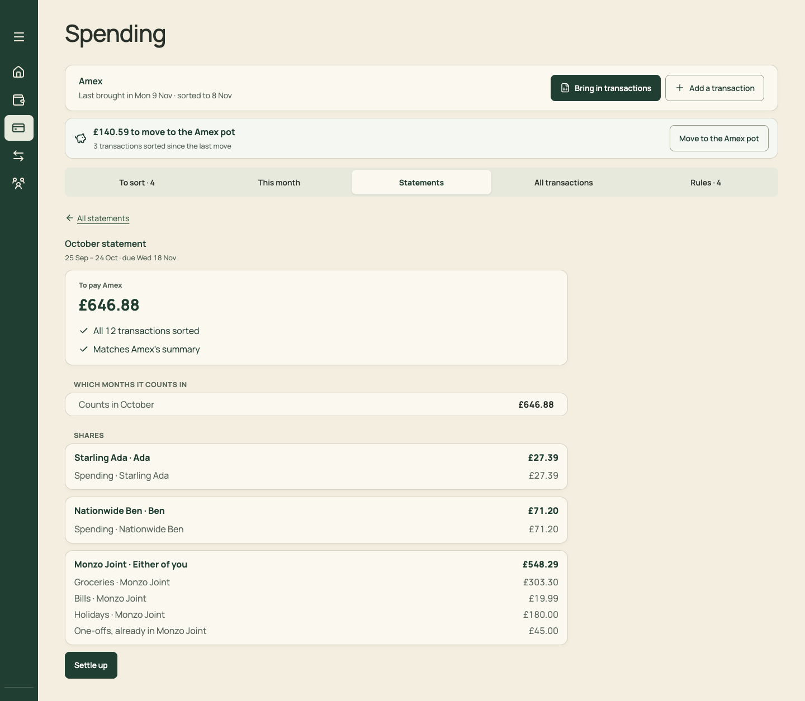
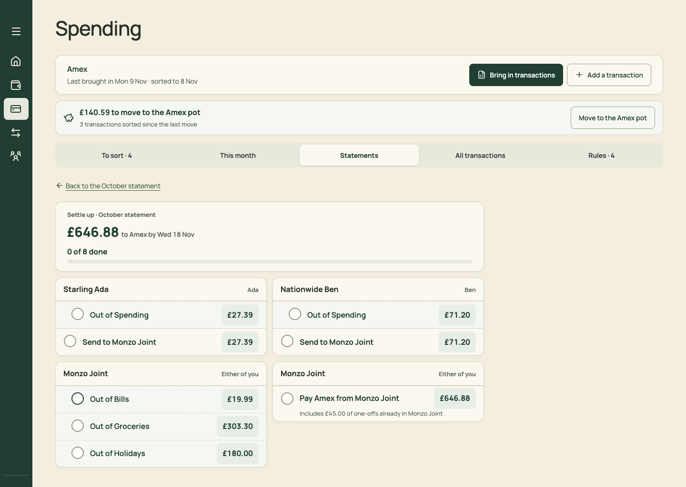
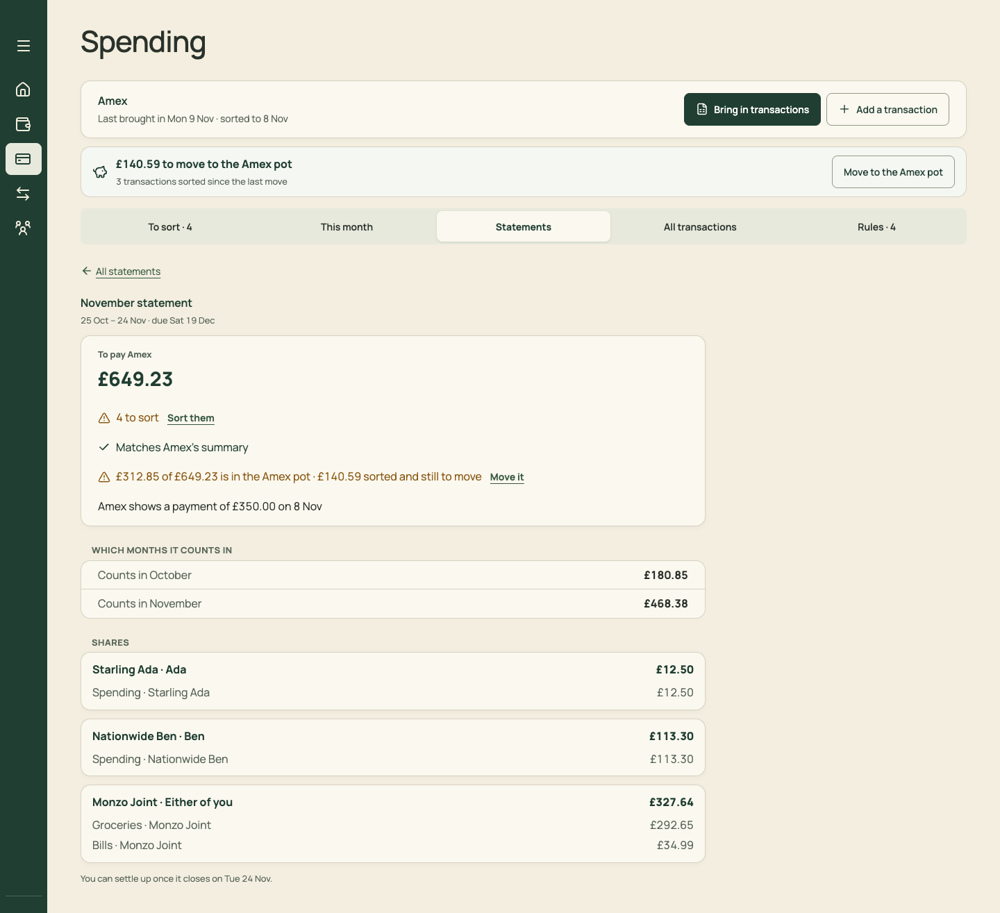
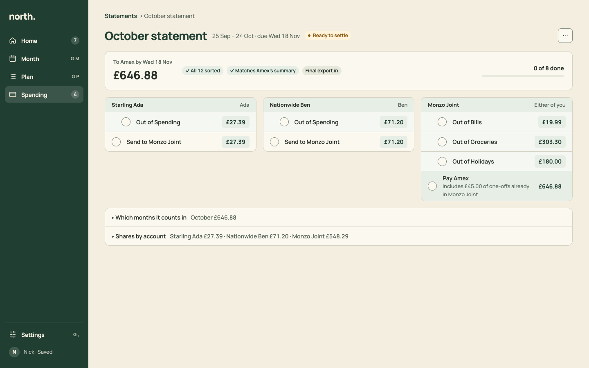

# PR 14 · A statement's page, led by Settle up

| | |
| --- | --- |
| **Suggested PR title** | `Audit 3 · 14: statement page leads with Settle up (steps inline, breakdown folded)` |
| **Size** | M (≈450 lines) |
| **Needs** | PR 13 merged |
| **Unblocks** | 20 |
| **Branch** | `audit3/14-statement-settle` |

## Goal

Paying the Amex should take one page, not two. A statement's page leads with:
- the amount and due date;
- its checks (sorted, matches the summary, final export);
- **the Settle up steps themselves**, in account columns, made of the same step rows as payday.

"Which months it counts in" and "Shares by account" fold underneath. The Statements list becomes calm `ListRow`s.

## Findings it fixes

- [F03 · "Move money and tick it" has four different UIs](../review.md#f03) (Settle up part)
- [F13 · Competing primaries, with the key action at the bottom](../review.md#f13) (Statement)

## Current behaviour

| Statements list | October statement | Settle up (a second page) | November statement (open) |
| --- | --- | --- | --- |
|  |  |  |  |

- **`StatementsPanel.tsx` › `StatementDetail`:**
  - "← All statements" (an underlined link), a small heading "October statement · 25 Sep – 24 Oct · due Wed 18 Nov";
  - a card "To pay Amex £646.88 · ✓ All 12 transactions sorted · ✓ Matches Amex's summary";
  - "WHICH MONTHS IT COUNTS IN" (capitals, a one-row card), then "SHARES" (three cards);
  - **Settle up** at the very bottom.
- **`SettleUp`:** a separate page ("← Back to the October statement"), with "Settle up · October statement £646.88 to Amex by Wed 18 Nov · 0 of 8 done" and account cards in a 2-column grid.
- **The open November statement** shows "4 to sort · Sort them", "£312.85 of £649.23 is in the Amex pot · £140.59 sorted and still to move · Move it", "Amex shows a payment of £350.00 on 8 Nov", and "You can settle up once it closes on Tue 24 Nov." at the bottom.

## Target behaviour

See [mockups/05-spending.html](../mockups/05-spending.html) (second artboard):



### Statements list (`section=statements`)

- **`Section`:** "Statements · 2".
- **Rows:** one `ListRow` per statement, newest first.
  - **Title:** "October statement".
  - **Meta:** "25 Sep – 24 Oct · due Wed 18 Nov".
  - **Trailing:** "£646.88".
  - **Trailing meta:** a `StatusChip` for its state. "Open · closes Tue 24 Nov" and "Settled Mon 23 Nov" are neutral. "Ready to settle" and "Needs the final export" are warning. "3 to sort" is warning. "4 of 10 done" is neutral.
- **Empty:** `EmptyState` "No statements yet" with the action "Bring in".

### Statement page (`statement=<key>`)

- **Header:** `Breadcrumb` "Statements › October statement" (Back returns to the list), then the in-tab heading as a `PageHeader`-styled block.
  - **Title:** "October statement".
  - **Context:** "25 Sep – 24 Oct · due Wed 18 Nov".
  - **Chip:** the state.
  - **⋯:** "Bring in the final export", "Settle without the final export" (when applicable).
- **Summary card** (one row on desktop, stacked on phones):
  - left: "To Amex by Wed 18 Nov" (13/600 muted) over "£646.88" (28/700);
  - middle: the checks as `StatusChip`s ("✓ All 12 sorted", "✓ Matches Amex's summary", "Final export in", or warning chips "4 to sort", "£12.34 of charges missing");
  - right: "0 of 8 done" with a `Meter` (only when settle steps exist).
- **When it isn't ready** (open, unsorted, or missing the final export):
  - Instead of steps, a `Section` "Before you can settle up" lists what it's waiting for as `ListRow`s with actions: "4 transactions to sort · Sort them" (To sort tab), "Closes Tue 24 Nov", and "Bring in the final export · Bring it in / Settle without it".
  - For a set-aside card, add "£312.85 of £649.23 is in the Amex pot · £140.59 sorted and still to move · Set aside" (opens To sort's Set aside block).
- **When it is ready**, the **Settle up steps** come inline, in account columns (desktop: three across, wrapping; phone: stacked). Each account is a `StepGroup`:
  - **Without a set-aside pot** (the October statement): today's `SettleUp` plan. Pot outs are `StepRow indent`, then "Send to Monzo Joint". The Monzo Joint group ends with **"Pay Amex" `emphasis="pay"`**, captioned "Includes £45.00 of one-offs already in Monzo Joint".
  - **With the Amex pot** (from the November statement): the groups for whatever is still to move into the pot, then "Pay Amex from the Amex pot". These are the same steps #141 computes. Only the presentation changes.
  - **Payment detected:** "Amex shows a payment of £350.00 on 8 Nov" becomes the Pay Amex row's caption, plus a "Tick Pay Amex" link when the amount matches.
- **All ticked:** the chip becomes "Settled Mon 23 Nov" and the steps fold into a `Section collapsed` row "Settle up · 8 of 8 done". Today's pine banner is removed.
- **Breakdown:** one card with two disclosures (closed by default):
  - "Which months it counts in", summary "October £646.88" (or "October £180.85 · November £468.38");
  - "Shares by account", summary "Starling Ada £27.39 · Nationwide Ben £71.20 · Monzo Joint £548.29". Expanded, it shows today's per-pot lines.
- **Remove:**
  - the separate `SettleUp` page and its "Back to the October statement";
  - the "Settle up" and "Sort 3 first" buttons (the page now shows either the steps or what it's waiting for);
  - "You can settle up once it closes on Tue 24 Nov." (the waiting list says it).

## Files

- **Change:** `src/pages/StatementsPanel.tsx` (`StatementDetail`, `SettleUp` merged in), the Spending › Statements section of `docs/product-design-spec.md`, and `src/styles.css` (delete only).
- **Reuse:** `StepRow`/`StepGroup`, `ListRow`, `StatusChip`, `Meter`, `Breadcrumb`, `Section`, `EmptyState`; `statementSummary`, `settlePlan` (or whatever `SettleUp` calls today), `setAside`, `transferTicks`.
- **Don't touch:** settle maths, tick keys (the StepRow test from PR 04 covers them), import, or the To sort tab.

## Acceptance criteria

- [ ] The October statement shows its steps on the same page as its total and checks. Ticking all 8 marks it settled (Home's settle task disappears, and the chip becomes "Settled").
- [ ] The November statement (open) shows "Before you can settle up" with "4 transactions to sort · Sort them", "Closes Tue 24 Nov" and the Amex pot line. There are no steps.
- [ ] With the Amex pot: after 24 Nov (test with a fixed `today`), the steps are "into the Amex pot" groups plus "Pay Amex from the Amex pot", matching #141's plan.
- [ ] The payment-detected line appears on the Pay Amex row, and "Tick Pay Amex" ticks it.
- [ ] Breakdown disclosures are closed by default, with today's figures inside.
- [ ] Phone: the first step is within the first screen, under the summary card.
- [ ] Keyboard: Tab order is breadcrumb → ⋯ → steps (tick, amount) → disclosures. The breadcrumb returns focus to the statement's row in the list.
- [ ] `npm run check` passes. Update `Spending.test.tsx`'s statement and settle-up tests (two pages become one).

## How to check

```sh
node docs/audit-3/tools/capture.mjs statements "view=spending&section=statements"
node docs/audit-3/tools/capture.mjs statement-oct "view=spending&section=statements&statement=amex:2026-10-24"
node docs/audit-3/tools/capture.mjs statement-nov "view=spending&section=statements&statement=amex:2026-11-24"
```

Compare with `docs/audit-3/mockups/png/statement-desktop.png`, and the before images `docs/audit-3/screenshots/{spending-statements-desktop,statement-oct-desktop,settle-up-desktop,statement-nov-desktop,statement-oct-phone}.png`.

## Working in this repo

- **Run it:** `npm run dev -- --port 5174 --strictPort --mode localonly` (local storage, no sign-in). Seed by opening `http://localhost:5174/scripts/baseline-seed.html`. It loads `docs/fixtures/plan-transfers-baseline.json` (Ada and Ben, 40 items, an Amex card with October and November statements and an Amex pot) and lands on Plan for November 2026. Re-seed before each check. Figures like "19 days left" depend on today's date.
- **Screenshots:** `node docs/audit-3/tools/capture.mjs <name> "<query>"` writes phone (375×812) and desktop (1440×900) PNGs, viewport and full height, to `/tmp/north-shots`. Add `--width 1100` for in-between widths. Playwright isn't a dependency; see the script header.
- **Check:** `npm run check` (eslint, vitest, build) must pass. CI runs the same.
- **CI guards:** `src/styles.tokens.test.ts` (no raw colours, sizes or spacing outside `:root`; breakpoints 640/768/1100 only), `src/styles.contrast.test.ts`, `src/copy.vocabulary.test.ts` (retired words; the glossary is in `docs/product-design-spec.md`), `src/styles.views.test.ts`.
- **Tests:** jsdom has no `matchMedia`, so components render their phone presentation. Stub `window.matchMedia` with `matches: false` to test desktop.
- **Docs:** update your screen's section of `docs/product-design-spec.md`, and any rules doc whose behaviour changes. Never `git add -A docs`: untracked review notes live there.
- **Style:** match the surrounding code (some files are dense one-liners) and don't reformat code you aren't changing. Design rules: [plan.md §2.3](../plan.md#design-system).
- **Branch:** `audit3/NN-short-name` from a fresh `main`. One PR, squash-merged.
