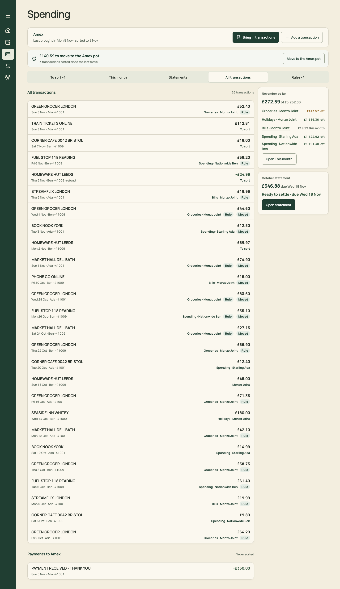

# PR 15 · Transactions: a table with search, filters and month groups

| | |
| --- | --- |
| **Suggested PR title** | `Audit 3 · 15: Transactions tab — searchable, filterable table grouped by month` |
| **Size** | M (≈450 lines) |
| **Needs** | PR 13 merged (the tab exists and is named) |
| **Unblocks** | 20 |
| **Branch** | `audit3/15-transactions-table` |

## Goal

Make every Amex transaction findable in seconds. A desktop table matches To sort's: Date, Merchant, Card, Amount, Pot or account, Tags. It's grouped by month, with search (`/`) and one Filter menu (pot or account, person, statement, To sort only). On phones it's a searchable list grouped by month. Any row can be re-sorted.

## Findings it fixes

- [F20 · Desktop space is used inconsistently, and lists that should be tables aren't](../review.md#f20) (transactions)

## Current behaviour



"All transactions" in `Spending.tsx` is a 26-row card list at about 770px wide, beside the rail:
- each row: merchant / "Sun 8 Nov · Ada ··41001" left, amount and "Groceries · Monzo Joint [Rule] [Moved]" right;
- no search, no filter, no month headings;
- "Payments to Amex · Never sorted" at the end.

On phones it's under ⋯ "More Spending sections" (PR 13 makes it a tab).

## Target behaviour

The same visual language as To sort in [mockups/05-spending.html](../mockups/05-spending.html), and the design system's table rules ([mockups/png/design-system.png](../mockups/png/design-system.png)).

### Desktop (`section=transactions`)

- **Toolbar:** `SearchField` ("Search transactions", `data-shortcut="search"`, `/` hint), `FilterMenu` (the Filter button opens a menu with these groups), a muted count on the right ("26 transactions · £1,450.64"), and a "Clear" link when anything is active.
  - **Pot or account:** a multi-select, grouped as in the sort sheet's "All pots and accounts".
  - **Person:** Ada, Ben.
  - **Statement:** October, November.
  - **Status:** To sort, Sorted by rule, Moved to the Amex pot, Split, Refund.
  - **Active filters** show as removable chips under the toolbar ("Groceries · Monzo Joint ×").
- **Table:** one card. Columns: Date (110) | Merchant | Card (110) | Amount (110, num) | Pot or account | Tags (160).
  - **Band rows by transaction month:** "November 2026 · 14 transactions · £…".
  - **Merchant cell:** the description. A refund or purchase link goes under it as meta ("Refund of COSTCO £186.40 · 24 Oct" / "Refunded −£14.99 · 6 Nov").
  - **Pot cell:** the destination name, "To sort" (warning chip) or "Split · 2 pots".
  - **Split rows:** the lines appear beneath as indented sub-rows ("Spending · Starling Ada · Kettle £34.99").
  - **Tags:** `StatusChip`s Rule, Moved, Refund.
- **Row interaction:** click or Enter opens the existing `SortSheet` for that transaction (re-sort, "Move back to To sort", split). Rows are focusable.
- **Payments:** a final band "Payments to Amex · never sorted", collapsed by default, with today's rows.
- **Search** matches description, pot or account name, card ending and person name, and amount text ("62.40"). It filters within the active filters.
- **No matches:** `EmptyState` "No transactions match "groc" with these filters" with the action "Clear filters".
- **None at all:** `EmptyState` "Nothing brought in yet" with the action "Bring in".

### Phone

- Search field, then a Filter icon button (opens the same filters in a Sheet).
- Month section headings ("November 2026"), then `ListRow`s:
  - **Title:** merchant.
  - **Meta:** "Sun 8 Nov · Ada · Groceries · Monzo Joint".
  - **Trailing:** amount, with the tags as small chips under it.
- Tapping a row opens the sort sheet.

## Files

- **Add:** `src/pages/TransactionsTable.tsx` (+ css) and `src/pages/transactionFilters.ts` (pure filter and search, tested).
- **Change:** `src/pages/Spending.tsx` (the transactions tab body only), the Spending › Transactions section of `docs/product-design-spec.md`, and `src/styles.css` (delete the old list rules if nothing else uses `.spending-list`; To sort's rules-check list may still use it).
- **Reuse:** `allTransactions`, `payments`, `refundsOf`, `splitLabel`, `destinationNamer`, `transactionMeta`, `SortSheet`, `Toolbar`/`SearchField`/`FilterMenu` (PR 02; if `FilterMenu` doesn't exist yet, build it here in `components/ui/` for Plan to reuse in PR 16), `StatusChip`, `EmptyState`, `ListRow`.
- **Don't touch:** sorting, splits, refunds or rules; To sort; Statements.

## Acceptance criteria

- [ ] Desktop: 26 transactions in two month bands, with columns aligned. Payments are collapsed at the end.
- [ ] `/` focuses search. Typing "green" leaves the 8 GREEN GROCER rows, and the count updates.
- [ ] Filtering by "Groceries · Monzo Joint" and "Ben" leaves only Ben's grocery rows, and the chips show. Clear resets.
- [ ] Clicking a row opens the sort sheet. Re-sorting changes the row's pot cell and the Home and Month figures.
- [ ] Split and refund rows show their lines and links.
- [ ] Phone: a list grouped by month, with search, and filters in a Sheet.
- [ ] Empty states as above.
- [ ] Keyboard: Tab to the table, then ↑/↓ (and J/K once PR 18 lands) and Enter.
- [ ] `npm run check` passes. Add `transactionFilters.test.ts` (search fields, filter combinations, month grouping).

## How to check

```sh
node docs/audit-3/tools/capture.mjs transactions "view=spending&section=transactions"
```

Compare with the before image `docs/audit-3/screenshots/spending-all-desktop.png`, and with To sort's table in `docs/audit-3/mockups/png/spending-desktop.png` for visual consistency.

## Working in this repo

- **Run it:** `npm run dev -- --port 5174 --strictPort --mode localonly` (local storage, no sign-in). Seed by opening `http://localhost:5174/scripts/baseline-seed.html`. It loads `docs/fixtures/plan-transfers-baseline.json` (Ada and Ben, 40 items, an Amex card with October and November statements and an Amex pot) and lands on Plan for November 2026. Re-seed before each check. Figures like "19 days left" depend on today's date.
- **Screenshots:** `node docs/audit-3/tools/capture.mjs <name> "<query>"` writes phone (375×812) and desktop (1440×900) PNGs, viewport and full height, to `/tmp/north-shots`. Add `--width 1100` for in-between widths. Playwright isn't a dependency; see the script header.
- **Check:** `npm run check` (eslint, vitest, build) must pass. CI runs the same.
- **CI guards:** `src/styles.tokens.test.ts` (no raw colours, sizes or spacing outside `:root`; breakpoints 640/768/1100 only), `src/styles.contrast.test.ts`, `src/copy.vocabulary.test.ts` (retired words; the glossary is in `docs/product-design-spec.md`), `src/styles.views.test.ts`.
- **Tests:** jsdom has no `matchMedia`, so components render their phone presentation. Stub `window.matchMedia` with `matches: false` to test desktop.
- **Docs:** update your screen's section of `docs/product-design-spec.md`, and any rules doc whose behaviour changes. Never `git add -A docs`: untracked review notes live there.
- **Style:** match the surrounding code (some files are dense one-liners) and don't reformat code you aren't changing. Design rules: [plan.md §2.3](../plan.md#design-system).
- **Branch:** `audit3/NN-short-name` from a fresh `main`. One PR, squash-merged.
