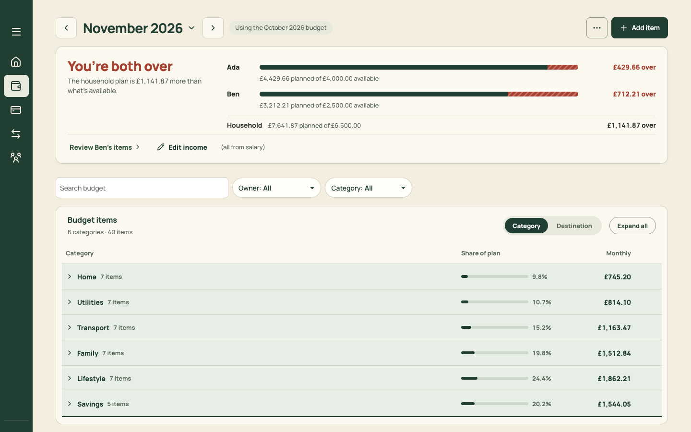
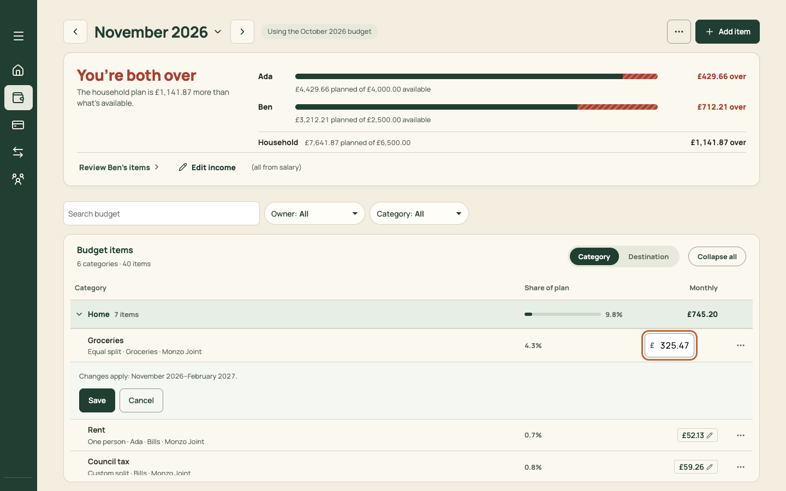
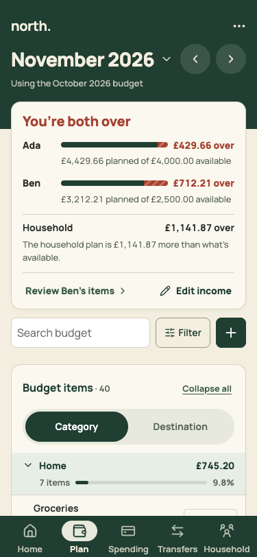
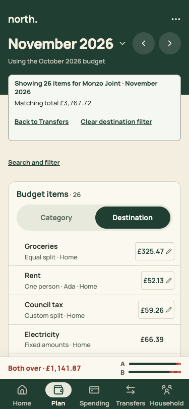
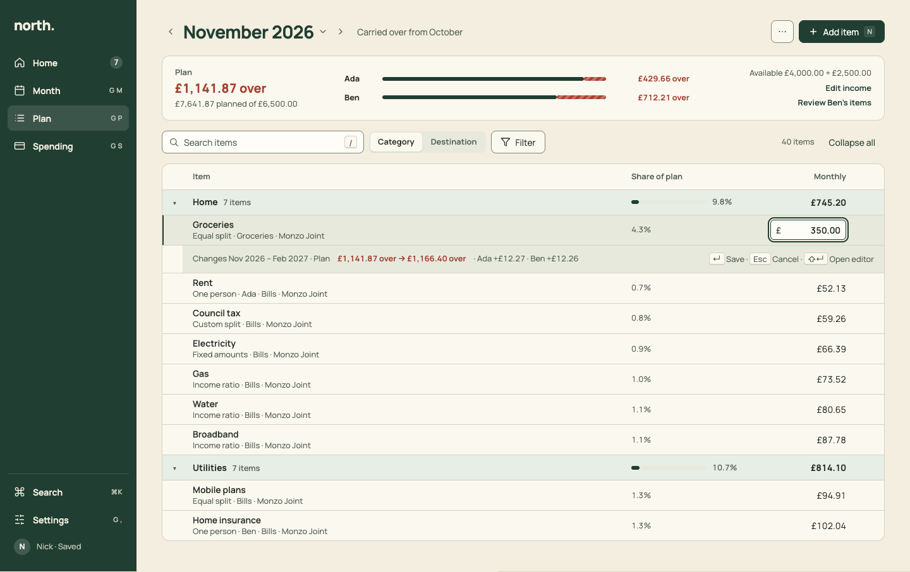
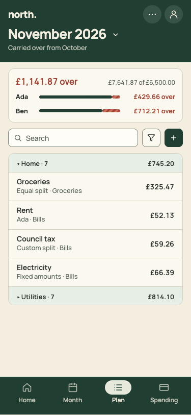

# PR 16 · Plan: compact figures, one toolbar, open groups, inline edit

| | |
| --- | --- |
| **Suggested PR title** | `Audit 3 · 16: Plan — compact figures, one toolbar, groups open on desktop, inline amount edit with impact` |
| **Size** | M (≈650 lines). If it passes 700, split the inline edit into **16b**. |
| **Needs** | PR 02 and PR 05 merged. **Decision D4.** |
| **Unblocks** | 17, 18, 20 |
| **Branch** | `audit3/16-plan-density` |

## Goal

Cut the steps and chrome in the most common planning task, changing an amount:
- the **figures** shrink to one 84px row;
- **search, grouping and filters** share one toolbar;
- **groups start open on desktop**;
- rows are 44px;
- **the amount is edited in place.** <kbd>↵</kbd> saves, <kbd>Esc</kbd> cancels, and the impact shows on one line under the row before you save;
- the "26 items" filter from Month becomes a chip.

## Findings it fixes

- [F06 · On Plan, every edit starts with opening a group](../review.md#f06)
- [F14 · Alarm colour on headlines](../review.md#f14) (Plan headline)
- [F16 · Quick edit inserts a panel and pushes the rows down](../review.md#f16) (carries audit 2 P5)
- Audit 2 P7 (destination filter chip), now folded into F06.

## Current behaviour

| Desktop, cold | Desktop, a group open plus quick edit | Phone, a group open | Phone, from Month's "26 items" |
| --- | --- | --- | --- |
|  |  |  |  |

- **The meter card** (`AllocationMeter`) is 245px on desktop and 330px on phones: "You're both over" at 28px red, "The household plan is £1,141.87 more than what's available.", per-person bars, "Household £7,641.87 planned of £6,500.00", then "Review Ben's items › / ✎ Edit income (all from salary)".
- **The filter row** (`PlanFilters`): search plus Owner and Category selects on desktop. On phones: search, Filter and +.
- **The "Budget items" card header:** "6 categories · 40 items", Category/Destination, Expand all, then a column header row.
- **Groups** start closed (`state/planGroups.ts`).
- **Rows** are 58–63px, with a pencil-chip amount and a ⋯.
- **Quick edit** (`PlanTable`) inserts a 105px panel with "Changes apply: November 2026–February 2027." and Save/Cancel.
- **The destination filter** (from Transfers) is a card: "Showing 26 items for Monzo Joint · November 2026 · Matching total £3,767.72 · Back to Transfers · Clear destination filter", plus a "Search and filter" link.

## Target behaviour

See [mockups/03-plan.html](../mockups/03-plan.html):

| Desktop | Phone |
| --- | --- |
|  |  |

### Header

- `PageHeader` with `MonthTitle`. Context: the carried-over note ("Carried over from October", when it applies).
- **Actions:**
  - ⋯ with "Edit income ↗" (Settings › Pay & income for this month; until PR 09 lands, today's dialog), "Accounts, pots & categories ↗", and "Go back to the October budget" / "Clear the November budget" (today's `revertLabel`, which confirms).
  - **Primary "Add item"** with the `N` hint.

### Figures row (`AllocationMeter`, desktop variant)

- One card, 84px high, in a grid `240px 1fr 260px`.
- **Lead:**
  - "Plan" (13/600 muted);
  - the balance via `balanceLabel`: "£1,141.87 over" (20/700, `--critical` only when over), "£X left" (`--text`) or "Balanced";
  - "£7,641.87 planned of £6,500.00" (13 muted).
- **People:** one line per person, a grid `48px 1fr 120px`: name 600, a `Meter` (over hatch as today), and "£429.66 over" / "£X left" right-aligned (critical only when over). With one adult, show no people column.
- **Right** (13px, right-aligned):
  - "Available £4,000.00 + £2,500.00";
  - "Edit income" (link);
  - "Review Ben's items" (link, shown when someone is over; today's `onReview`, for the worst person).
- **Remove:**
  - the headline "You're both over" and the sentence "The household plan is …";
  - "(all from salary)". Keep the basis only when it isn't all salary, e.g. "£6,000.00 salary + £500.00 other" under the Available line.
- **Phone:** a compact two-line card. Line 1: "£1,141.87 over" left, "£7,641.87 of £6,500.00" right. Then one thin `Meter` row per person with their figure. The docked mini meter stays as today.

### Toolbar (replaces `PlanFilters` row and the "Budget items" card header)

- **Desktop:** a single row.
  - `SearchField` ("Search items", `/` hint, `data-shortcut="search"`);
  - `Segmented` Category | Destination;
  - `FilterMenu` (Owner: All / Joint / Ada / Ben / Needs owner; Category: …) with a count badge when active. Active filters show as chips after the button, each with ×, plus "Clear".
  - flex spacer, then a muted count "40 items", then a quiet "Collapse all" / "Expand all".
- **Phone:** Search (flex), a Filter icon button (a Sheet holding Owner, Category **and** the Category/Destination switch), and + (Add item). Remove the in-card Category/Destination switch and "Expand all" pill on phones; Expand all goes in the Filter sheet.
- **Destination filter** (arriving from Month's "26 items ›", `planDestination`): a chip "Monzo Joint ×" in the toolbar, and a quiet link "← Back to Month" at the left of the toolbar. Today's "Showing 26 items for…" card goes. Search results and the count say "26 items · £3,767.72".

### Table (`PlanTable`)

- **Groups open by default on desktop:** in `state/planGroups.ts`, with no session entry, default to all open when not in the mobile presentation. Phones stay closed by default (D4). The open/closed state stays remembered per session.
- **Column header:** a single quiet row (Item | Share of plan | Monthly), with no card title block.
- **Band row:** 40px. "▾ Home · 7 items", share `Meter` plus %, total.
- **Item row:** 44px.
  - Name 600; meta 13 muted ("Equal split · Groceries · Monzo Joint").
  - Share % (muted); amount as **plain text** (no pencil chip; the pencil appears on row hover and focus).
  - ⋯ (Duplicate, Remove) **visible on hover and focus only** (always visible with `(hover: none)`).
- **Inline amount edit** (replaces the quick-edit panel):
  - **Trigger:** click the amount, or press <kbd>E</kbd> on a focused row (the key works once PR 18 lands; the click works now).
  - **Field:** the amount cell becomes a 120px field with "£", focus and the ring, its content selected.
  - **Impact line:** a 34px impact row appears directly under the item row, on `--surface-selected`. It reads "Changes Nov 2026 – Feb 2027 · Plan **£1,141.87 over → £1,166.40 over** · Ada +£12.27 · Ben +£12.26", with "↵ Save · Esc Cancel · ⇧↵ Open editor" right-aligned. Compute it live with `budgetImpact` (debounce 150ms) from the typed value. The scope comes from `formatEditScope(budgetEditScope(...))`.
  - **Keys:** <kbd>↵</kbd> saves (today's inline save path, including `onAmountSaved` and the "View affected transfers" result, which now reads "View affected Payday steps"). <kbd>Esc</kbd> restores. <kbd>⇧↵</kbd> opens the full editor with the typed amount. Blur without Enter cancels.
  - **Fixed-amount items:** not editable inline, as today. The amount shows a lock tooltip "Fixed amounts: edit in the item".
- **Save result:** today's floating `.budget-save-result` becomes a `Toast` ("Groceries saved · View affected Payday steps").

## Files

- **Change:** `src/pages/PlanPage.tsx` (from PR 05), `src/pages/PlanTable.tsx`, `src/pages/PlanFilters.tsx`, `src/components/AllocationMeter.tsx` (+ test), `src/state/planGroups.ts`, `src/pages/planRows.ts` (count and total strings only), `src/components/GroupedTable.tsx` (row height and hover affordances only), the Plan section of `docs/product-design-spec.md`, and `src/styles.css` (delete only; new rules in `src/pages/plan.css`).
- **Reuse:** `budgetImpact`, `ImpactPreview` maths, `balanceLabel`, `formatEditScope`, `MonthTitle`, `Toolbar`/`SearchField`/`Segmented`/`FilterMenu` (from PR 02 or 15), `Meter`, `Toast`.
- **Don't touch:** the editor (`BudgetItemEditor`, PR 17), grouping logic (`groupPlanItems`, `planGroupKey`), plan maths, and Month.

## Acceptance criteria

- [ ] Desktop 1440×900, cold open: the first item row is above y≈260, and at least 12 item rows are visible without scrolling.
- [ ] Phone cold open: the figures card is at most 130px, and the first group band is above y≈330.
- [ ] No red headline. Red appears only on over amounts. "You're both over" no longer appears anywhere on Plan.
- [ ] Click £325.47 on Groceries, type 350, and the impact line shows the new balance and per-person deltas before saving. Enter saves (the figures row updates and a toast confirms). Esc restores. ⇧Enter opens the editor with £350.00.
- [ ] Owner and Category filters work from one Filter menu, with chips. Clear resets. Search still matches names, categories, owners and destinations, and Esc in the search clears it (today's behaviour).
- [ ] From Month's "26 items ›": the toolbar shows "Monzo Joint ×" and "← Back to Month". Back returns to the same band.
- [ ] Groups are open on desktop by default. Collapse all, then reload in the same session: they stay collapsed. A new session (new tab): open again.
- [ ] 1100 and 800 widths: the toolbar wraps cleanly (search on its own line at 800). No horizontal scroll.
- [ ] Keyboard: `/` focuses search. Tab reaches the amount, and Enter on the amount starts the edit.
- [ ] `npm run check` passes. Update `MonthlyBudget.test.tsx` and `MonthlyBudget.filters.test.tsx` for the new structure, keeping every behaviour assertion.

## How to check

```sh
node docs/audit-3/tools/capture.mjs plan "view=plan&month=2026-11"
node docs/audit-3/tools/capture.mjs plan-800 "view=plan&month=2026-11" --desktop --width 800
node docs/audit-3/tools/capture.mjs plan-1100 "view=plan&month=2026-11" --desktop --width 1100
node docs/audit-3/tools/capture.mjs plan-dest "view=plan&month=2026-11&planDestination=account:joint"
```

Compare with `docs/audit-3/mockups/png/plan-desktop.png` and `plan-phone.png`, and the before images `docs/audit-3/screenshots/{plan-desktop,plan-quick-edit-desktop,plan-group-open-phone,plan-see-items-phone,plan-800}.png`. Walk Job 1: change Groceries to £350. Target: 2 clicks plus typing.

## Working in this repo

- **Run it:** `npm run dev -- --port 5174 --strictPort --mode localonly` (local storage, no sign-in). Seed by opening `http://localhost:5174/scripts/baseline-seed.html`. It loads `docs/fixtures/plan-transfers-baseline.json` (Ada and Ben, 40 items, an Amex card with October and November statements and an Amex pot) and lands on Plan for November 2026. Re-seed before each check. Figures like "19 days left" depend on today's date.
- **Screenshots:** `node docs/audit-3/tools/capture.mjs <name> "<query>"` writes phone (375×812) and desktop (1440×900) PNGs, viewport and full height, to `/tmp/north-shots`. Add `--width 1100` for in-between widths. Playwright isn't a dependency; see the script header.
- **Check:** `npm run check` (eslint, vitest, build) must pass. CI runs the same.
- **CI guards:** `src/styles.tokens.test.ts` (no raw colours, sizes or spacing outside `:root`; breakpoints 640/768/1100 only), `src/styles.contrast.test.ts`, `src/copy.vocabulary.test.ts` (retired words; the glossary is in `docs/product-design-spec.md`), `src/styles.views.test.ts`.
- **Tests:** jsdom has no `matchMedia`, so components render their phone presentation. Stub `window.matchMedia` with `matches: false` to test desktop.
- **Docs:** update your screen's section of `docs/product-design-spec.md`, and any rules doc whose behaviour changes. Never `git add -A docs`: untracked review notes live there.
- **Style:** match the surrounding code (some files are dense one-liners) and don't reformat code you aren't changing. Design rules: [plan.md §2.3](../plan.md#design-system).
- **Branch:** `audit3/NN-short-name` from a fresh `main`. One PR, squash-merged.
