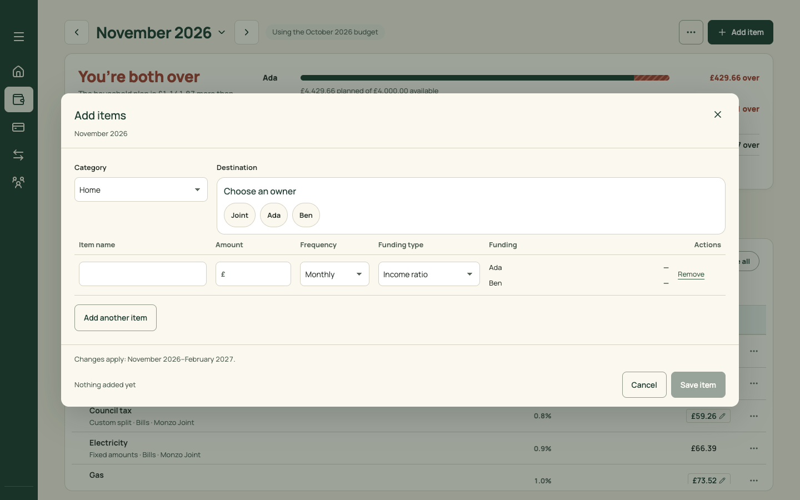
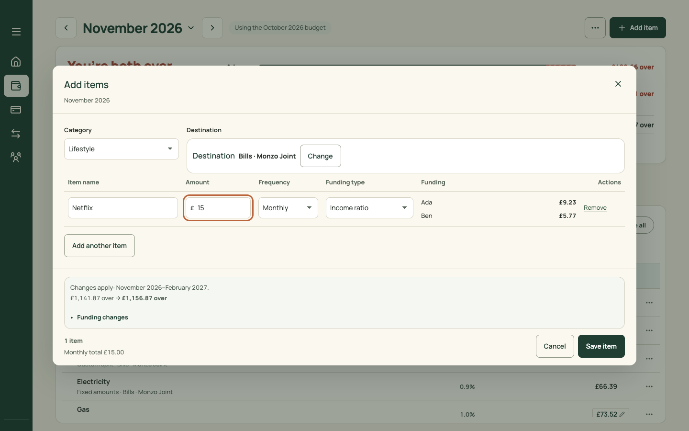
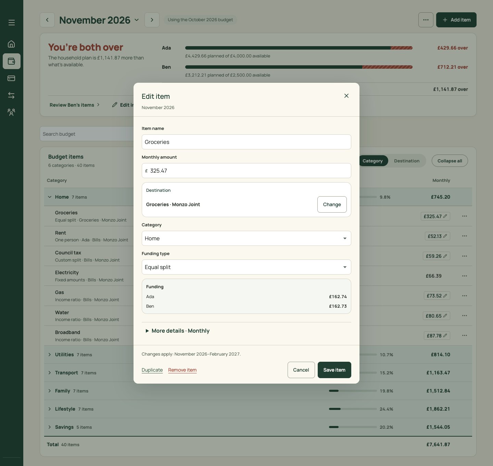
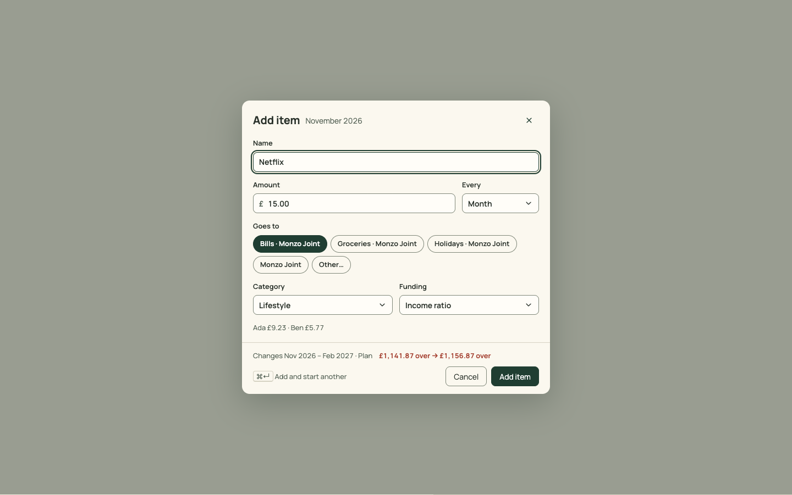

# PR 17 · One editor for adding and editing items

| | |
| --- | --- |
| **Suggested PR title** | `Audit 3 · 17: one item editor — name first, recent destinations, "Add and start another"` |
| **Size** | M (≈550 lines; net negative once the batch table goes) |
| **Needs** | PR 03 (Sheet) and PR 16 (Plan page) merged. **Decision D5.** |
| **Unblocks** | 20 |
| **Branch** | `audit3/17-item-editor` |

## Goal

Adding and editing an item should be the same short form, in the order people think:
1. **Name**;
2. **Amount** and how often;
3. **where it goes**, with the destinations you use most as one-tap chips;
4. **category** and **funding**, pre-filled.

"Add and start another" (<kbd>⌘↵</kbd>) replaces the multi-row batch table.

## Findings it fixes

- [F15 · Add and Edit are two different dialogs, and Add asks for the name last](../review.md#f15) (carries audit 2 E1)
- [F12 · Five overlay types](../review.md#f12) (the editor's own dialog goes)
- [F28 · Tone slips](../review.md#f28) ("Destination Destination")

## Current behaviour

| Add items (empty) | Add items (filled) | Edit item |
| --- | --- | --- |
|  |  |  |

`src/pages/BudgetItemEditor.tsx` renders `.budget-batch-dialog`:
- **Add:** a 1220px batch table.
  - Order: Category (select) → Destination ("Choose an owner" bubbles → account bubbles → pot bubbles, via `DestinationPicker`) → rows of Item name | Amount | Frequency | Funding type | Funding | Remove.
  - "Add another item"; footer "Changes apply… · Nothing added yet · Cancel · Save item".
  - Once chosen, the destination box reads "Destination  Destination  Bills · Monzo Joint · Change".
- **Edit:** a single column. Item name, Monthly amount, Destination (Change), Category, Funding type, Funding, "More details · Monthly", and a footer with Duplicate / Remove item / Cancel / Save item.
- **Walkthrough:** adding "Netflix £15 to Bills" took 7 clicks and 2 fields.

## Target behaviour

See [mockups/03-plan.html](../mockups/03-plan.html) (second artboard):

### One editor (`BudgetItemEditor`, hosted in `Sheet` size `md`)

- **Title:** "Add item" or "Edit item"; description: the month ("November 2026").
- **Fields, in order:**
  1. **Name:** text, `data-autofocus` on add.
  2. **Amount** (`GroupedMoneyInput`) and **Every** (Month / Year / Week… from today's frequency options) side by side, `1fr 140px`.
  3. **Goes to:**
     - Up to **five chips**, the destinations used by the most items this month (`destinationLabel` names, "Bills · Monzo Joint"), with the device's last-used destination first (`localStorage` `north.lastDestination`), then "Other…".
     - The selected chip is filled pine.
     - "Other…" expands today's `DestinationPicker` inline (owner → account → pot, and create). Its header shows the chosen destination as **"Bills · Monzo Joint · Change"**, with no duplicate "Destination" label.
     - On edit, the item's own destination is selected (added as a chip if it isn't in the top five).
  4. **Category** and **Funding** side by side.
     - Category defaults, on add: the group you launched from (when added from a band's context), else the last used (`north.lastCategory`).
     - Funding defaults to the last used (`north.lastFunding`), else "Income ratio". The funding-specific fields (one person, custom shares, fixed amounts) appear under it, as today.
  5. **Funding preview:** one muted line, "Ada £9.23 · Ben £5.77".
  6. **"More details":** a disclosure for the rest of today's single-item fields.
- **Footer** (Sheet `footer`):
  - an impact line, "Changes Nov 2026 – Feb 2027 · Plan **£1,141.87 over → £1,156.87 over**", with "Funding changes" as a disclosure (today's `ImpactPreview` content);
  - on add: a muted "⌘↵ Add and start another" hint on the left, then Cancel and **Add item**;
  - on edit: Duplicate and Remove item (danger text) on the left, then Cancel and **Save item**.
- **Save disabled until valid** (name, amount over 0, destination, category). Validation errors sit under their field, as today.
- **⌘↵ / Ctrl+↵ (add):** saves, keeps Goes to, Category and Funding, clears Name and Amount, focuses Name, and shows a Toast "Netflix added". The Sheet stays open.
- **Duplicate:** opens Add pre-filled with "Netflix (copy)" (today's `template`).
- **Phone:** a bottom sheet at full height (`size="xl"` maps to 100dvh on phones), with the footer pinned above the keyboard (use `env(keyboard-inset-height)` where supported, else the visual viewport).

### Retire

- The batch table, the "Add another item" row and the "Nothing added yet" footer.
- `.budget-batch-*` CSS.
- `commitItemBatch` stays in the domain and is called with one item. Remove UI-only batch helpers once unused.

## Files

- **Change:** `src/pages/BudgetItemEditor.tsx` (a rewrite of the shell; reuse its field components and validation), `src/pages/DestinationPicker.tsx` (inline mode and label fix), `src/domain/budgetItemDrafts.ts` (only if a helper becomes single-item; keep `commitItemBatch` behaviour), `src/pages/PlanPage.tsx` (the open, save and duplicate wiring), the Plan › Editing section of `docs/product-design-spec.md`, and `src/styles.css` (delete `.budget-batch-*`).
- **Reuse:** `Sheet`, `GroupedMoneyInput`, `DestinationPicker`, `ImpactPreview`, `budgetImpact`, `destinationLabel`/`shortAccountLabels`, `Toast`.
- **Don't touch:** item maths, funding rules, destination creation rules, and the Plan table (PR 16).

## Acceptance criteria

- [ ] Add "Netflix £15 to Bills, Lifestyle" from Plan cold: **Add item → type name → type amount → click "Bills · Monzo Joint" → choose Lifestyle → Add item**. That's 5 clicks and 2 fields (down from 7 and 2), and 3 clicks when the category default is already right. It's also doable keyboard only with N, Tab, Space and Enter.
- [ ] The editor never shows "Destination Destination".
- [ ] ⌘↵ adds and keeps the destination, category and funding for the next item. Two items added this way both appear in their group, and the toast confirms each.
- [ ] Edit shows the same form, with Duplicate and Remove item. Remove confirms (today's copy).
- [ ] "Other…" lets you create a new account or pot inline, as today (`DestinationPicker.test.tsx` passes).
- [ ] The impact line and "Funding changes" match today's `ImpactPreview` numbers.
- [ ] Phone: a full-height bottom sheet, with the footer visible while typing.
- [ ] First run (no accounts): "Goes to" shows only "Add an account…", which opens the inline creation.
- [ ] Keyboard: Name is focused on open, Tab follows the field order, and Esc closes and returns focus to Add item or the row.
- [ ] `npm run check` passes. Update the add and edit tests in `MonthlyBudget.test.tsx` (batch rows become sequential adds).

## How to check

- Open `http://localhost:5174/?view=plan&month=2026-11`, press Add item (or `N`), and do the acceptance walk.
- Capture by hand with the device toolbar at 375 and 1440, and compare with `docs/audit-3/mockups/png/plan-editor-desktop.png` and the before images `docs/audit-3/screenshots/plan-add-items-*.png` and `plan-editor-desktop.png`.

## Working in this repo

- **Run it:** `npm run dev -- --port 5174 --strictPort --mode localonly` (local storage, no sign-in). Seed by opening `http://localhost:5174/scripts/baseline-seed.html`. It loads `docs/fixtures/plan-transfers-baseline.json` (Ada and Ben, 40 items, an Amex card with October and November statements and an Amex pot) and lands on Plan for November 2026. Re-seed before each check. Figures like "19 days left" depend on today's date.
- **Screenshots:** `node docs/audit-3/tools/capture.mjs <name> "<query>"` writes phone (375×812) and desktop (1440×900) PNGs, viewport and full height, to `/tmp/north-shots`. Add `--width 1100` for in-between widths. Playwright isn't a dependency; see the script header.
- **Check:** `npm run check` (eslint, vitest, build) must pass. CI runs the same.
- **CI guards:** `src/styles.tokens.test.ts` (no raw colours, sizes or spacing outside `:root`; breakpoints 640/768/1100 only), `src/styles.contrast.test.ts`, `src/copy.vocabulary.test.ts` (retired words; the glossary is in `docs/product-design-spec.md`), `src/styles.views.test.ts`.
- **Tests:** jsdom has no `matchMedia`, so components render their phone presentation. Stub `window.matchMedia` with `matches: false` to test desktop.
- **Docs:** update your screen's section of `docs/product-design-spec.md`, and any rules doc whose behaviour changes. Never `git add -A docs`: untracked review notes live there.
- **Style:** match the surrounding code (some files are dense one-liners) and don't reformat code you aren't changing. Design rules: [plan.md §2.3](../plan.md#design-system).
- **Branch:** `audit3/NN-short-name` from a fresh `main`. One PR, squash-merged.
