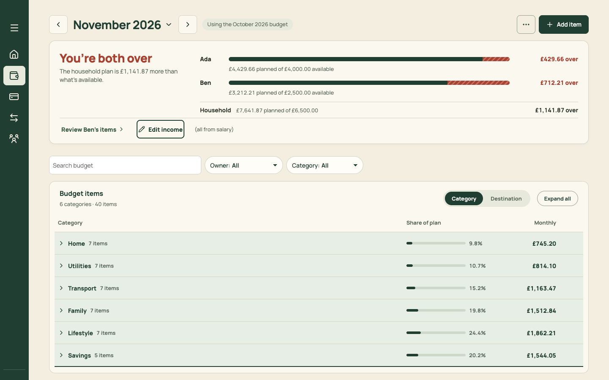

# PR 18 · Keyboard on every list: J/K, Enter, X, C, E

| | |
| --- | --- |
| **Suggested PR title** | `Audit 3 · 18: list keyboard navigation — J/K/↑/↓, Enter, X tick, C copy, E edit` |
| **Size** | M (≈400 lines) |
| **Needs** | PR 07 (shortcut registry), PR 10 (Home), PR 11 (Month payday), PR 13 (Spending) and PR 16 (Plan) merged |
| **Unblocks** | — |
| **Branch** | `audit3/18-keyboard-lists` |

## Goal

Every list in North moves and acts from the keyboard, the same way, as To sort's table already does. One hook gives roving focus and the keys. Each list declares what Enter, X, C and E mean for its rows. Together with PR 07 and PR 19, all four jobs can be done without the mouse on desktop.

## Findings it fixes

- [F07 · Outside To sort there's no keyboard model](../review.md#f07) (lists)

## Current behaviour



- Only `SortTable.tsx` has row keys (↑/↓ move, `/` pot, Enter place, A always, S split; focus moves to the next row once placed).
- Everywhere else, Tab is the only way to move:
  - Plan needs 20+ Tabs to reach the first group, and each item takes 3 Tab stops (name, amount, ⋯).
  - Payday has 2 stops per step (tick, amount).
  - Home tasks are one stop each.

## Target behaviour

### `src/state/useListNavigation.ts`

```ts
useListNavigation<T>({ id: string; rows: T[]; getKey: (row: T) => string; onOpen?: (row: T) => void;
  actions?: Partial<Record<'x' | 'c' | 'e' | 'a' | 's', (row: T) => void>>; wrap?: boolean })
  → { containerProps; rowProps(row): { tabIndex: 0 | -1; 'data-focused'?: true; onFocus; onKeyDown; ref } }
```

- **Roving tabindex:** the list is **one** Tab stop. It lands on the last-focused row, or the first.
- **Keys:**
  - <kbd>J</kbd>/<kbd>↓</kbd> and <kbd>K</kbd>/<kbd>↑</kbd> move; <kbd>Home</kbd>/<kbd>End</kbd> go to the first or last row;
  - <kbd>↵</kbd> runs `onOpen`;
  - the action keys run their handlers;
  - <kbd>Esc</kbd> blurs to the list container.
- Focus scrolls into view (`block: 'nearest'`) and keeps 48px clear of sticky headers (`--page-sticky-top`).
- Inner buttons (tick, amount, ⋯) stay clickable but leave the Tab order (`tabIndex=-1`), because the keys reach them. Screen readers get `aria-keyshortcuts` on the row and a visually hidden hint per list: "Use J and K to move, Enter to open, X to tick, C to copy".
- Register each list's keys with the PR 07 registry (group "Lists"), so `?` shows them while the list is on screen.

### Wire it into

| List | Enter | Extra keys |
| --- | --- | --- |
| Home › To do | opens the task's target | — |
| Plan › items (and band rows: Enter toggles) | opens the editor | <kbd>E</kbd> edit amount in place (PR 16). <kbd>⌫</kbd> or <kbd>Delete</kbd> start Remove (it confirms). <kbd>D</kbd> duplicates. |
| Month › Payday steps (per person column; ←/→ moves between columns on desktop) | opens the account's items | <kbd>X</kbd> tick or untick (accepts a change). <kbd>C</kbd> copies the amount. |
| Month › Pots | opens the pot page | — |
| Month › Close covers | — | <kbd>X</kbd>, <kbd>C</kbd> |
| Spending › To sort (align `SortTable` with the hook) | places | today's `/`, A and S, plus J and K |
| Spending › Set aside moves | — | <kbd>C</kbd> |
| Spending › Transactions | opens the sort sheet | — |
| Spending › Statements and statement steps | opens the statement | <kbd>X</kbd>, <kbd>C</kbd> on steps |
| Settings › each list | opens the editor | — |

### Visible state

The focused row uses the `ListRow` / table focused style from PR 02: `--surface-selected` with an inset 2px `--accent` left bar. Mouse hover doesn't move keyboard focus.

### Hints

Each list's `Section` aside shows its keys as `Kbd` on desktop (e.g. Home "J K move · ↵ open"; Payday "J K · X tick · C copy"). They're hidden at phone widths and with `(hover: none)`.

## Files

- **Add:** `src/state/useListNavigation.ts` (+ test).
- **Change:** `src/pages/Home.tsx`, `src/pages/PlanTable.tsx` (and `GroupedTable.tsx` row props), the Payday section and pots and close in `MonthPage` (or `month/*.tsx`), `src/pages/SortTable.tsx`, `src/pages/TransactionsTable.tsx`, `src/pages/StatementsPanel.tsx`, the Settings section lists, `src/components/ui/StepRow.tsx` (accept `rowProps`), `src/components/ui/ListRow.tsx` (accept `rowProps`), and the Keyboard subsection of `docs/product-design-spec.md`.
- **Reuse:** the registry (PR 07), `Kbd`, and `SortTable`'s existing focus-next-after-place logic.
- **Don't touch:** list content or layout, or the domain.

## Acceptance criteria

- [ ] On every list above, Tab enters once and J/K move with a visible focus. Enter does the documented action. Tab leaves the list.
- [ ] Payday: J to Fund Monzo Joint, then C copies "2215.45" (toast), then X ticks (the count updates), then J moves to Move to Bills. With a changed step, X accepts the new amount.
- [ ] Plan: J to Groceries, then E starts the inline edit, typing 350 and Enter saves, and focus returns to the row. D duplicates (the editor opens pre-filled).
- [ ] To sort keeps its keys. J and K also work, and focus moves to the next row after placing.
- [ ] Keys never fire while a field is focused or a Sheet is open (registry tests).
- [ ] `?` lists the list keys while that list is on screen.
- [ ] Screen reader smoke test (VoiceOver, Safari): each row announces its content, and the hint is read once on entering the list.
- [ ] `npm run check` passes. Add `useListNavigation.test.ts` and one keyboard test per screen.

## How to check

By hand at 1440×900, seeded:
- Home: Tab to To do, then J J Enter.
- `?view=plan&month=2026-11`: Tab to the table, then J, E, type, Enter.
- `?view=month&month=2026-11`: Tab to Payday, then J, C, X.
- `?view=spending&section=sort`: J, Enter.
- `?view=spending&section=transactions`: J, Enter.

Record the run with a screen recorder if you want a GIF for the PR.

## Working in this repo

- **Run it:** `npm run dev -- --port 5174 --strictPort --mode localonly` (local storage, no sign-in). Seed by opening `http://localhost:5174/scripts/baseline-seed.html`. It loads `docs/fixtures/plan-transfers-baseline.json` (Ada and Ben, 40 items, an Amex card with October and November statements and an Amex pot) and lands on Plan for November 2026. Re-seed before each check. Figures like "19 days left" depend on today's date.
- **Screenshots:** `node docs/audit-3/tools/capture.mjs <name> "<query>"` writes phone (375×812) and desktop (1440×900) PNGs, viewport and full height, to `/tmp/north-shots`. Add `--width 1100` for in-between widths. Playwright isn't a dependency; see the script header.
- **Check:** `npm run check` (eslint, vitest, build) must pass. CI runs the same.
- **CI guards:** `src/styles.tokens.test.ts` (no raw colours, sizes or spacing outside `:root`; breakpoints 640/768/1100 only), `src/styles.contrast.test.ts`, `src/copy.vocabulary.test.ts` (retired words; the glossary is in `docs/product-design-spec.md`), `src/styles.views.test.ts`.
- **Tests:** jsdom has no `matchMedia`, so components render their phone presentation. Stub `window.matchMedia` with `matches: false` to test desktop.
- **Docs:** update your screen's section of `docs/product-design-spec.md`, and any rules doc whose behaviour changes. Never `git add -A docs`: untracked review notes live there.
- **Style:** match the surrounding code (some files are dense one-liners) and don't reformat code you aren't changing. Design rules: [plan.md §2.3](../plan.md#design-system).
- **Branch:** `audit3/NN-short-name` from a fresh `main`. One PR, squash-merged.
