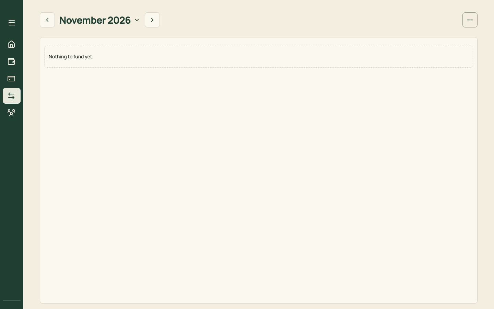
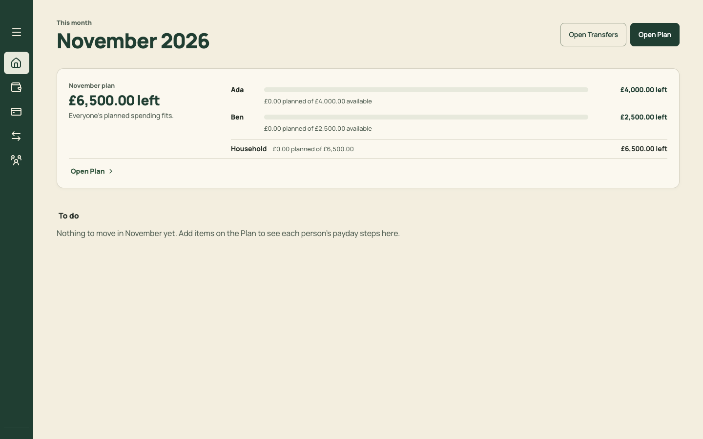
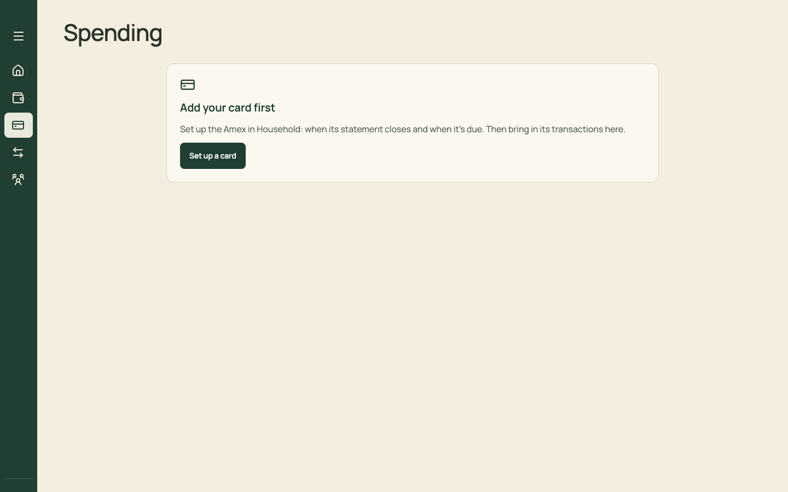
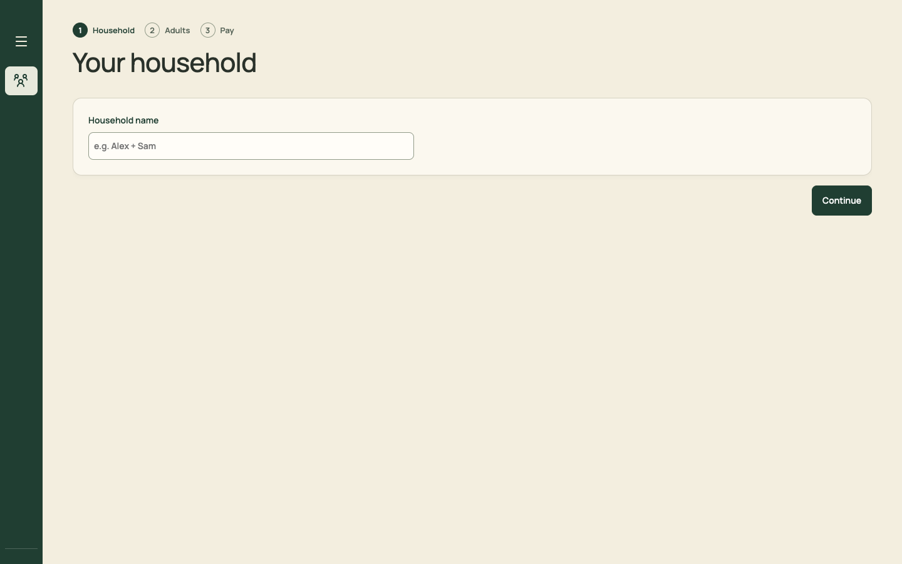

# PR 20 · Empty, first-run, loading and error states; a tone pass

| | |
| --- | --- |
| **Suggested PR title** | `Audit 3 · 20: one EmptyState everywhere, loading and error states, figure-first tone` |
| **Size** | M (≈450 lines, many small edits) |
| **Needs** | PRs 10, 12, 14, 15 and 17 merged (the screens are in their final shape). **Decision D11.** |
| **Unblocks** | — |
| **Branch** | `audit3/20-states-and-tone` |

## Goal

Finish the system:
- every empty list says what's missing and offers one action;
- first run never claims things "fit" when nothing is planned;
- loading doesn't jump;
- save and import failures look the same everywhere;
- copy is figure-first and calm, with the last second-person headlines and leftover oddities gone.

The vocabulary guard learns the new retired phrases.

## Findings it fixes

- [F21 · Empty states without a next step, and a false "fits"](../review.md#f21)
- [F14 · Alarm colour on headlines](../review.md#f14) (what's left of it)
- [F09 · The same status is restated](../review.md#f09) (a final sweep)
- [F24 · Five link styles](../review.md#f24) (a final sweep)
- [F28 · Tone slips](../review.md#f28)

## Current behaviour

| Transfers, no items | Home, no items | Spending, no card | First run |
| --- | --- | --- | --- |
|  |  |  |  |

- **Empty states:** some have no action ("Nothing to fund yet"), one is a false positive ("£6,500.00 left · Everyone's planned spending fits." with nothing planned), and one sits at a different width (Spending's centred card).
- **Loading:** a bare "Loading…" / "Loading budget…" paragraph inside `Suspense`.
- **Second-person and leftover copy** (some is removed earlier in 10–17; sweep what's left):
  - "You're both over" / "Ada is over" headlines;
  - "You're up to date for November";
  - "Who's moving money on this phone?";
  - "1 pot needs care";
  - "Amex · Pays Amex";
  - "(all from salary)";
  - the persistent "Click/Tap an amount to copy it…" hint.

## Target behaviour

### `EmptyState` (PR 02) everywhere a list can be empty

| Where | Title | Sentence | Action |
| --- | --- | --- | --- |
| Home To do (all done) | Nothing to do | "You're set for November. Next: Ada's pay arrives Fri 27 Nov." (the next Coming up item) | — |
| Home, first run | Nothing planned for November yet | "Add what you pay for each month and North works out who funds what." | Plan November |
| Month › Payday, no items | Nothing to fund yet | "Add items on the Plan and each person's payday steps appear here." | Open Plan |
| Month › Pots, nothing spent | No pot spending yet | "Bring in Amex transactions to see each pot against the plan." | Open Spending |
| Plan, no budget this month | No budget for December yet | "Start from November's, or add items." | Use November's budget · Add item |
| Plan, first run | Start your plan | "Add rent, bills, savings: anything you pay each month." | Add item (+ "Add income" if none) |
| Plan, search with no match | No items match "xyz" | "Within the current filters." | Clear filters |
| Spending, no card | Add your card first | "Tell North when the statement closes and when it's due." | Set up a card |
| Spending › To sort, none yet | Nothing to sort | "Bring in the Excel export from Amex to start." | Bring in |
| Spending › To sort, all done | Everything is sorted | — | — |
| Spending › Transactions, none, or none matching | Nothing brought in yet / No transactions match | — | Bring in / Clear filters |
| Spending › Statements, none | No statements yet | — | Bring in |
| Settings lists | No income yet / No accounts yet / No categories yet / No cards yet / No sorting rules yet | one sentence each (see PRs 08 and 09) | Add … |

Every empty state sits where the content would be, at the content's width (no centred card).

### Loading

- Replace the `Suspense` fallbacks with a `PageSkeleton`: the page header's height plus three muted bars of `--row-h`, with no animation under reduced motion.
- `role="status"` and `aria-label="Loading"`.
- Lazy routes keep their chunking.

### Errors (one pattern)

- **Save failures** ("Not saved", "Choose a version"):
  - a `Notice` (critical tone) under the page header on every screen, not only in the sidebar or ⋯: "Your changes aren't saved. Check your connection, then try again." with "Try again" and "Details" (opens Settings › Account & sync);
  - `role="alert"`, once per failure.
  - Local-only mode never shows it.
- **Import errors** (Bring in): keep today's copy ("This doesn't look like an Amex Excel export…") in the same `Notice` style inside the sheet.
- **Inline validation:** unchanged (field-level).
- Add `Notice` to `components/ui` if PR 02 didn't: tones neutral, warning and critical, with an icon, text, and optional actions.

### Tone sweep (figure first, verbs for actions, no second-person headlines)

| Today | Becomes |
| --- | --- |
| "You're both over" / "Ada is over" (anywhere left) | "£1,141.87 over" / "Ada £429.66 over" |
| "You're up to date for November" / "You're both up to date" | the folded "Payday · 18 of 18 done" (PR 11) and Home's Done row "November's payday steps all done" |
| "Who's moving money on this phone?" | removed (PR 11) |
| "1 pot needs care" / "2 pots need care" | "1 pot ahead of pace" / "1 pot over" (whichever applies; both: "2 pots need a look") |
| "Amex · Pays Amex" | "Amex pot · pays the Amex" |
| "(all from salary)" | removed. Basis shown only when it isn't all salary. |
| "Click an amount to copy it for your banking app." (persistent) | shown once per device (`copyHint.ts`) |
| "Using the October 2026 budget" (Plan chip, Home) | "Carried over from October" (Plan context); Home: removed unless it changes |
| Underlined links ("All statements", "Back to November", "Check", "Sort them", "Move it") | breadcrumbs and plain pine links (PR 01 rule) |

- Update the glossary in `docs/product-design-spec.md`: add **Month**, **Payday**, **Set aside** and **Settings**; note that "Transfers" is no longer a screen name.
- Extend `src/copy.vocabulary.test.ts` `retired` with:
  - `/you['’]re both (over|up to date)/i`;
  - `/needs care|need care/i`;
  - `/who['’]s moving money/i`;
  - `/all from salary/i`.
- Update its "reads some prose from every screen" expectations if screen names changed.

## Files

- **Change:** across pages, copy and empty branches only: `Home.tsx`, `MonthPage.tsx` (and `month/*`), `PlanPage.tsx`, `PlanTable.tsx`, `Spending.tsx`, `TransactionsTable.tsx`, `StatementsPanel.tsx`, `SpendingMonth.tsx`, `SettingsPage.tsx` and sections, `App.tsx` (Suspense fallbacks only), `src/copy.vocabulary.test.ts`, the glossary and Controls sections of `docs/product-design-spec.md`.
- **Add:** `src/components/ui/PageSkeleton.tsx` and `src/components/ui/Notice.tsx` (if missing).
- **Reuse:** `EmptyState`, `Notice`, `saveStatus.ts`, `AccountStatusPanel`, `copyHint.ts`.
- **Don't touch:** layouts (done in 10–17), the domain, or tests' behaviour (copy assertions update).

## Acceptance criteria

- [ ] Every row of the empty-state table renders as specified (make each state by editing `localStorage` `north.budget.v3`; see How to check).
- [ ] No screen says "fits", "left" or "up to date" when nothing is planned.
- [ ] A forced save failure (cloud mode: go offline in devtools, then edit) shows the critical Notice on the current screen with Try again. It clears on success.
- [ ] Loading a lazy route shows the skeleton, and the page doesn't jump when it resolves.
- [ ] `grep -rniE "you['’]re both|needs care|who['’]s moving money|all from salary" src --include=*.tsx` finds nothing. The vocabulary test enforces it.
- [ ] Text links have no underline except inside sentences.
- [ ] `npm run check` passes.

## How to check

- **First run:** `localStorage.clear()` in devtools, reload, and finish setup → Home.
- **No items:** in devtools, run `d=JSON.parse(localStorage['north.budget.v3']); d.budget.snapshots={}; localStorage['north.budget.v3']=JSON.stringify(d)`, then reload Home, Month and Plan.
- **No card:** set `d.card.cards=[]`, then open Spending.
- **No transactions:** set `d.card.transactions=[]`.

Then capture:

```sh
node docs/audit-3/tools/capture.mjs empty-home "view=home"
node docs/audit-3/tools/capture.mjs empty-month "view=month"
```

Note: `capture.mjs` re-seeds first, so take empty-state captures by hand. Compare with `docs/audit-3/screenshots/empty-*.png` (before).

## Working in this repo

- **Run it:** `npm run dev -- --port 5174 --strictPort --mode localonly` (local storage, no sign-in). Seed by opening `http://localhost:5174/scripts/baseline-seed.html`. It loads `docs/fixtures/plan-transfers-baseline.json` (Ada and Ben, 40 items, an Amex card with October and November statements and an Amex pot) and lands on Plan for November 2026. Re-seed before each check. Figures like "19 days left" depend on today's date.
- **Screenshots:** `node docs/audit-3/tools/capture.mjs <name> "<query>"` writes phone (375×812) and desktop (1440×900) PNGs, viewport and full height, to `/tmp/north-shots`. Add `--width 1100` for in-between widths. Playwright isn't a dependency; see the script header.
- **Check:** `npm run check` (eslint, vitest, build) must pass. CI runs the same.
- **CI guards:** `src/styles.tokens.test.ts` (no raw colours, sizes or spacing outside `:root`; breakpoints 640/768/1100 only), `src/styles.contrast.test.ts`, `src/copy.vocabulary.test.ts` (retired words; the glossary is in `docs/product-design-spec.md`), `src/styles.views.test.ts`.
- **Tests:** jsdom has no `matchMedia`, so components render their phone presentation. Stub `window.matchMedia` with `matches: false` to test desktop.
- **Docs:** update your screen's section of `docs/product-design-spec.md`, and any rules doc whose behaviour changes. Never `git add -A docs`: untracked review notes live there.
- **Style:** match the surrounding code (some files are dense one-liners) and don't reformat code you aren't changing. Design rules: [plan.md §2.3](../plan.md#design-system).
- **Branch:** `audit3/NN-short-name` from a fresh `main`. One PR, squash-merged.
