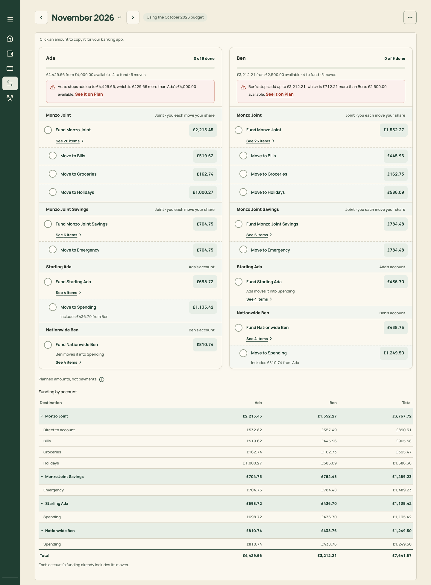

# PR 22 · Steps say where the money comes from ("Pay lands in")

| | |
| --- | --- |
| **Suggested PR title** | 22a: `Audit 3 · 22a: "Pay lands in" — rules and domain (source account for funding steps)`; 22b: `Audit 3 · 22b: "Pay lands in" — settings, setup and step labels` |
| **Size** | M–L, so ship it as two PRs: **22a** (rules, domain, tests; ≈400 lines) and **22b** (UI; ≈350 lines) |
| **Needs** | PR 11 merged (Payday section). PR 09 for the Settings field (22b). **Decision D9 must be "yes"** (and D10 for the setup step). |
| **Unblocks** | — |
| **Branch** | `audit3/22a-pay-lands-in-rules`, then `audit3/22b-pay-lands-in-ui` |

## Goal

Today a payday step says "Fund Starling Ada £698.72" without saying **from where**, because the rules treat the source as unknown. So:
- funding the account your pay already lands in shows as a step that moves nothing;
- a cross-person step ("Fund Nationwide Ben", in Ada's list) has no "from".

Learn where each salary lands, then make the steps real transfers:
- **"Starling Ada → Monzo Joint · £2,215.45"**;
- **"Already in Starling Ada · £698.72"** for your own landing account, shown but not counted as a step.

This is audit 2's T1, carried forward.

## Findings it fixes

- [F18 · Steps can't say where the money comes from](../review.md#f18)
- [F30 · Setup creates no accounts](../review.md#f30) (if D10 is accepted)

## Current behaviour

- `docs/transfer-calculation-rules.md` › *Routing* says the source is unknown (`null`).
- `src/domain/transferInstructions.ts` builds fund and move steps per person and account, with no source.
- Ada's list has "Fund Starling Ada £698.72" and "Fund Nationwide Ben £810.74 · Ben moves it into Spending".
- `IncomeSource` (`domain/monthlyBudget.ts`) has `personId`, `type`, `baseAmountPence`, `changes` and `payday`, but no account.

## Target behaviour

### 22a: rules and domain

- **Model:** add `landsInAccountId?: string` to an **employment** `IncomeSource`. It's shared across months, like `payday`. Validate it in `budgetDocument.ts` (it must reference an existing account). Old documents load unchanged: the field is optional.
- **Rules** (update `docs/transfer-calculation-rules.md` › *Routing*, and add a section "Source account"):
  - A person's **source** is the landing account of their employment income. With several salaries, use the one with the largest base amount for the month. Ties go to the first. Without one, the source stays `null`, and steps read as today.
  - **Fund step to the source account itself:** the money is already there. It becomes an **"already there"** entry. It's not a transfer, not tickable, and not counted in "x of y". Pot moves out of it remain steps.
  - **Fund step to another account:** "from → to". The amount is unchanged.
  - **Cross-person caption** ("Ben moves it into Spending") is unchanged. With a source, Ada's step reads "Starling Ada → Nationwide Ben".
- **Ticks:** step keys **must not change** for steps that remain. Keys are by person, destination and month today; keep them. An "already there" entry has no tick. If a tick exists for it from before, ignore it (don't delete).
- **Counts:** `fundCount` excludes "already there". `stepSummary` text becomes "3 to fund · 5 moves". Home's progress and Month's counts follow.
- **Tests:**
  - `transferInstructions.test.ts`: no source (unchanged); a source equal to a destination ("already there"); a source different (from → to); two salaries (the larger wins); a source account deleted (falls back to `null`).
  - `transferTicks.test.ts`: keys are stable.
  - `baselineFixture.test.ts`: the fixture has no `landsInAccountId`, so its output is unchanged.

### 22b: UI

- **Settings › Pay & income** (PR 09): each salary's editor gets **"Pay lands in"**, a select of accounts owned by that person (plus joint ones), with "Not set". The source row meta adds "lands in Starling Ada".
- **Setup wizard Pay step** (if D10 is accepted): after each pay amount, an optional "Where does it land?" field with the person's accounts, or "Add the account" (inline `AccountFields`: bank, type and owner preset to the person). This also covers F30, so the first item no longer forces inline account creation.
- **Payday rows** (`StepRow` via `PaydaySection`):
  - Fund with a source: label "Starling Ada → Monzo Joint", caption unchanged.
  - Already there: a muted, non-interactive row "Already in Starling Ada", with the amount muted and still copyable. It has no tick column, and the band stays.
  - Settle up and covers keep their own wording ("Send to Monzo Joint").
- **Month header and Home:** counts exclude "already there" (from 22a).
- **Copy:** add "Pay lands in" and "Already in" to the glossary in `docs/product-design-spec.md`.

## Files

- **22a:** `docs/transfer-calculation-rules.md`, `src/domain/monthlyBudget.ts` (type), `src/domain/budgetDocument.ts` (validation and migration no-op), `src/domain/transferInstructions.ts`, `src/domain/personTransfers.ts` (`fundCount`), `src/pages/budgetLabels.ts` (`stepSummary`), and tests.
- **22b:** `src/pages/settings/PayAndIncome.tsx`, `src/pages/SetupWizard.tsx` (+ `AccountFields` reuse), `src/pages/month/PaydaySection.tsx` (or `PaydaySteps.tsx`), `src/components/ui/StepRow.tsx` (a `variant="already"` prop), and `docs/product-design-spec.md`.
- **Don't touch:** funding maths (who funds how much), pot moves, or the settle-up and set-aside rules.

## Acceptance criteria

- [ ] With no `landsInAccountId` anywhere, every screen is identical to before (fixture snapshot tests).
- [ ] Set Ada's salary to land in Starling Ada. Her list shows "Already in Starling Ada · £698.72" (not tickable), and "Starling Ada → Monzo Joint £2,215.45" and so on. Her count reads "0 of 8" (it was 9). Home's Fund row matches.
- [ ] Set Ben's salary to land in Nationwide Ben. Ada's cross-person step reads "Starling Ada → Nationwide Ben £810.74".
- [ ] Ticks made before setting the field remain on the same steps.
- [ ] Deleting the landing account falls back to "Not set" with no crash, and Settings shows "Not set".
- [ ] Setup (D10): a new household can add "Pay lands in" with an inline new account. The first Add item then offers it as a destination.
- [ ] Phone and desktop: "already there" rows are visually quiet and skipped by J/K tick focus (they stay reachable for copy with C).
- [ ] `npm run check` passes. The rules doc and spec are updated in the same PRs.

## How to check

1. Seed. In Settings › Pay & income, set Ada → Starling Ada and Ben → Nationwide Ben.
2. Run `node docs/audit-3/tools/capture.mjs month "view=month&month=2026-11"` (it re-seeds, so for this check set the field in devtools first, or capture by hand).
3. Compare with `docs/audit-3/screenshots/transfers-desktop.png`: Ada's "Fund Starling Ada" becomes "Already in Starling Ada".

## Working in this repo

- **Run it:** `npm run dev -- --port 5174 --strictPort --mode localonly` (local storage, no sign-in). Seed by opening `http://localhost:5174/scripts/baseline-seed.html`. It loads `docs/fixtures/plan-transfers-baseline.json` (Ada and Ben, 40 items, an Amex card with October and November statements and an Amex pot) and lands on Plan for November 2026. Re-seed before each check. Figures like "19 days left" depend on today's date.
- **Screenshots:** `node docs/audit-3/tools/capture.mjs <name> "<query>"` writes phone (375×812) and desktop (1440×900) PNGs, viewport and full height, to `/tmp/north-shots`. Add `--width 1100` for in-between widths. Playwright isn't a dependency; see the script header.
- **Check:** `npm run check` (eslint, vitest, build) must pass. CI runs the same.
- **CI guards:** `src/styles.tokens.test.ts` (no raw colours, sizes or spacing outside `:root`; breakpoints 640/768/1100 only), `src/styles.contrast.test.ts`, `src/copy.vocabulary.test.ts` (retired words; the glossary is in `docs/product-design-spec.md`), `src/styles.views.test.ts`.
- **Tests:** jsdom has no `matchMedia`, so components render their phone presentation. Stub `window.matchMedia` with `matches: false` to test desktop.
- **Docs:** update your screen's section of `docs/product-design-spec.md`, and any rules doc whose behaviour changes. Never `git add -A docs`: untracked review notes live there.
- **Style:** match the surrounding code (some files are dense one-liners) and don't reformat code you aren't changing. Design rules: [plan.md §2.3](../plan.md#design-system).
- **Branch:** `audit3/NN-short-name` from a fresh `main`. One PR, squash-merged.
