# North Planner · UX review, audit 3

**11 November 2026 · main @ 2bf55bb (after #141) · replaces audit 2's open items**

Companion documents: [plan.md](plan.md) (target design, PR sequence, decisions) · [mockups/](mockups/index.html) (before/after) · [prs/](prs/) (one brief per PR).

---

## The verdict

North's individual screens are careful, honest and mostly well worded. Taken together they don't yet feel like one product, because each feature was built as its own small app on its own schedule. Plan came first, then Transfers, Household, Home, Spending and the Amex pot. Each brought its own header, summary, section style, step list, overlay and link style. Each also repeats the household's status in its own words.

Measured against Linear and Things (calm, one obvious action, little chrome, keyboard-first, consistent), the gaps are structural more than visual:

1. **The month's money is spread across four screens.** Funding it is Transfers. Watching it is Spending › This month. Closing it is a sub-page of Spending, and paying the card is Spending › Statements › Settle up. Home tries to stitch them together with two separate task systems.
2. **The same act looks different everywhere.** "Move £X from A to B, then tick it" has four different UIs. "Where do we stand" is restated on five screens.
3. **Chrome comes before work, and the action comes last.** On a phone, Spending's This month starts its first pot at y=879. On desktop, Plan's first item is at y=620 after a click. Settle up and Close October are the last element on their pages.
4. **It's a mouse app.** Apart from the To sort table, there's no way to move, search, jump or act from the keyboard. That's the biggest single gap against the Linear and Things standard for an app two people use several times a week, mostly on desktop.

The fix is to **reorganise around the household's routine** (Home · Month · Plan · Spending, plus Settings) and **build every screen from one small set of shared parts**. Polishing screen by screen won't close these gaps. The plan does both, in 22 PRs ordered so that shared parts land first and the screen work can run in parallel.

---

## Method

- **App:** `npm run dev -- --port 5174 --mode localonly`, seeded from `scripts/baseline-seed.html` (fixture `docs/fixtures/plan-transfers-baseline.json`: Ada and Ben, 40 items, the Amex card with 27 transactions, October and November statements, an Amex pot). Today is Wed 11 Nov 2026.
- **Capture:** Playwright with Chromium at **1440×900** (desktop) and **375×812** (touch, mobile), plus 800, 1100 and 1280 wide. Full-height captures grow the viewport to the shell's scroll container. All 17 routes were captured at both sizes, along with every dialog and sheet on the four jobs, first run, empty states, and a card with no transactions.
- **Walkthroughs:** each job was scripted end to end, counting clicks and fields. Positions, heights, tab order, focus styles and contrast were read from the live DOM.
- **Code:** read to find root causes: `styles.css` (167 KB, 596 class selectors), the step-row markup in four files, five overlay implementations, and the test guards (`styles.tokens`, `styles.contrast`, `copy.vocabulary`, `styles.views`).
- **Not covered:** real devices and Safari, screen readers (only structure, names and focus were checked), cloud sign-in, sync, save failures and conflicts (local-only mode can't fail), on-screen keyboards, and importing a real Amex export.

Screenshots are in [screenshots/](screenshots/). Severity: **High** slows a top job or breaks the design standard app-wide. **Medium** is friction or inconsistency within a job. **Low** is polish.

---

## The four jobs, end to end

| Job | Today (desktop / phone) | Dead ends, forced decisions, lost context | Target |
| --- | --- | --- | --- |
| **1 · Plan the month**: change Groceries to £350, add "Netflix £15" to Bills | **10 clicks + 3 fields / 11 taps + 3 fields**. Plan → open the Home group (closed every visit) → amount chip → type → Enter → Add item → Category select (2) → owner bubble → account bubble → pot bubble → name → amount → Save | You have to know which group Groceries is in, or search. Add makes you choose Category and then walk owner → account → pot before you can type the name. Add and Edit are different dialogs. Income and pots are behind Plan ⋯ › dialogs. | **5 clicks + 3 fields**, or keyboard only: <kbd>G</kbd><kbd>P</kbd> → click amount → type → <kbd>↵</kbd> → <kbd>N</kbd> → name, amount → recent-destination chip → <kbd>↵</kbd> |
| **2 · Track and tick off**: at payday tick your steps, mid-month check pots against plan | Payday: Home → Payday transfers card → Transfers (first step y=670 on phone) → copy + tick × 9. Pots: Home → Spending → This month tab → scroll past y=879 → pot. **3 taps and a screen of scrolling** to see a pot | Payday and pots are on different tabs. "See N items" sits between steps. A person's red box sits above their steps. Some steps may be no-ops because the source account is unknown (T1). Funding by account is 700px below on desktop. | Month tab: Payday first while steps are left, otherwise Pots. **1 tap**. First step at y≈250 on phone |
| **3 · Settle the Amex**: bring in, sort 8, set aside, later settle | Review: **14 clicks / 22 taps**. Bring in → file → "Sort 7" → Place ×8 (phone: Choose + pot ×8) → Move to the Amex pot → Moved. Settle: Spending → Statements → statement → scroll → Settle up (a second page) → tick ×8 | The Amex pot banner, card summary and tabs repeat above every sub-page. Settle up is at the bottom, then on a second page. Close October lives under This month. "This month" sits inside Spending although it's about pots. | Review: <kbd>I</kbd> → file → <kbd>↵</kbd>×8 → Mark moved (**2 clicks + keys**). Settle: Spending › Statements › statement: steps first, **no second page** |
| **4 · Quick check-in**: open Home and know where things stand | Home is **1,496px desktop (1.7 screens) / 2,014px phone (2.5 screens)**. It opens on the plan meter, which doesn't change between plan edits. The most urgent thing (statement due Wed 18 Nov) is at y≈910 desktop and y≈1,110 phone | Two task systems: month cards, and "To do · 2 left" that counts only per-person rows. Over-plan is shown three times, funding progress twice. | **One screen.** A three-figure strip, then one To do list ordered by date |

---

## Root causes

Each finding below names one or more of these.

- **RC1 · Structure follows build order, not routine.** The tabs are the features in the order they shipped. The household's routine runs: fund at payday, watch the pots, review the card every few days, close the month, pay the statement. That routine crosses Transfers, Spending (three of its five sections), Close and Statements, and Home has to stitch it back together. Settings went wherever each feature needed them.
- **RC2 · No single source for "where we stand".** Every screen summarises the household again (meter, month card, per-person cards, This month card, side panel, Transfers hero), each with its own wording and maths. More summaries mean more clutter and less trust.
- **RC3 · No shared components.** `PageFrame` exists but takes eight optional slots, so every page arranges itself differently. The step row is hand-copied JSX in `PaydaySteps`, `StatementsPanel` and `CloseMonth`, plus a fourth variant in `MoveToPotSheet`. There are five overlay implementations. The single 167 KB stylesheet has feature-prefixed families (`budget-v3-*`, `spending-*`, `payday-*`, `home-*`, `allocation-meter-*`), eight font weights, 25 heading/title classes and four input heights. Drift is the default.
- **RC4 · Context pinned above the work, and the action at the end.** Pages lead with status cards, banners and explanations. The one action (Settle up, Close October) sits after them.
- **RC5 · Defaults favour caution over speed.** Groups start closed, quick edit needs Save, To sort is pick-then-place, and there are no keyboard paths. Each is reasonable alone; together they cost every visit.
- **RC6 · Emphasis inflation.** Red 28px headlines, per-person red boxes, amber chips, several filled buttons per screen, and underlined links everywhere. When everything is emphasised, nothing stands out. The genuinely urgent item (a payment due in 7 days) is the calmest thing on Home.

---

## Findings, ranked by severity

### High

### F01 · Home has two task systems, and its count is wrong
**Severity:** High · **Job:** 4 (and 3) · **Root cause:** RC1, RC2 · **Fix:** [PR 10](prs/10-home-inbox.md)

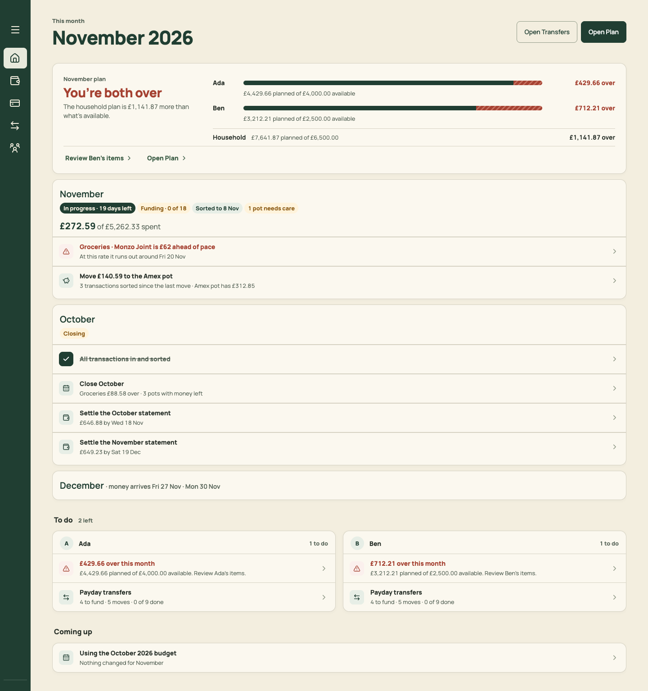

Home's tasks come from two places:
- **Month cards:** November (pace warning, Move to the Amex pot), the October checklist (Close October, Settle the October statement, Settle the November statement) and December.
- **"To do · 2 left":** one card per adult, with their over-plan warning and Payday transfers.

The heading says **2 left** while seven things need doing on the same screen. The two systems also order things differently. Month cards follow the month; To do is per person. Nothing is ordered by when it's due. A household that "knows the app well" still has to read the whole page to find the next thing.

**Target:** one To do list holding every task type, ordered by date. Heads-ups (pace) go last under their own label. The count matches the list.

### F02 · The month's lifecycle is split across four screens
**Severity:** High · **Jobs:** 2, 3, 4 · **Root cause:** RC1 · **Fix:** [PR 06](prs/06-nav-shell.md), [PR 11](prs/11-month-payday.md), [PR 12](prs/12-month-pots-close.md)

| Transfers (fund) | Spending › This month (watch) | Close October (close) |
| --- | --- | --- |
| 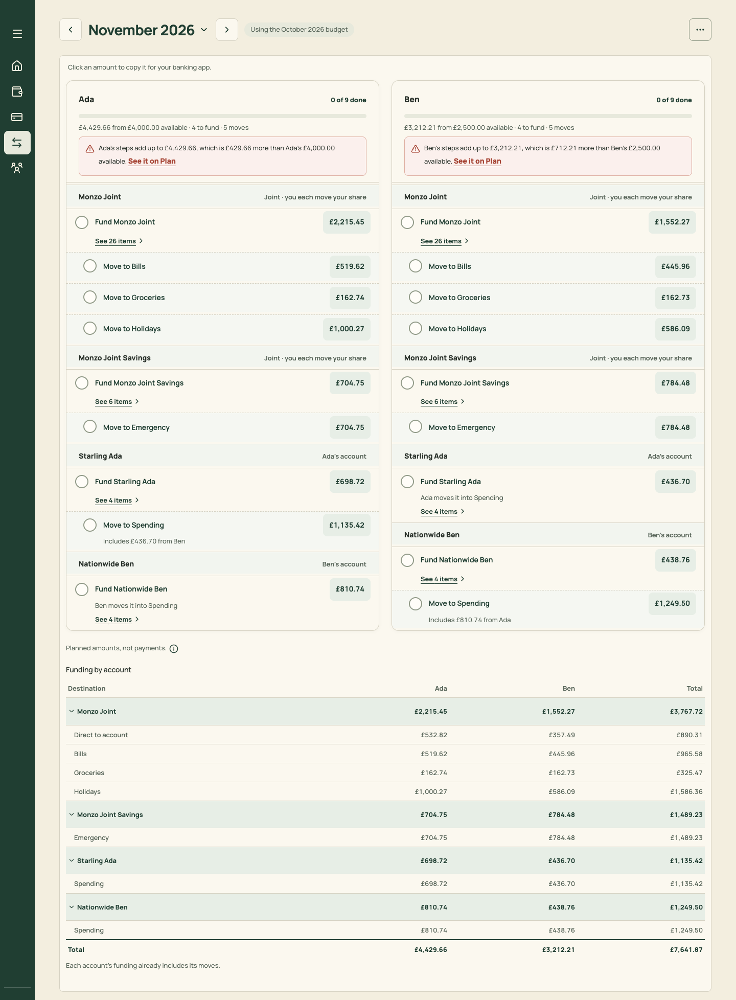 | 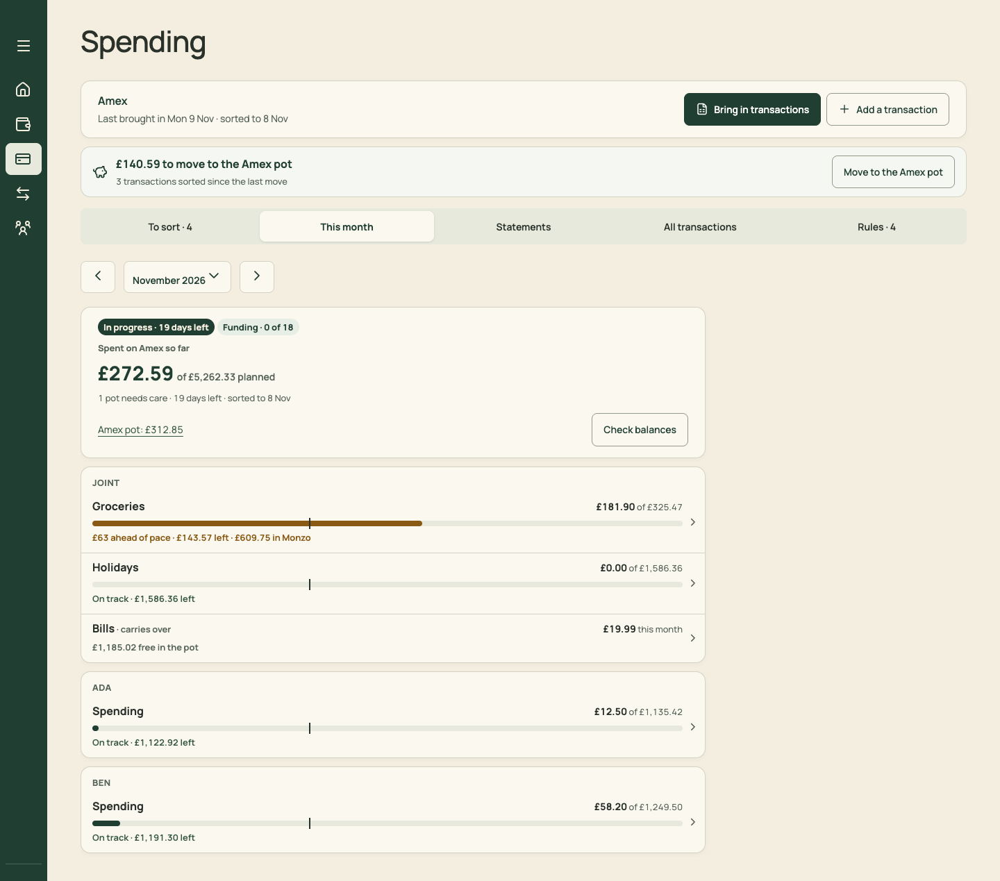 | 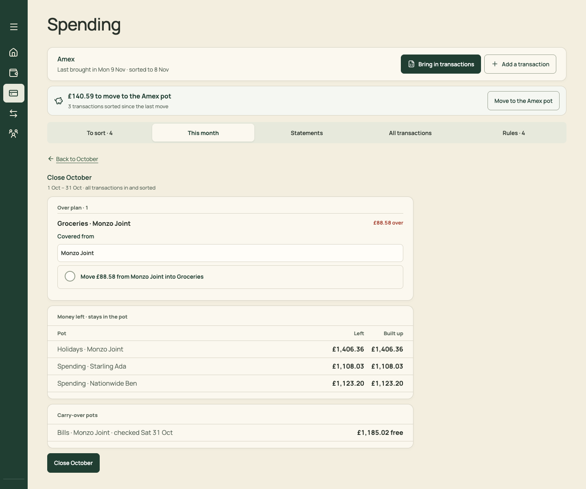 |

The card tracker already models month stages (funded → in progress → closing → to settle → settled; see `domain/monthStages.ts`), and Home shows them as chips. The navigation doesn't follow them:
- Funding is the **Transfers** tab.
- Watching the pots is the second tab inside **Spending**.
- Closing is a sub-page of Spending's This month.
- Paying is under Spending › Statements.

The month picker on Plan and Transfers is the page title. On Spending it's a control inside one tab, and it does nothing on the other four tabs. "Where is November up to?" takes four screens.

**Target:** a **Month** destination whose screen follows the stages: Payday steps while any are left, then Pots, then Close for an ended month. Statements stay with the card, because a statement spans two months.

### F03 · "Move money and tick it" has four different UIs
**Severity:** High · **Jobs:** 2, 3 · **Root cause:** RC3 · **Fix:** [PR 04](prs/04-step-row.md), then the screen PRs

| Payday (Transfers) | Move to the Amex pot | Settle up | Close October cover |
| --- | --- | --- | --- |
| 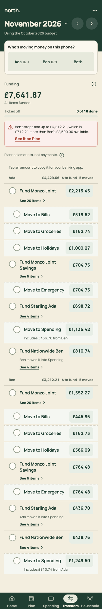 | 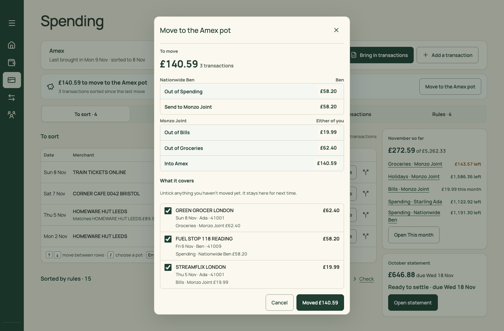 | 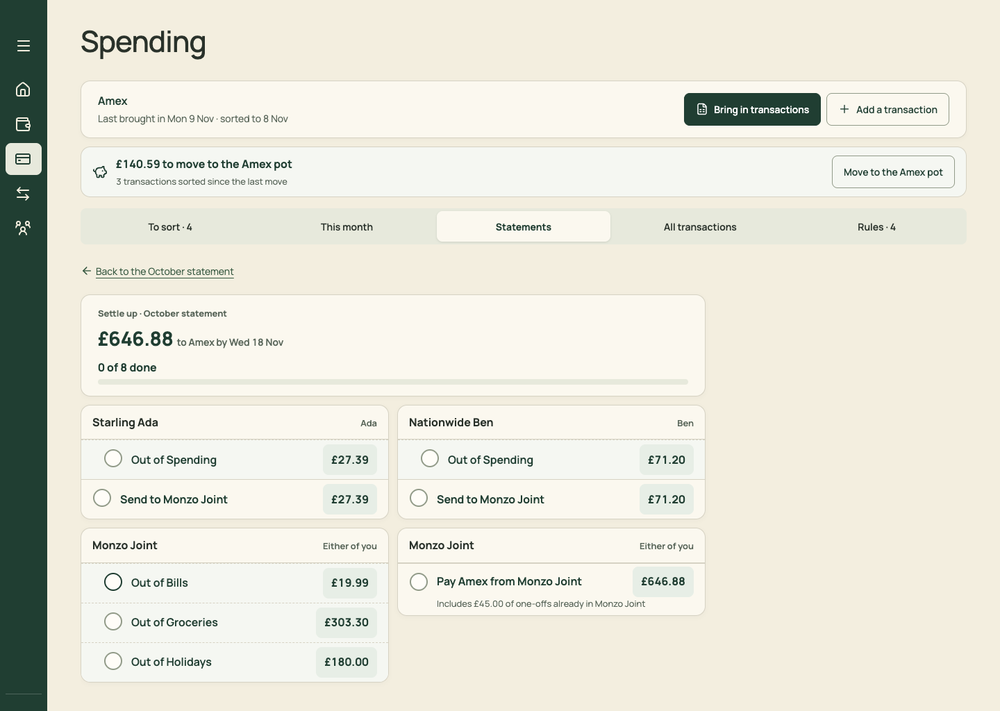 |  |

The same act takes four forms:
- **Payday:** steps grouped by account band in a per-person card.
- **Move to the Amex pot:** a static list of moves plus a checkbox list of transactions and one "Moved £140.59" button.
- **Settle up:** account cards in a two-column grid, including two separate "Monzo Joint · Either of you" cards.
- **Close-month cover:** a tick inside a bordered box under a select.

In code, three of them copy the same `payday-step*` markup by hand and the fourth has its own `move-step` classes. Copy-on-click works in some places and not others. Tick rules like "changed since ticked" are rebuilt per screen.

**Target:** one `StepRow` (tick, label, caption, copyable amount, changed state) and one `StepGroup` (account band). Payday, Set aside, covers and Settle up all use them.

### F04 · Home fails the "in seconds" test
**Severity:** High · **Job:** 4 · **Root cause:** RC2, RC4 · **Fix:** [PR 10](prs/10-home-inbox.md)

| Desktop · 1,496px | Phone · 2,014px |
| --- | --- |
|  | 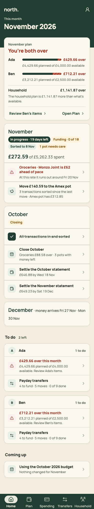 |

Home is 1.7 screens tall on desktop and 2.5 on a phone. It opens on the **plan meter**: a 245px card that only changes when the plan is edited and repeats Plan's own header. The **statement due in 7 days** is the seventh block (y≈910 desktop, y≈1,110 phone). The plan overage appears three times: the meter headline, and once in each person's To do card. "Coming up" spends a card on "Using the October 2026 budget · Nothing changed for November".

**Target:** a three-figure strip (Plan · Spent · Amex, each a link), then To do, then Coming up. It fits one screen at both sizes ([mockup](mockups/02-home.html)).

### F05 · Spending pins three blocks above every sub-page
**Severity:** High · **Jobs:** 3, 2 · **Root cause:** RC4 · **Fix:** [PR 13](prs/13-spending-shell.md)

| This month, phone (first pot y=879) | Statement, phone | Pot page, desktop |
| --- | --- | --- |
| 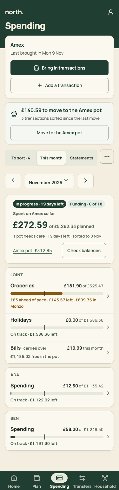 | 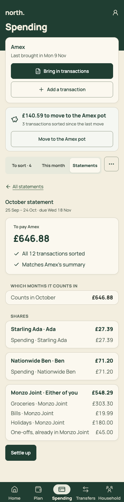 | 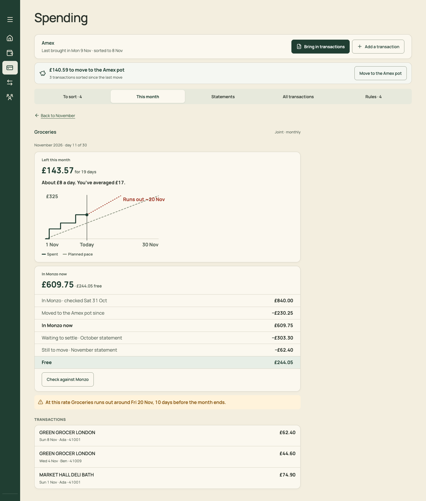 |

Every Spending page, including a pot's page, a statement and Close October, starts with three blocks:
- the card summary with **Bring in transactions** and **Add a transaction**;
- the **£140.59 to move to the Amex pot** banner;
- the **five-tab bar**.

On desktop the content starts at y≈390. On a phone it starts at y=596 (To sort and statements) or y=879 (This month). On a detail page the page's own title ("Groceries", "October statement") is small text at y≈440, below a much larger "Spending" h1. The banner is also wrong in context: on the October Close page it asks you to move November money.

**Target:** one header line for the card ("November statement £649.23 · closes Tue 24 Nov · £312.85 in the Amex pot") with one primary action, Bring in. Three tabs. Set aside appears under To sort, where it's the natural next step. Detail pages get a breadcrumb and their own title.

### F06 · On Plan, every edit starts with opening a group
**Severity:** High · **Job:** 1 · **Root cause:** RC4, RC5 · **Fix:** [PR 16](prs/16-plan-density.md)

| Desktop, a group opened (first item y=620) | Phone, a group opened (first item y≈740) |
| --- | --- |
| 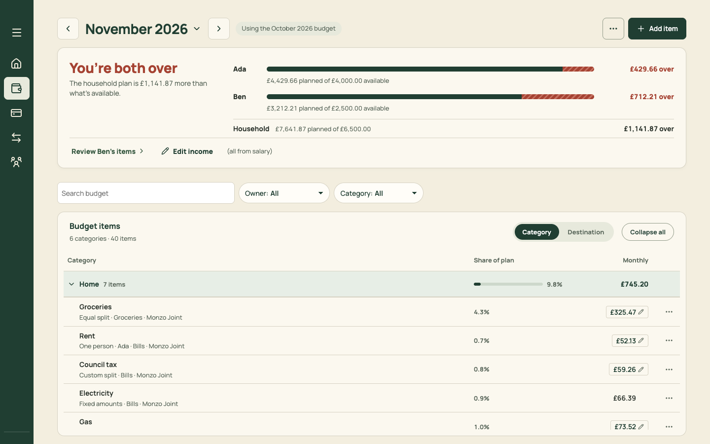 | 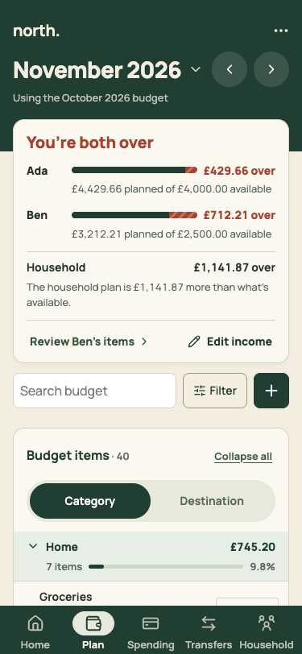 |

Plan opens with all six groups closed (#111). So every visit to change an amount is: find the group, open it, find the row. On desktop the meter card (245px), the filter row and the table's own header (title, count, switch, Expand all, column labels) push the first item to y=620 at 1440×900. Only four rows are visible. On a phone the per-person meter (#116) has grown the card to 330px, so audit 2's P1 target (first item at y≈300) has slipped back to y≈740. Filters live in a row of their own, separate from the table's controls.

**Target:** figures in one 84px row, search/group/filter in one toolbar, groups open by default on desktop, 44px rows. The first item lands at y≈250 with 14 rows on screen ([mockup](mockups/03-plan.html)).

### F07 · Outside To sort there's no keyboard model
**Severity:** High · **Jobs:** all · **Root cause:** RC5 · **Fix:** [PR 07](prs/07-keyboard-core.md), [PR 18](prs/18-keyboard-lists.md), [PR 19](prs/19-command-palette.md)

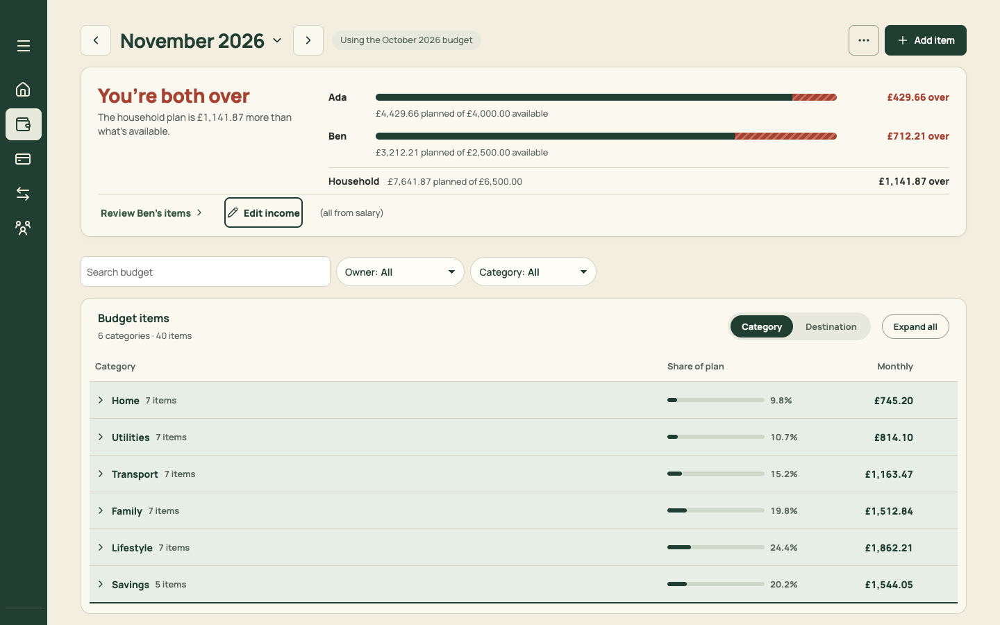

The desktop tab order starts with six sidebar stops ("Expand sidebar", Home, Plan, Spending, Transfers, Household) before any content, on every page. There's no skip link. Plan takes 14 Tab presses to reach the search field and 21 to reach the first group, and items can't be reached without opening a group. Missing entirely:
- <kbd>/</kbd> to search;
- <kbd>N</kbd> to add;
- go-to keys or a ⌘K palette;
- <kbd>J</kbd>/<kbd>K</kbd> movement on any list but To sort;
- a keyboard way to tick a step or copy an amount.

Focus is visible but inconsistent. Header controls get a 3px orange ring and in-page controls a 2px pine ring. The Plan filter selects show no ring at all (`outline: none` on `:focus-visible`). The Plan table region gets the browser's default blue ring.

For a household that uses this mostly on desktop, several times a week, this is the biggest single gap against Linear and Things.

**Target:**
- a skip link and one focus ring;
- <kbd>G</kbd> then <kbd>H</kbd>/<kbd>M</kbd>/<kbd>P</kbd>/<kbd>S</kbd>/<kbd>,</kbd> to go to a screen;
- <kbd>/</kbd> search, <kbd>N</kbd> new, <kbd>[</kbd>/<kbd>]</kbd> month;
- <kbd>J</kbd>/<kbd>K</kbd>/<kbd>↵</kbd> on every list, <kbd>X</kbd> to tick and <kbd>C</kbd> to copy a step;
- <kbd>?</kbd> for the key list, and ⌘K to jump to any item, pot, statement or action.

### F08 · Settings are in four places, and Household takes a nav slot
**Severity:** High · **Jobs:** 1, 3 · **Root cause:** RC1 · **Fix:** [PR 08](prs/08-settings-page.md), [PR 09](prs/09-settings-budget.md) · *carries audit 2 S1 and S4*

| Household tab | Plan ⋯ › Manage (side panel) | Phone: Plan ⋯ |
| --- | --- | --- |
| 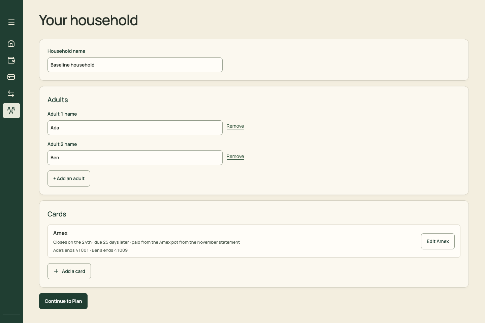 | 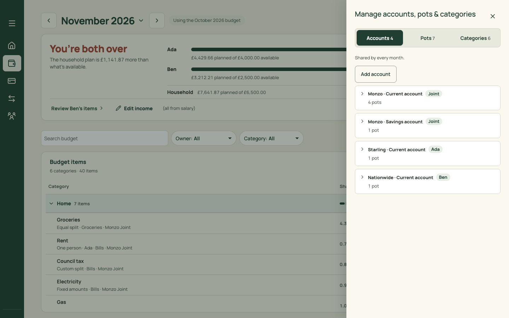 | 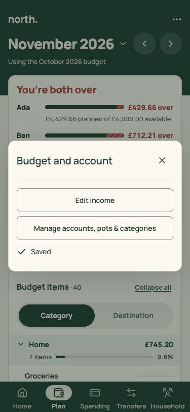 |

Settings now live in four places:
- **Household tab:** household name, adults and **Cards**, ending in "Continue to Plan".
- **Plan ⋯ › Edit income:** a dialog.
- **Plan ⋯ › Manage accounts, pots & categories:** a right-hand side panel with three tabs. The pot's spending settings (carries over, pace, build-up flag) are two levels in.
- **Spending › Rules:** a primary tab for something you visit rarely.

Household takes one of five primary nav slots, though it's visited only a few times a year.

**Target:** one **Settings** page (Household · Pay & income · Accounts & pots · Categories · Cards · Sorting rules · Account & sync) at the sidebar foot and behind the account button on phones ([mockup](mockups/06-settings.html)).

### Medium

### F09 · The same status is restated in different words on three to five screens
**Severity:** Medium · **Jobs:** 2, 4 · **Root cause:** RC2 · **Fix:** [PR 10](prs/10-home-inbox.md), [PR 11](prs/11-month-payday.md), [PR 13](prs/13-spending-shell.md), [PR 20](prs/20-states-and-tone.md)

| Fact | Where it appears today |
| --- | --- |
| Funding progress | "Funding · 0 of 18" (Home chip, This month chip), "0 of 9 done" ×2 (Home To do), "Ticked off · 0 of 18 done" (phone Transfers), "0 of 9 done" ×2 (desktop Transfers) |
| Spent vs plan | "£272.59 of £5,262.33 spent" (Home), "Spent on Amex so far £272.59 of £5,262.33 planned" (This month), "November so far £272.59 of £5,262.33" (side panel) |
| Over plan | "You're both over" (Home, Plan), "£429.66 over this month" ×2 (Home To do), red boxes "Ada's steps add up to £4,429.66, which is £429.66 more than…" (Transfers) |
| Amex pot | Home task, Spending banner, "Amex pot: £312.85" (This month), the statement's check line, and the Amex pot page ("In Monzo now £312.85" twice) |

Each restatement is another block to scan and another wording to keep in sync. **Target:** each fact has one home (Plan for the plan, Month for funding and pots, Spending for the card). Home's strip links to them, and other screens show only what changes a decision there.

### F10 · Four page-header patterns and three month controls
**Severity:** Medium · **Jobs:** all · **Root cause:** RC3 · **Fix:** [PR 02](prs/02-ui-primitives.md), [PR 06](prs/06-nav-shell.md)

| Home | Plan / Transfers | Spending | Household |
| --- | --- | --- | --- |
| Eyebrow "This month", 42px "November 2026", Open Transfers + Open Plan | Month picker *is* the 28px title, "Using the October 2026 budget" chip, ⋯ (+ Add item) | 42px "Spending" h1, then a card summary. The month control (‹ dropdown ›, different again) is inside This month only | 42px "Your household", form cards, "Continue to Plan" at the bottom |

Home can't change month at all. The hidden h1 on Plan and Transfers reads "Monthly budget", so a screen reader announces the wrong page. **Target:** one `PageHeader` (title or month title, context, at most ⋯ and one primary) and one `MonthTitle` control, used by Month, Plan and Home.

### F11 · Section headings come in six styles
**Severity:** Medium · **Jobs:** all · **Root cause:** RC3 · **Fix:** [PR 02](prs/02-ui-primitives.md) + screen PRs

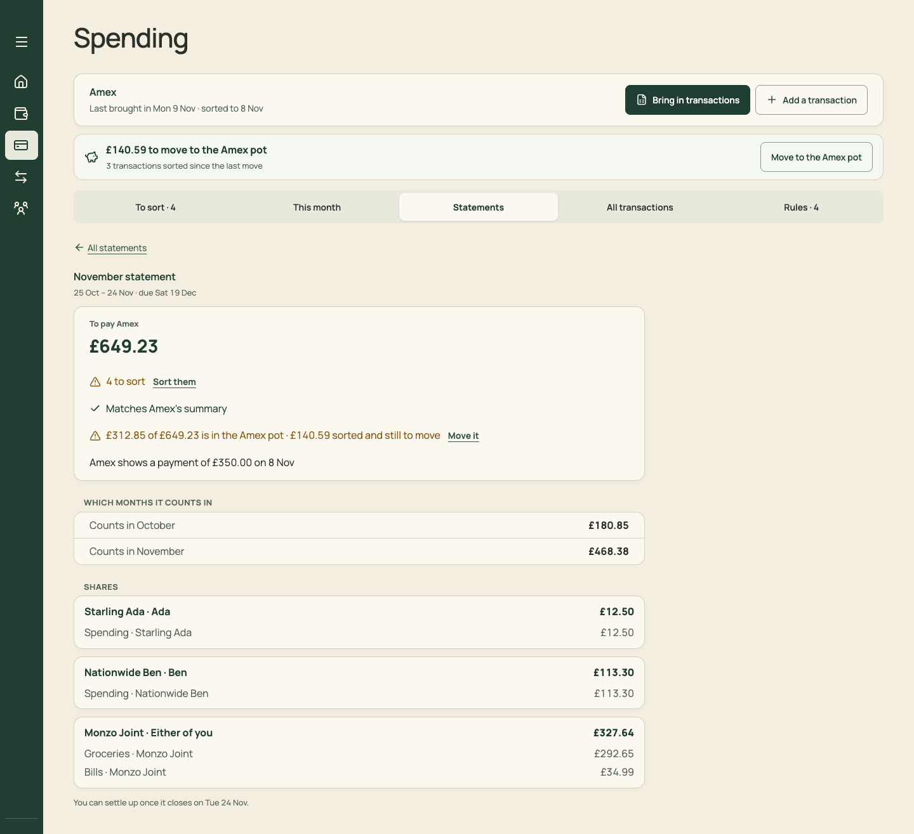

The six styles:
- ALL-CAPS eyebrows outside cards: WHICH MONTHS IT COUNTS IN, SHARES, TRANSACTIONS, JOINT/ADA/BEN.
- Small bold labels inside cards: "To pay Amex", "Over plan · 1", "November plan", "In Monzo now".
- An h2 with a right-aligned muted count: "To sort … 4 transactions".
- A card header with a two-line subtitle: "Budget items · 6 categories · 40 items".
- A plain bold h2: "To do · 2 left", "Coming up".
- Band rows: Plan's groups.

The stylesheet has 25 heading/title classes. **Target:** one `Section` heading (16/700 title, muted count, optional aside), sentence case, never ALL CAPS.

### F12 · Five overlay types, and phone "sheets" that aren't sheets
**Severity:** Medium · **Jobs:** 1, 3 · **Root cause:** RC3 · **Fix:** [PR 03](prs/03-sheet.md)

| Sort sheet, phone | Move sheet, phone | Item editor, desktop | Manage, desktop |
| --- | --- | --- | --- |
| 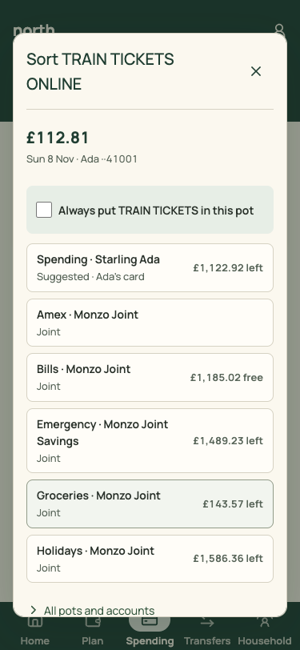 | 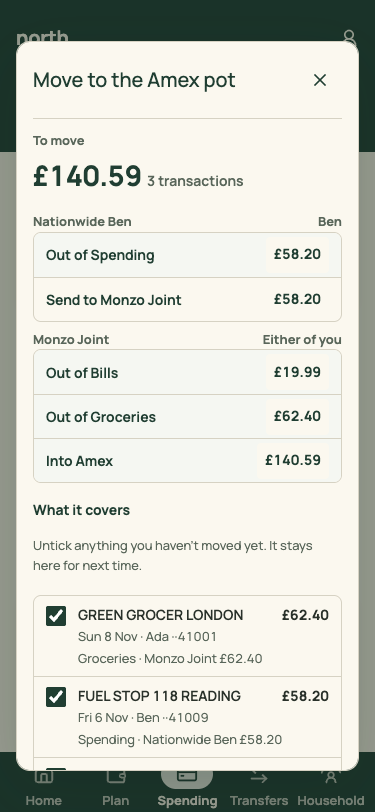 | 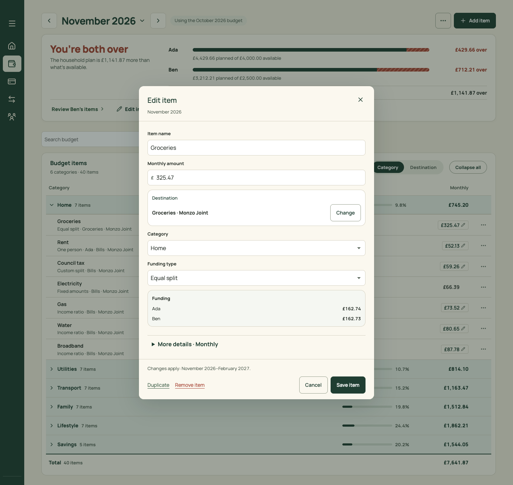 |  |

The five types, in code:
1. `ModalDialog` (sort, move, bring in, split, check balances, filters, Budget and account).
2. The item editor's own dialog (`budget-batch-dialog`).
3. Manage's right-hand side panel (`budget-v3-overlay`).
4. The month picker popover.
5. The header's utility sheet (`PlannerHeader`), which reimplements the focus trap.

On phones, the "sheets" are cards floating mid-screen with margins. They aren't anchored to the bottom, so they cover the header and nav at odd heights, and their actions aren't in thumb reach. **Target:** one `Sheet`: a centred dialog on desktop, a bottom sheet on phones, with one focus trap, one close, and one footer with actions.

### F13 · Competing primary buttons, with the key action at the bottom
**Severity:** Medium · **Job:** 3 · **Root cause:** RC4, RC6 · **Fix:** [PR 13](prs/13-spending-shell.md), [PR 14](prs/14-statement-settle.md), [PR 12](prs/12-month-pots-close.md)

| To sort, desktop | To sort, phone | Statement, desktop |
| --- | --- | --- |
| 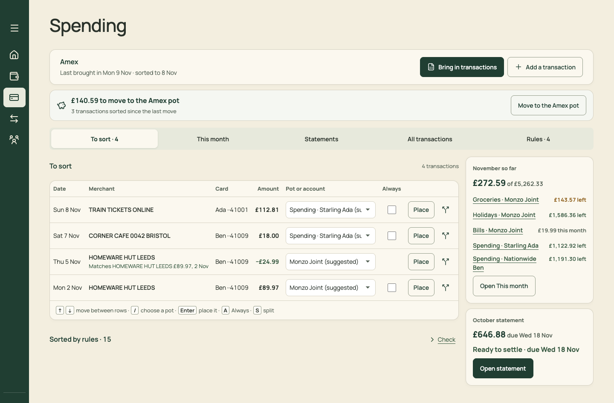 | 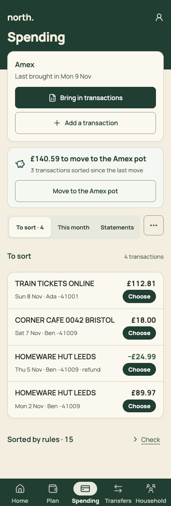 | 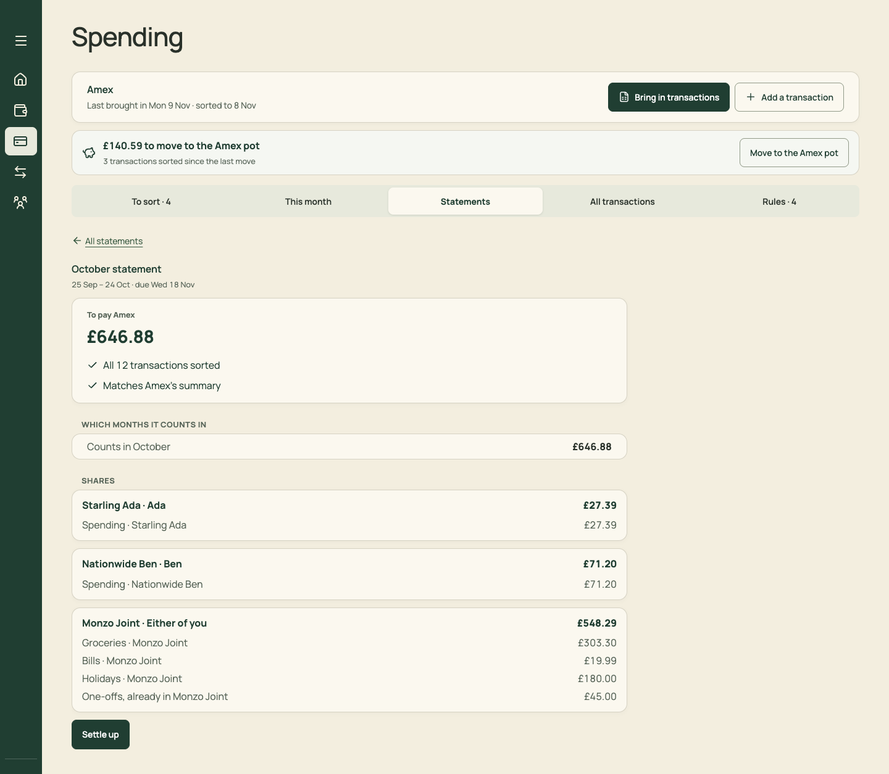 |

- **To sort, desktop:** two filled buttons (Bring in, Open statement) and seven outlined ones (Add a transaction, Move to the Amex pot, Place ×4, Open This month).
- **To sort, phone:** four filled "Choose" pills stacked in the list, under two full-width buttons.
- **Statement:** Settle up is the last element, after "Which months it counts in" and three Shares cards.
- **Close October:** the same pattern, with the button at the end.

**Target:** at most one primary per screen, in the header. Rows are the tap target, with no Choose pills. A statement leads with its steps.

### F14 · Alarm colour on headlines, not on the urgent item
**Severity:** Medium · **Jobs:** 1, 2, 4 · **Root cause:** RC6 · **Fix:** [PR 16](prs/16-plan-density.md), [PR 11](prs/11-month-payday.md), [PR 20](prs/20-states-and-tone.md)

| Plan | Transfers |
| --- | --- |
| 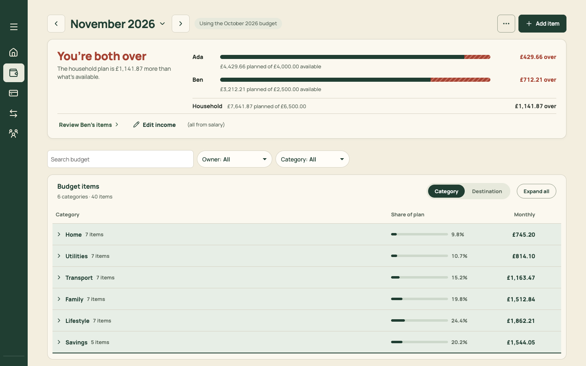 |  |

- "You're both over" is a 28px red headline on both Home and Plan.
- Transfers puts a red bordered box over each person's steps.
- Home tints whole rows red ("Groceries · Monzo Joint is £62 ahead of pace") and amber.

Meanwhile the statement due in 7 days is plain grey text. The product spec asks for calm ("do not add alarming language to routine financial work"). **Target:** red only on the amount that is over, amber only on pace and review, and urgency carried by **order** (due date first), not colour.

### F15 · Add and Edit are two different dialogs, and Add asks for the name last
**Severity:** Medium · **Job:** 1 · **Root cause:** RC3, RC5 · **Fix:** [PR 17](prs/17-item-editor.md) · *carries audit 2 E1*

| Add items (empty) | Add items (filled) | Edit item |
| --- | --- | --- |
| 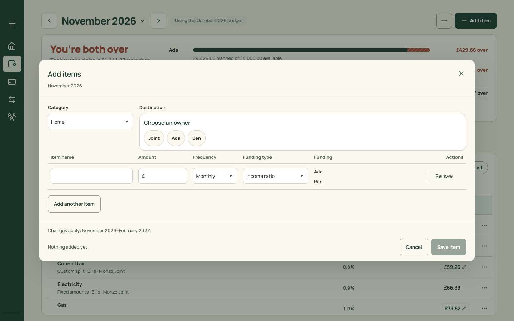 | 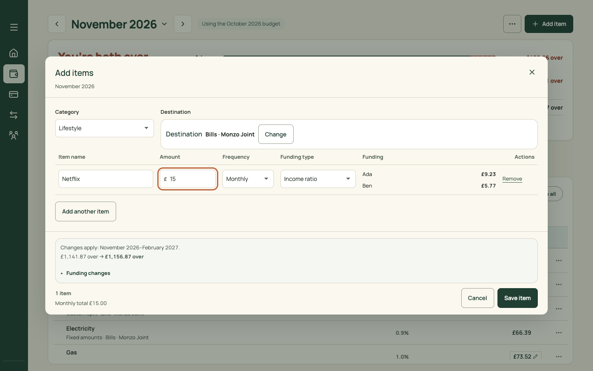 |  |

Add opens a 1220px batch table. It starts with **Category**, then "Choose an owner" → account → pot bubbles (three clicks), and only then Name, Amount, Frequency and Funding type. Edit is a different single-column form, Name first. Adding one item took 7 clicks and 2 fields in the walkthrough. Once a destination is chosen the box reads "Destination  Destination  Bills · Monzo Joint". **Target:** one editor in thinking order (Name, Amount, Goes to with recent-destination chips, Category, Funding), with "Add and start another" (<kbd>⌘↵</kbd>) replacing the batch table.

### F16 · Quick edit inserts a panel and pushes the rows down
**Severity:** Medium · **Job:** 1 · **Root cause:** RC5 · **Fix:** [PR 16](prs/16-plan-density.md) · *carries audit 2 P5*

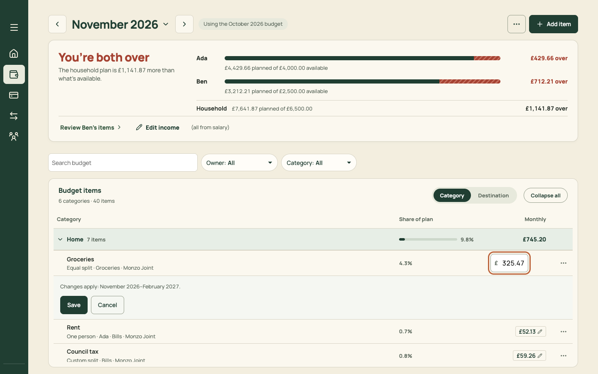

Clicking an amount chip opens a 105px panel under the row ("Changes apply: November 2026–February 2027." with Save and Cancel), which moves the table. The impact on the balance isn't shown until after you save. **Target:** the amount becomes a field in place, and one line under the row shows scope and impact ("Plan £1,141.87 over → £1,166.40 over · Ada +£12.27 · Ben +£12.26"). <kbd>↵</kbd> saves, <kbd>Esc</kbd> cancels and <kbd>⇧↵</kbd> opens the full editor.

### F17 · Payday steps carry noise
**Severity:** Medium · **Job:** 2 · **Root cause:** RC4 · **Fix:** [PR 11](prs/11-month-payday.md) · *carries audit 2 T6, T7*

| Desktop (1,950px) | Phone (2,225px) |
| --- | --- |
|  |  |

- "See 26 items ›" sits under every fund step (×8 on desktop).
- The account band ("Monzo Joint · Joint · you each move your share") is followed by "Fund Monzo Joint".
- Each person's 76px red warning box sits above their steps.
- A persistent hint, "Click an amount to copy it for your banking app.", stays on screen.
- The Funding by account table adds 700px below.
- On phones, "Who's moving money on this phone?" takes 110px, and in Both only the worst person's warning shows (Ben's), though Ada is over too.

**Target:**
- item count as a link on the band;
- the over-available warning as one line in the person header;
- the hint shown once per device;
- "By account" as a toggle;
- a compact Ada / Ben / Both switch in the section heading.

### F18 · Steps can't say where the money comes from
**Severity:** Medium · **Job:** 2 · **Root cause:** model (carried) · **Fix:** [PR 22](prs/22-pay-lands-in.md), after decision D9 · *carries audit 2 T1*

The transfer rules still leave the source account unknown. So:
- Ada's list says "Fund Starling Ada £698.72" even if her pay lands in Starling, which means moving nothing.
- Her list also has "Fund Nationwide Ben £810.74 · Ben moves it into Spending", a cross-person step with no "from".

Ticks (#118) solved keeping your place, but this is still the biggest correctness gap in the actioning job. **Target:** "Pay lands in" per salary. Steps read "Starling Ada → Monzo Joint", and funding your own pay account shows as "Already there".

### F19 · The To sort table clips below 1440px and cuts off "(suggested)" at 1440
**Severity:** Medium (bug) · **Job:** 3 · **Root cause:** RC3 · **Fix:** [PR 13](prs/13-spending-shell.md)

| 1100px | 1280px | 1440px |
| --- | --- | --- |
| 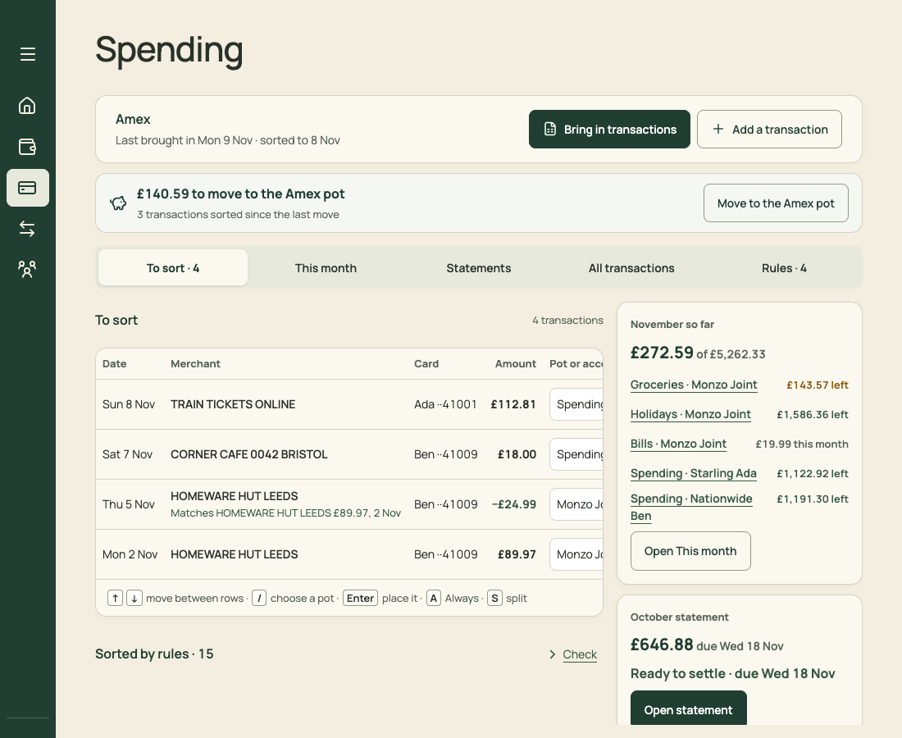 | 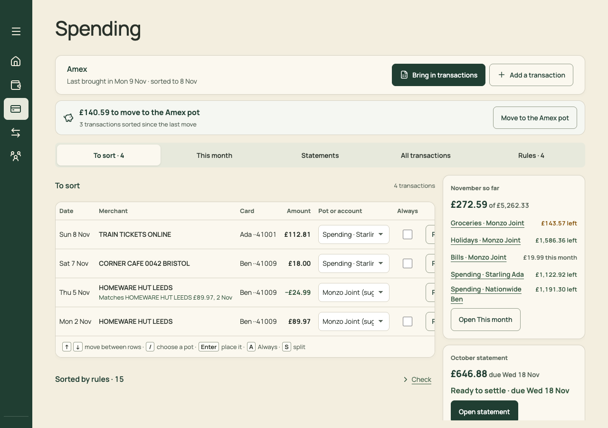 |  |

Below 1440px the 300px side panel squeezes the table. At 1100 the "Pot or account" column is cut off mid-select. At 1280 (a common laptop width) the Place and Split columns are off the edge, behind an internal horizontal scroll. At 1440 the native select is 210px wide and shows "Spending · Starling Ada (su". **Target:** no rail, a 360px pot column, and "Suggested" as a chip inside the field.

### F20 · Desktop space is used inconsistently, and lists that should be tables aren't
**Severity:** Medium · **Jobs:** 2, 3 · **Root cause:** RC3 · **Fix:** [PR 12](prs/12-month-pots-close.md), [PR 15](prs/15-transactions-table.md)

| This month | All transactions |
| --- | --- |
|  | 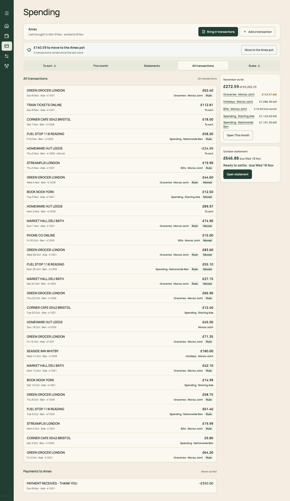 |

This month, Statements, pot pages and Close are fixed at about 900px, leaving 400px empty at 1440. Plan and Transfers use the full width. This month's pots are cards with stacked bars, so Spent, Planned and Left don't line up across pots. All transactions is a 26-row card list with no search, filter or month headings, while To sort beside it is a proper table. **Target:** pots as one aligned table (Spent · Planned · Left · Pace · In Monzo), and Transactions as a table with search, filters (pot, person, statement) and month groups.

### F21 · Empty states without a next step, and a false "fits"
**Severity:** Medium · **Jobs:** first run, 1, 2 · **Root cause:** RC3 · **Fix:** [PR 20](prs/20-states-and-tone.md)

| Transfers with no items | Home with no items | Spending with no card |
| --- | --- | --- |
| 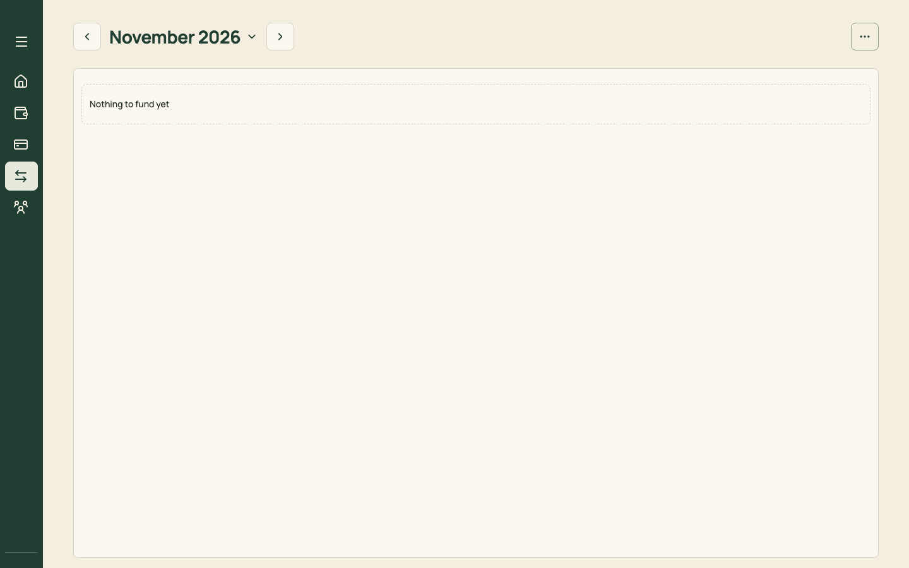 | 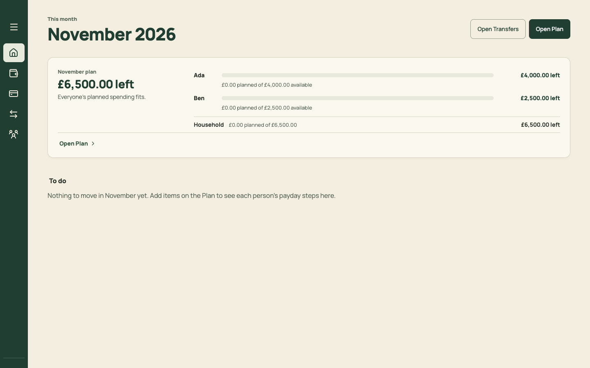 | 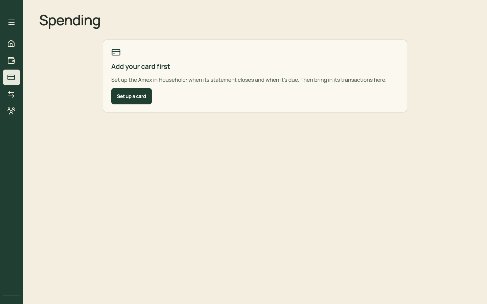 |

- **Transfers:** "Nothing to fund yet" in a dashed box inside a full-height empty card, with no action.
- **Home:** with nothing planned, it says "£6,500.00 left · Everyone's planned spending fits." and still offers "Open Transfers".
- **Spending:** the no-card state is a centred card at a different width from every other page.
- **Loading:** a bare "Loading…" paragraph, which shifts the layout.

**Target:** one `EmptyState` (title, one sentence, one action) placed where the content would be, and Home's first-run reading "Nothing planned for November yet · Open Plan".

### F22 · Field edges fail non-text contrast, and focus has three looks
**Severity:** Medium (accessibility) · **Jobs:** all · **Root cause:** RC3 · **Fix:** [PR 01](prs/01-tokens.md)

Measured from the tokens:
- Field and select borders use `--line` (**1.43:1** on `--card`) or `--line-strong` (**2.72:1**). Both are below WCAG 1.4.11's 3:1 for the edge of a control.
- Inputs come in four heights: 40, 42, 44 and 46px.
- Focus has three looks: orange 3px (header and sidebar), pine 2px (page), and none on the Plan filter selects (`outline: none` on `:focus-visible`).
- The Plan table region has `tabindex` with the browser's blue ring.

Text contrast is fine everywhere: the contrast test passes, and muted text is 5.2–5.7:1. Phone tap targets are all at least 44px except "See it on Plan" (93×32). **Target:** `--border-field: #80887a` (3.46:1), one 36/44px control height, and one focus ring (2px pine with a 2px offset).

### F23 · The design system has drifted in code
**Severity:** Medium (system cause) · **Jobs:** all · **Root cause:** RC3 · **Fix:** [PR 01](prs/01-tokens.md), [PR 02](prs/02-ui-primitives.md), [PR 04](prs/04-step-row.md)

Audit 2 (V1) loaded Manrope 400..800, but the CSS asks for **eight** weights: 400, 500, 550, 600, 650 (×42), 700 (×58), 750 and 800 (×27), so "bold" means four different things. `styles.css` is one 167 KB file of very long lines with 596 class selectors in feature-prefixed families. That makes parallel work conflict-prone and inconsistency cheap. `SummaryTiles` is unused. The token test guards colours, radii, sizes and spacing, but not weights or control heights, and it only scans `styles.css`. **Target:** three weights, semantic tokens, shared components with their own CSS files, and the guard extended to every CSS file.

### Low

### F24 · Five link styles
**Severity:** Low · **Root cause:** RC3, RC6 · **Fix:** [PR 01](prs/01-tokens.md), [PR 20](prs/20-states-and-tone.md)

1. Underlined pine text: "Sort them", "Move it", "All statements", "Back to November", "Check", "Remove", and the side panel's pot names.
2. Bold pine with a chevron: "Review Ben's items ›", "Open Plan ›".
3. Bold red underlined: "See it on Plan".
4. Underlined "See 26 items ›".
5. Underlined "Expand all" on phones but a pill on desktop.

**Target:** links are pine 600 with no underline, and underlined only inside sentences. Back navigation is a breadcrumb in the page header.

### F25 · The phone header changes per screen, and titles are generic
**Severity:** Low · **Root cause:** RC3 · **Fix:** [PR 06](prs/06-nav-shell.md) · *carries audit 2 V3 (titles)*

The phone header's right-hand button is a person icon (account sheet) on Home and Spending but ⋯ ("Budget and account") on Plan and Transfers, so the account and save status are in a different place per screen. The document title is always "North Planner", so browser tabs and history can't tell screens apart. Plan's and Transfers' h1 is a hidden "Monthly budget". **Target:** the account button is always top right. A page's own ⋯ sits beside it. Titles read "Plan · November 2026 · North".

### F26 · A pot's page mixes three measures
**Severity:** Low · **Job:** 2 · **Root cause:** RC2 · **Fix:** [PR 12](prs/12-month-pots-close.md)

Groceries shows three measures:
- "Left this month £143.57 for 19 days";
- "In Monzo now £609.75 · £244.05 free", with a six-line reconciliation;
- "Runs out ~20 Nov", once in the chart and again in an amber banner below.

Left, In Monzo and Free are each correct, but together they ask the reader to know the model. **Target:** lead with Left (this month's question), show In Monzo and Free in a "Balance" block with the reconciliation folded, and give the runs-out message once.

### F27 · The sidebar is unlabelled by default, with ambiguous icons
**Severity:** Low · **Root cause:** RC1 · **Fix:** [PR 06](prs/06-nav-shell.md) · *carries audit 2 V5*

The desktop sidebar is collapsed to icons by default. Plan is a wallet, Spending a card, Transfers arrows and Household people. The save status shows only as an icon unless expanded. **Target:** expanded by default from 1280px, with labels, counts and shortcut hints. <kbd>⌘\\</kbd> collapses it.

### F28 · Tone slips: second person, persistent hints, doubled labels
**Severity:** Low · **Root cause:** RC6 · **Fix:** [PR 20](prs/20-states-and-tone.md)

Examples:
- "You're both over" and "You're up to date for November" are chatty, where elsewhere the copy is neutral and figure-first.
- "Click an amount to copy it for your banking app." stays forever on desktop.
- "(all from salary)" sits orphaned beside Edit income.
- "Who's moving money on this phone?"
- "Destination Destination Bills · Monzo Joint".
- "Amex · Pays Amex" on the Amex pot page.
- "1 pot needs care" (care?).

**Target:** figure first, verb-led actions, hints that show once, and glossary additions for the new words (Month, Set aside, Settings).

### F29 · Not installable
**Severity:** Low · **Job:** 4 (phone) · **Fix:** [PR 21](prs/21-pwa.md) · *carries audit 2 V3*

There's no manifest, icons or apple-touch-icon, so a phone check-in opens a browser tab. The app is local-first, but it doesn't open offline. **Target:** a manifest (standalone, pine), icons, and a service worker for the app shell.

### F30 · Setup creates no accounts
**Severity:** Low · **Jobs:** first run · **Fix:** folded into [PR 22](prs/22-pay-lands-in.md) if D9 is accepted · *carries audit 2 S5*

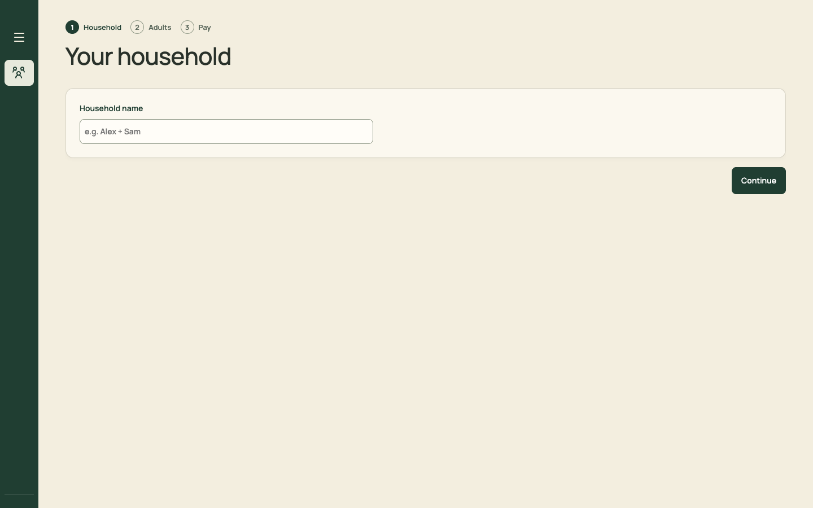

The setup wizard asks for the household, adults and pay, but no accounts, so the first item makes you create one inline. This matters only on a reset, so it's Low. If "Pay lands in" (D9) is accepted, the setup Pay step is where it's asked.

---

## Carried forward from audit 2

| Audit 2 item | Status on 11 Nov | In audit 3 |
| --- | --- | --- |
| T1 source account ("Pay lands in") | Open | **F18**, decision D9, PR 22 |
| T2 per-device checklist | Superseded: household ticks shipped in #118–#119 | Dropped |
| T3 desktop steps | Shipped #120 | Dropped |
| T4, T5, T8 | Shipped #106 | — |
| T6 phone Transfers top | Partly: the hero is smaller, but the person switch is 110px | **F17** |
| T7 "See N items" on every fund step | Open | **F17** |
| T9 Transfers header | Shipped #108, #120 | Dropped |
| P1–P4, P6, P8, P9 | Shipped #102, #109–#113 | Dropped. P1's goal regressed after #116 → **F06** |
| P5 inline quick edit | Open | **F16** |
| P7 destination filter chip | Open | **F06** (PR 16) |
| E1 add flow | Open | **F15** |
| E2–E4 | Shipped #103, #105 | — |
| E5 two-column editor | No longer needed (the editor fits at 900px) | Dropped |
| S1 settings hub, S4 Household page | Open, and larger now (Cards, pot settings, Rules) | **F08** |
| S2, S3 | Shipped #104 | — |
| S5 Accounts step in setup | Open | **F30** |
| R1, R2 | Shipped #108, #101 | New 1100px issue → **F19** |
| V1 fonts | Fonts load, but the CSS uses 8 weights | **F23** |
| V2, V4 | Shipped | — |
| V3 manifest and titles | Open | **F25**, **F29** |
| V5 sidebar expanded | Open | **F27** |
| Decisions T1 / T2 / S1–S5 | — | T1 → **D9**. T2 moot. S1 → part of **D1**. S5 → **D10** |

## What's already good (keep it)

- **Honest, specific copy.** Glossary words are enforced by `copy.vocabulary.test.ts`, amounts keep their pennies, and "Changes apply: November 2026–February 2027" sits above every save.
- **Ticks with "changed since ticked"** (#118–#119): the right model for actioning, and worth reusing everywhere money moves.
- **The To sort table on desktop:** keyboard-first, with suggestions and Always. It's the pattern the rest of the app should follow.
- **Pace with an even-spending tick and "runs out around"** gives a clear early warning.
- **The Amex import** checks the export against Amex's own summary.
- **Contrast and tap targets:** text contrast passes AA everywhere and is guarded in CI. Phone controls are almost all 44px or more.
- **Pine identity:** the phone header and tab bar (#114) feel like an app. The palette is calm and distinctive; keep it.
